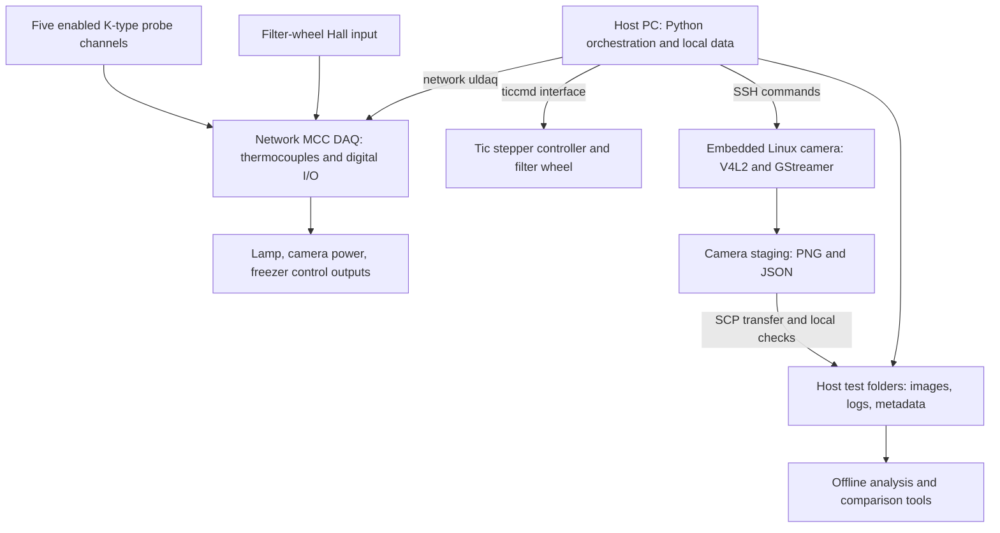

# Purpose and system overview

Status: first review draft · Source snapshot: 23 October 2026 · Scope: setup and methodology

## What FreezerTest does

FreezerTest automates temperature-dependent optical measurements of a camera using a freezer, temperature probes, a switched light source, and a motorized filter wheel. A host PC coordinates the apparatus and asks an embedded Linux camera computer to capture images. Offline analysis extracts image position, line/edge width, signal, and image-noise indicators, then compares their evolution within a test and across repeated tests.

The owner describes the camera as an **Offner optical setup**. That is owner-reported context, rather than a complete optical prescription. Exact camera model, detector identity, slit dimensions, mirror/grating specifications, target geometry, and illumination hardware remain to be supplied. See [project context](08-project-context.md) and [hardware](02-hardware-and-connections.md).

Primary source: [long-test runner](../Scripts/run_long_test.py#L441), [single sweep](../Scripts/run_single_sweep_remote.py#L201), [analysis configuration](../Config/analysis_config.py#L14), and [chat T2](10-sources-and-maintenance.md#t2-freezer-camera-drift-analysis).

## Functional architecture

This is a software-level diagram. The diagram does not establish electrical isolation, relay contact ratings, a shared power-supply topology, or physical component locations. The [hardware page](02-hardware-and-connections.md) distinguishes those unknowns from configured connections.

## Acquisition hierarchy

| Term | Meaning in this project |
|---|---|
| Repeat sequence | A configured number of complete tests, with one shared repeat-group identifier |
| Test / repeat | One test folder containing pre-cool events, temperature logging, a measurement phase, and cleanup |
| Sweep | One ordered visit to all configured filter positions, normally producing four images plus metadata |
| Capture | One image at one filter position; filters are captured sequentially, not simultaneously |
| Analysis row | A per-sweep result assembled from available images, metrics, and associated temperatures |

This distinction matters: a filter-4 image is taken later than the filter-1 image in the same sweep. A sweep-associated temperature is not automatically the exact optical-component temperature at every individual exposure. See [data and metadata](05-data-and-metadata.md).

## Current configured measurement channels

| Wheel position | Analysis name | Intended role | Nominal optical filter setting | Exposure control value |
|---|---|---|---|---|
| 1 | `no_filter` | Spatial edge/line-spread analysis and signal ROIs | Open/no filter according to analysis configuration | 3000 |
| 2 | `bp_780` | Spectral line profile | 780 nm, nominal filter FWHM 3 nm | 15000 |
| 3 | `bp_1064` | Spectral line profile | 1064 nm, nominal filter FWHM 3 nm | 8000 |
| 4 | `bp_1550` | Spectral line profile and background/noise ROIs | 1550 nm, nominal filter FWHM 4 nm | 15000 |

These names and nominal bandwidths come from [analysis configuration](../Config/analysis_config.py#L14); exposures come from [local configuration](reference/local_config_snapshot.txt#L58). They are not supplier certificates or a verified wheel-loading record. Exposure values are passed to `exposure_time_absolute`; their physical unit must be confirmed for the deployed driver. See [camera control](../Camera_scripts/camera_control.py#L50).

## Current implemented test concept

With the supplied local overrides, the runner starts temperature logging, switches lamp and camera off, and runs the freezer until `probe_5 <= 12 °C`. A pre-cool timeout aborts the test. On successful pre-cool, it switches the freezer off, waits 60 seconds, powers the camera on, waits 45 seconds, and starts keepalive streaming. It then captures sweeps during warm-up until the configured endpoint logic ends measurement. The configured endpoint is three consecutive new records observed by the runner at `probe_5 >= 40 °C`, with a 14-hour measurement deadline checked between operations. Blocking operations and the final sweep can extend that deadline. The configured repeat count is eight.

The current runner **does not implement** the requested 15 °C warm-start branch. It also does not command a controlled heating rate, establish thermal equilibrium at setpoints, or check humidity. These distinctions are central to interpreting temperature-associated measurements. See [running the test](04-running-the-test.md), [review gaps](09-review-questions-and-gaps.md), and [pre-cool code](../Scripts/run_long_test.py#L330).

## What the analysis can answer

- How spectral profile peak positions and FWHM change in image coordinates.
- How the selected spatial edge and its fitted line-spread width change.
- How selected signal-region mean DN and background-region spatial scatter change.
- How those metrics relate to associated external probe temperatures, selected internal camera temperatures, sweep index, and repeat identity. Recorded timestamps support additional time-based analysis, but the supplied viewers do not offer an elapsed-time axis.

The methodology does not, by itself, establish absolute wavelength accuracy, intrinsic spectrometer resolution independently of the bandpass filters, radiometric response, temporal noise, MTF, or a root cause of drift. It does not supply pass/fail specifications. [Analysis methodology](06-analysis-methodology.md) records the exact calculations and limits.

## Boundaries with a future camera-development knowledge base

This corpus keeps apparatus details, operating behavior, analytical definitions, configuration provenance, and known threats to measurement validity. A future camera-development corpus should own individual test outcomes, comparisons between camera units, drift histories, design experiments, proposed root causes, and decisions about optical or mechanical redesign.

The historical camera construction details in [project context](08-project-context.md) are retained only to explain the device under test and to guide the hardware review. Earlier assistant hypotheses about glue, expansion, or mechanical settling are not treated as established facts.
