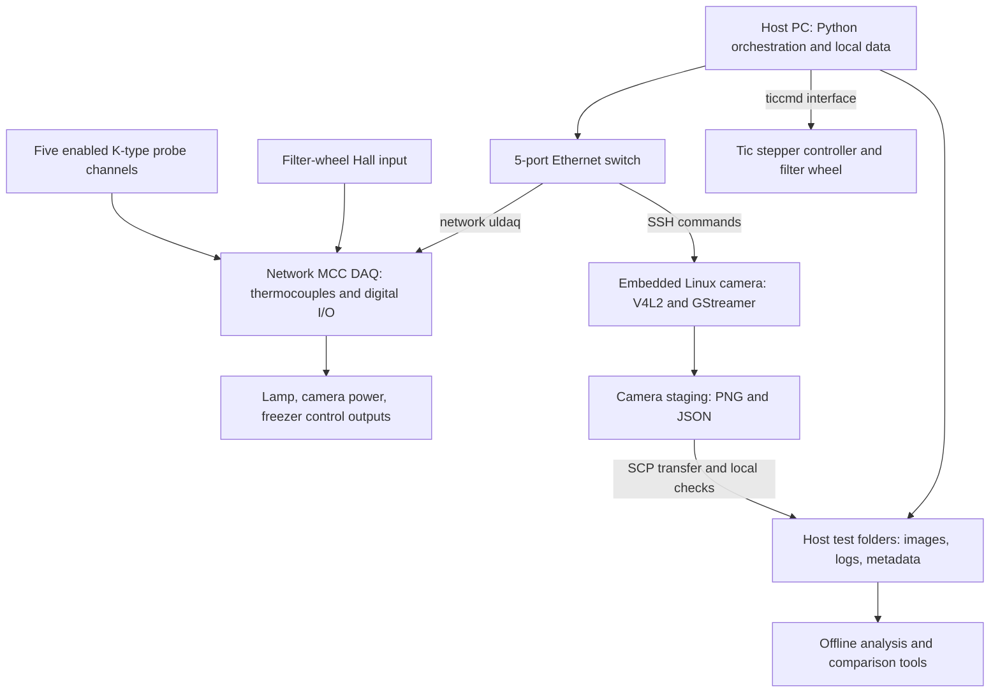

# Purpose and system overview

Status: owner review, second batch · Updated: 29 October 2026 · Code snapshot reviewed: 23 October 2026

## What FreezerTest does

FreezerTest automates temperature-dependent optical measurements of a camera using a freezer, temperature probes, a switched light source, and a motorized filter wheel. A host PC coordinates the apparatus and asks an embedded Linux camera computer to capture images. Offline analysis extracts image position, line/edge width, signal, and image-noise indicators, then compares their evolution within a test and across repeated tests.

The camera sits on an aluminium tray in the upper freezer. The target is **white PTFE with a black 3D-printed cage** to form sharp dark lines, illuminated by a **halogen tube and silver-coated parabolic reflector** focused onto the target. PTFE was chosen by the owner for reflection over the intended 400–1700 nm span; no calibrated reflectance standard is implied. [Owner review R2](10-sources-and-maintenance.md#r2-owner-review-and-component-photos-29-october-2026), [hardware and photographs](02-hardware-and-connections.md).

The devices under test are **variants of the Qtec Hypervision camera family**, using Qtec computer logic and hardware. There is no single fixed reference-camera revision: multiple units of the same kind are tested to build evidence of reproducibility, while deliberate camera changes are also tested to investigate their consequences. The method and apparatus belong here; individual outcomes and development decisions remain outside this corpus. [Owner review R1](10-sources-and-maintenance.md#r1-owner-review-27-october-2026).

Qtec describes Hypervision as an Offner push-broom hyperspectral camera based on its C-series platform. The owner describes the relevant camera range as approximately 400–1700 nm; Qtec's current VIS-SWIR family documentation specifies 430–1700 nm. The exact configuration, detector, optics, and revision should be recorded for each tested unit rather than copied wholesale from a generic product page. See [Qtec Hypervision](https://docs.qtec.com/hsi/hypervision/intro/), [project context](08-project-context.md), and [hardware](02-hardware-and-connections.md).

Primary source: [long-test runner](../Scripts/run_long_test.py#L441), [single sweep](../Scripts/run_single_sweep_remote.py#L201), [analysis configuration](../Config/analysis_config.py#L14), and [chat T2](10-sources-and-maintenance.md#t2-freezer-camera-drift-analysis).

## Functional architecture

This is a software-level diagram. The diagram does not establish electrical isolation, relay contact ratings, a shared power-supply topology, or physical component locations. The [hardware page](02-hardware-and-connections.md) distinguishes those unknowns from configured connections.

## Acquisition hierarchy

| Term | Meaning in this project |
|---|---|
| Repeat sequence | A configured number of complete tests, with one shared repeat-group identifier |
| Test / repeat | One test folder containing pre-cool events, temperature logging, a measurement phase, and cleanup |
| Sweep | One ordered visit to all configured filter positions, normally producing four images plus metadata |
| Capture | One image at one filter position; filters are captured sequentially, not simultaneously |
| Analysis row | A per-sweep result assembled from available images, metrics, and associated temperatures |

This distinction matters: a filter-4 image is taken later than the filter-1 image in the same sweep. A sweep-associated temperature is not automatically the exact optical-component temperature at every individual exposure. See [data and metadata](05-data-and-metadata.md).

## Current configured measurement channels

| Wheel position | Analysis name | Intended role | Nominal optical filter setting | Exposure control value |
|---|---|---|---|---|
| 1 | `no_filter` | Spatial edge/line-spread analysis and signal ROIs | Open/no filter according to analysis configuration | 3000 |
| 2 | `bp_780` | Spectral line profile | Thorlabs **FBH780-3**: 780 nm, nominal FWHM 3 nm | 15000 |
| 3 | `bp_1064` | Spectral line profile | Thorlabs **FLH1064-3**: 1064 nm, nominal FWHM 3 nm | 8000 |
| 4 | `bp_1550` | Spectral line profile and background/noise ROIs | Thorlabs **FBH1550-4**: 1550 nm, nominal FWHM 4 nm | 15000 |

The owner selected these narrow bandpass filters to sample widely separated portions of the camera's wavelength range. They provide three discrete spectral samples, not continuous coverage or absolute wavelength calibration. Component identities are owner-confirmed; nominal wavelengths/widths agree with [Thorlabs' specification table](https://www.thorlabs.us/newgrouppage9.cfm?objectgroup_id=16235&pn=FB1070-10). The position-to-analysis mapping comes from [analysis configuration](../Config/analysis_config.py#L14); exposures shown are the historical copied profile, from [local configuration](reference/local_config_snapshot.txt#L58). Per-run filter-position verification remains necessary. Exposure values are passed to `exposure_time_absolute`; their physical unit must be confirmed for the deployed driver. See [camera control](../Camera_scripts/camera_control.py#L50).

## Current implemented test concept

Normal preparation includes verifying filter positions before each long test and manually focusing on the target plane when changing cameras. The runner starts temperature logging, switches lamp and camera off, and runs the freezer until the selected pre-cool threshold is met; the owner-confirmed normal threshold is **`probe_5 <= 5 °C`**. The copied configuration used 12 °C for a shorter trial. A pre-cool timeout aborts the test. On successful pre-cool, the runner switches the freezer off, waits 60 seconds, powers the camera on, waits 45 seconds, and starts keepalive streaming when enabled. It then captures sweeps during warm-up until the selected endpoint logic ends measurement. The historical copied profile ends after three consecutive new records observed at `probe_5 >= 40 °C`, with a 14-hour measurement deadline checked between operations, and requests eight repeats. Blocking operations and the final sweep can extend that deadline. These trial-specific settings should not be treated as universal protocol requirements. [Owner review R1](10-sources-and-maintenance.md#r1-owner-review-27-october-2026).

The **camera and lamp supply the heat during measurement** after freezer power has been switched off. Normal operation never enables camera and freezer simultaneously. In the reviewed code the lamp is on during sweep captures and off between them, so its heating contribution is intermittent; the camera stays powered and streams between sweeps when keepalive is enabled. This describes the actual warming mechanism without implying a controlled heating rate or a continuously illuminated lamp. Routine camera shutdown is by cutting its power, as confirmed by the owner. [Owner review R2](10-sources-and-maintenance.md#r2-owner-review-and-component-photos-29-october-2026), [sweep lamp sequence](../Scripts/run_single_sweep_remote.py#L301).

In the usual probe arrangement, probes **1–3 measure the outer shell** (non-computer side, computer/hot side, and the side between them). Probe **4 is on the upper/camera-facing tray surface** and probe **5 is underneath the same tray**, both away from camera/lamp heat sources. Thus the usual pre-cool/end condition is based on **tray-underside temperature**, not a direct camera-core or free-air reading. Placements can change by test and the actual map must be recorded. [Usual probe map](02-hardware-and-connections.md#thermocouple-channels).

The runner does not command a controlled heating rate, establish thermal equilibrium at setpoints, or check humidity. These distinctions are central to interpreting temperature-associated measurements. See [running the test](04-running-the-test.md), [review gaps](09-review-questions-and-gaps.md), and [pre-cool code](../Scripts/run_long_test.py#L330).

## What the analysis can answer

- How spectral profile peak positions and FWHM change in image coordinates.
- How the selected spatial edge and its fitted line-spread width change.
- How selected signal-region mean DN and background-region spatial scatter change.
- How those metrics relate to associated external probe temperatures, selected internal camera temperatures, sweep index, and repeat identity. Recorded timestamps support additional time-based analysis, but the supplied viewers do not offer an elapsed-time axis.

The methodology does not, by itself, establish absolute wavelength accuracy, intrinsic spectrometer resolution independently of the bandpass filters, radiometric response, temporal noise, MTF, or a root cause of drift. It does not supply pass/fail specifications. [Analysis methodology](06-analysis-methodology.md) records the exact calculations and limits.

## Boundaries with a future camera-development knowledge base

This corpus keeps apparatus details, operating behavior, analytical definitions, configuration provenance, and known threats to measurement validity. A future camera-development corpus should own individual test outcomes, comparisons between camera units, drift histories, design experiments, proposed root causes, and decisions about optical or mechanical redesign.

The historical camera construction details in [project context](08-project-context.md) are retained only to explain the device under test and to guide the hardware review. Earlier assistant hypotheses about glue, expansion, or mechanical settling are not treated as established facts.
