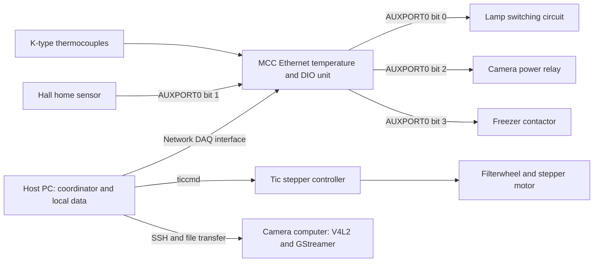
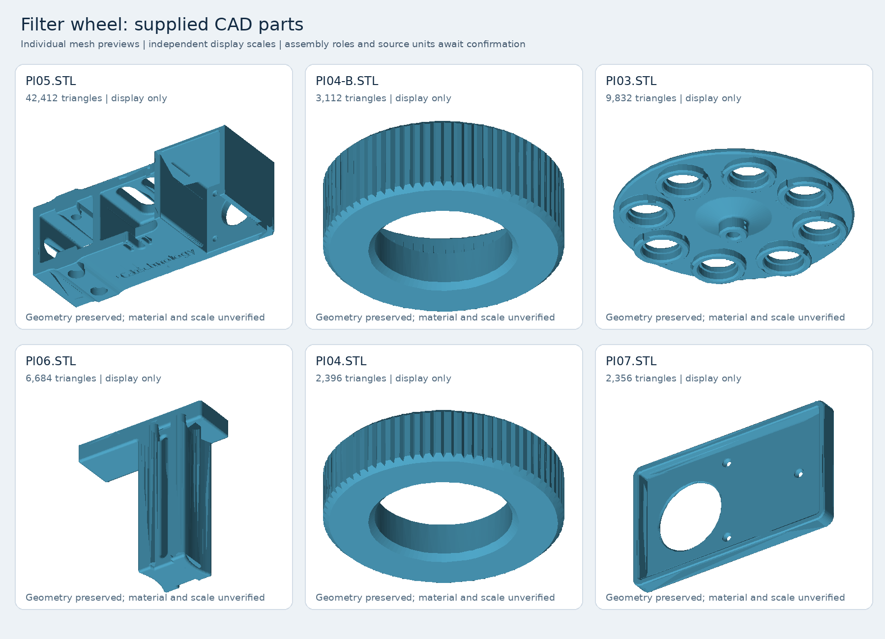

# Hardware and connections

Status: owner review updated 27 October 2026; original source snapshot 23 October 2026. Component identities and arrangement supplied in the [27 October owner review](10-sources-and-maintenance.md#r1-owner-review-27-october-2026) are distinguished below from software settings and generic manufacturer specifications. This is not yet an as-built wiring drawing. Physical probe locations, remaining part numbers, actual supply wiring and optical geometry still require review.

## System arrangement

The host PC runs the test coordinator, reads an Ethernet MCC temperature/DIO unit, commands a Tic stepper controller, and triggers image capture on the camera computer over SSH. The camera computer exposes a V4L2 video device and saves PNG images before transferring the sweep to the host. The freezer, lamp, and camera power are switched through the MCC digital outputs. The Hall home sensor is read through an MCC digital input. These are software relationships; cable routes and terminal numbers have not been established from a drawing. [Temperature and DIO controller](../Control/temperature_control.py#L69), [filterwheel driver](../Control/filterwheel_control.py#L42), [remote capture](../Scripts/run_single_sweep_remote.py#L51).

The diagram is a logical interface map. It does not specify load-side power wiring, isolation, connector pin numbers, or electrical polarity beyond the configured logic levels below.

## Component inventory and evidence

| Component | Established identity, owner description or code interface | Still to confirm physically |
|---|---|---|
| Host PC | Python programs coordinate tests, store data, run analysis and Streamlit comparison views. | Machine identity, operating-system version, interface configuration, environment/package versions, backup location. |
| Camera and embedded computer | Owner identifies the Qtec Hypervision family, with variations tested rather than one fixed hardware revision. SSH control, `/dev/video4`, V4L2 and GStreamer are implemented. | Per-test camera/revision identity, sensor, serial number, firmware/driver versions, optics, TEC hardware and setpoint. |
| MCC temperature and digital-I/O unit | Owner supplies Digilent/MCC **E-TC**, part **6069-410-025**. Ethernet `uldaq` access; eight configured thermocouple channels and `AUXPORT0` bit I/O. | Serial number, terminal map, common/reference connections and calibration status. |
| Thermocouples and extension | Owner supplies **Omega 5SRTC-TT-KI-36-1M** thermocouples and **Labfacility XF-1275-FAR** KX extension wire. Channels 0–4 enabled as type K. | Attachment methods, physical positions, actual extension lengths, connector counterpart model, reference measurements and uncertainty. |
| Tic controller and stepper motor | Owner identifies **Pololu 3132, Tic T834**, and a **NEMA 17** motor. Controlled with `ticcmd`. | Exact motor part number/electrical rating, serials, actual controller supply, winding wiring and mechanical drive ratio. NEMA 17 does not identify a specific motor model. |
| Filterwheel and Hall home sensor | Owner confirms sensor on the fixed base and magnet on the rotating part; supplied datasheet identifies Honeywell **SL353 series**, with HT/LT variants. Four configured measurement positions and active-low Hall logic. Six CAD meshes are preserved below. | Exact HT/LT suffix, fitted supply/interface circuit, physical datum, assembled dimensions and optical alignment. |
| Filters | Owner identifies **Thorlabs FBH780-3**, **FLH1064-3** and **FBH1550-4**, plus the open position. Nominal wavelengths/widths agree with analysis configuration. | Per-unit transmission data/certificates, orientation, installed mounting and serial/lot records. |
| Illumination | Lamp controlled by DIO bit 0; software waits 2 s before sweep capture. | Lamp/source type, spectrum, power supply, warm-up stability, positioning, optical path and switching interface. |
| Freezer and contactor | DIO bit 3 controls freezer enable; automated pre-cool followed by freezer-off measurement. | Freezer model, compressor/controller details, contactor and coil ratings, temperature limits and physical wiring. |
| Camera power relay | DIO bit 2 controls camera power; 45 s boot wait configured. | Relay specification, load-side voltage/current, power-supply topology, switching behavior and actual boot requirement. |
| Camera mounting, grating and target | Analysis expects spectral lines and a central dark vertical line; local notes mention a “PC Grating Holder.” User chat describes an Offner arrangement and the materials listed below. | Complete optical/mechanical drawing, grating properties, target description, distances, orientation and confirmation that the historical build is still current. |

Sources: [camera defaults](../Camera_scripts/camera_config.py#L2), [DAQ interface](../Control/temperature_control.py#L12), [temperature configuration](../Config/temperature_config.py#L8), [system motion and I/O settings](../Config/system_config.py#L1), [filter identities](../Config/analysis_config.py#L12), [target analysis setup](../Config/analysis_config.py#L41), [local metadata](reference/local_config_snapshot.txt#L66).

### Manufacturer specifications and their limits

The owner's camera description is approximately **400–1700 nm**. Qtec's public Hypervision documentation lists its VIS-SWIR version as **430–1700 nm**, describes an Offner spectrograph, and places it on a Linux computer platform. Preserve these as separate owner and public-product descriptions: the public specifications do not establish the exact range, detector or revision of every camera tested here. Record the camera identity for each run, and perform the owner's stated manual focus adjustment when changing camera. [Qtec Hypervision documentation](https://docs.qtec.com/hsi/hypervision/intro/), [owner review](10-sources-and-maintenance.md#r1-owner-review-27-october-2026).

Digilent identifies **6069-410-025** as **MCC E-TC**, with eight thermocouple inputs, 24-bit conversion, maximum 4 samples/s/channel and eight digital I/O. These are device capabilities, not the project's logging cadence or whole-chain accuracy. The code's logger requests a nominal 1 s interval. [Digilent E-TC product page](https://digilent.com/shop/mcc-e-tc-thermocouple-measurement-ethernet-daq-device/), [logger interval](../Control/temperature_logger.py#L21).

Pololu identifies item **3132** as the **Tic T834 with soldered connectors**, using a DRV8834 driver. Its manufacturer supply range is **2.5–10.8 V**, with approximately **1.5 A continuous per phase** without additional cooling. The actual installed supply voltage remains unrecorded. The separate 24 V camera/contactor comment below does not establish a supply connection to this controller. [Pololu 3132](https://www.pololu.com/product/3132).

## Optical and mechanical setup reported in project chats

In the 31 August 2026 project discussion, the user described an **Offner setup**, with the slit in a steel cup, rods made from **SS304**, and a **polycarbonate (PC) grating holder** intended to provide thermal compensation. The user discussed an approximately four-times-expansion rationale for that design; this is an engineering explanation from the chat, not a validated material property or established athermal performance measurement. The steel-cup grade was not established by the retrieved wording and should not be assumed to be SS304 merely because the rods are. [Project context](08-project-context.md), [retrieved chat source T2](10-sources-and-maintenance.md#t2-freezer-camera-drift-analysis).

The same user description identifies an unspecified **Loctite superglue** for the grating and **Casco SuperFix+** for the mirror-to-top-plate bond. Exact Loctite product, bond thickness/geometry, cure conditions, substrate preparation and resulting thermal/mechanical properties are not documented. This is evidence of adhesive choices reported for that build; it does not establish whether a later build changed them. No adhesive material constants have been inferred from product names. [Project context](08-project-context.md), [retrieved chat source T2](10-sources-and-maintenance.md#t2-freezer-camera-drift-analysis).

Other retrieved user discussion reports the freezer fan running during cooling, thermocouples and 24 V wiring, and prior condensation. The available discussion does not establish a complete current fan wiring/control circuit, humidity measurement, or an installed drying solution. Previously proposed condensation remedies are not treated as fitted hardware. See [the retrieved project context](08-project-context.md) for source limits and historical discussion.

## Network and device interfaces

| Connection | Configured value | Interpretation |
|---|---|---|
| Host to camera | Camera endpoint `10.100.10.100`; SSH account selected by `CAMERA_USER` | Noninteractive SSH is used; connection and authentication must already work. No password or key belongs in this knowledge base. |
| Host to MCC | Host `10.100.10.101`, port `54211`, interface `None` | Values passed to `get_net_daq_device_descriptor`; a specific interface is not selected in configuration. |
| Camera video | `/dev/video4` | Shared by PNG capture, keepalive streaming and sensor-temperature refresh by default. |
| Host to Tic | `ticcmd`, with `TIC_SERIAL=None` | No explicit device serial is selected in the current settings. Record the intended controller before using a host with multiple Tic devices. |
| Camera-side program directory | `/root/scripts/` | Capture and camera-temperature programs are expected here. |
| Camera-side image staging | `/root/scripts/data` | Sweeps are stored here before host transfer. |

These are configuration values, not confirmation that the devices are currently reachable. Sources: [camera network and paths](../Config/system_config.py#L82), [MCC endpoint](../Config/temperature_config.py#L8), [Tic device selection](../Control/filterwheel_control.py#L42), [SSH options](../Scripts/run_single_sweep_remote.py#L51).

## Digital input and output map

All four signals use the MCC `DigitalPortType.AUXPORT0`. A bit index is a software channel designation, not a connector pin number. [Port setup](../Control/temperature_control.py#L35).

| Logical function | AUXPORT0 bit | Direction | Active/on state | Inactive/off state | Where set |
|---|---:|---|---:|---:|---|
| Lamp | 0 | Output | 1 | 0 | Hard-coded in `temperature_control.py` |
| Filterwheel Hall sensor | 1 | Input | 0 | Any value other than 0 evaluates inactive | Configured `HALL_DIO_BIT`, `HALL_ACTIVE_STATE` |
| Camera power relay | 2 | Output | 1 | 0 | Configured camera-power constants |
| Freezer contactor | 3 | Output | 1 | 0 | Configured freezer constants |

The camera and freezer active levels are configurable; their off levels are calculated as the inverse. Connecting the controller turns the lamp and freezer off and configures the camera-power bit as an output. The connection method does **not** explicitly turn camera power off at that point; the pre-cool workflow does this later. Disconnect attempts to turn the lamp, freezer and camera power off. [Connection behavior](../Control/temperature_control.py#L69), [signal read/write functions](../Control/temperature_control.py#L102), [disconnect](../Control/temperature_control.py#L168).

The recorded `lamp_state`, `freezer_state`, and `camera_power_state` represent the program's commanded state. There is no separate feedback measurement in this controller proving that the relay operated, power reached the load, the lamp emitted light, or the compressor ran. [State fields and readings](../Control/temperature_control.py#L199).

### Shared supply and sequencing caveat

A comment in the calibration program states that the freezer contactor uses the camera 24 V supply and that camera and freezer should not be enabled together. That program turns the freezer off before enabling camera power. Treat this as a recorded design constraint requiring confirmation against the actual wiring. The low-level `camera_power_on()` and `freezer_on()` methods do not implement a mutual interlock; the normal long-test pre-cool sequence provides sequencing at a higher level. [Calibration comment and action](../Scripts/calibrate_filterwheel.py#L181), [low-level outputs](../Control/temperature_control.py#L116), [pre-cool sequencing](../Scripts/run_long_test.py#L330).

## Thermocouple channels

The owner identifies the thermocouples as **Omega 5SRTC-TT-KI-36-1M**. Omega lists that exact model as type K, **36 AWG / approximately 0.13 mm wire diameter**, **PFA insulation**, and **1 m lead length**; the 5SRTC style includes a miniature thermocouple plug and strain relief. These product details do not establish the physical placement or calibration of any particular probe. [Omega IEC series and exact model listing](https://www.jp.omega.com/pptst/5LSC_5SRTC_IEC.html).

The owner confirms that the thermocouple connectors are **inside the freezer**, extended outside with **Labfacility XF-1275-FAR** KX wire, [Farnell order reference 2918721](https://dk.farnell.com/labfacility/xf-1275-far/thermocouple-wire-type-kx-10m/dp/2918721). This identifies extension wire, not a separate connector product. The exact mating/extension connector model has not yet been supplied; do not infer it from the cable reference or the probe's included plug. Actual installed extension lengths and termination details remain to be recorded. [Owner review](10-sources-and-maintenance.md#r1-owner-review-27-october-2026).

| MCC channel | Logical probe name | Thermocouple type | Enabled in supplied configuration | Physical placement |
|---:|---|---|---|---|
| 0 | `probe_1` | K | Yes | Unconfirmed |
| 1 | `probe_2` | K | Yes | Unconfirmed |
| 2 | `probe_3` | K | Yes | Unconfirmed |
| 3 | `probe_4` | K | Yes | Unconfirmed |
| 4 | `probe_5` | K | Yes | Unconfirmed; used for current pre-cool and measurement endpoint |
| 5 | `probe_6` | K | No | Unconfirmed |
| 6 | `probe_7` | K | No | Unconfirmed |
| 7 | `probe_8` | K | No | Unconfirmed |

Source: [channel map](../Config/temperature_config.py#L12). Probe names are generic identifiers. Do not label a probe “ambient,” “grating,” “camera housing,” or similar until its actual placement is confirmed.

The owner reports **5 °C at probe 5** as the normal cold threshold and explains that **12 °C** was used recently to shorten testing. The archived local configuration contains 12 °C. These are protocol choices, not probe specifications or verified temperatures of the optics; retain the actual selected threshold with each test. [Owner review](10-sources-and-maintenance.md#r1-owner-review-27-october-2026), [configuration snapshot](reference/local_config_snapshot.txt#L27).

At connection, the controller sets a thermocouple type for every entry, including disabled channels. During a read it skips disabled channels, asks the device for Celsius values, and records `ULException` errors per probe. It does not apply a project-specific offset or scale correction in this code. Factory/device calibration and cold-junction behavior must be documented from the actual MCC model and its setup rather than inferred here. [Type setup](../Control/temperature_control.py#L77), [temperature reading](../Control/temperature_control.py#L210).

The default logger interval is 1 s, with a sleep after each reading cycle, so this is a nominal cadence rather than a guaranteed exact 1 Hz sample clock. [Logger defaults](../Control/temperature_logger.py#L21), [logger loop](../Control/temperature_logger.py#L79).

## Filterwheel, filters and position calibration

The owner identifies the three installed filter models below. Their nominal center wavelengths and FWHM values agree with the [analysis configuration](../Config/analysis_config.py#L12) and Thorlabs' product descriptions; no individual filter transmission certificate has been supplied. The three narrow passbands sample separated wavelengths across the broad camera range. They do not provide continuous spectral coverage of that range. [Thorlabs filter table](https://www.thorlabs.us/newgrouppage9.cfm?objectgroup_id=16235&pn=FB1070-10), [owner review](10-sources-and-maintenance.md#r1-owner-review-27-october-2026).

| Filter number | Analysis name and role | Owner-supplied model | Nominal wavelength | Nominal filter FWHM | Archived local position | Base-file position | Capture exposure control value |
|---:|---|---|---:|---:|---:|---:|---:|
| 1 | `no_filter`, spatial/open | Open position | — | — | -51 | -57 | 3000 |
| 2 | `bp_780`, spectral | [Thorlabs FBH780-3](https://www.thorlabs.com/item/FBH780-3) | 780 nm | 3 nm | -251 | -257 | 15000 |
| 3 | `bp_1064`, spectral | [Thorlabs FLH1064-3](https://www.thorlabs.com/item/FLH1064-3) | 1064 nm | 3 nm | -451 | -457 | 8000 |
| 4 | `bp_1550`, spectral | [Thorlabs FBH1550-4](https://www.thorlabs.com/item/FBH1550-4) | 1550 nm | 4 nm | -651 | -657 | 15000 |

The local positions override the base positions. The owner reports checking filterwheel positions for each long run; the archived numbers are not a permanent alignment guarantee. Values are Tic position units under the configured step mode, not verified angles or absolute physical positions. Adjacent configured slots are separated by 200 position units; no steps-per-revolution or gear ratio is established in the source. Exposure values are passed to the camera driver's `exposure_time_absolute` control. Their time unit and valid range require camera/driver verification; do not convert them into milliseconds using a generic camera convention. [Base positions and motion settings](../Config/system_config.py#L3), [local positions and exposures](reference/local_config_snapshot.txt#L52), [exposure command](../Camera_scripts/camera_control.py#L50), [owner review](10-sources-and-maintenance.md#r1-owner-review-27-october-2026).

### Mechanical reference and Hall arrangement

The owner confirms that the **Hall sensor is attached to the fixed base** and the **magnet is on the rotating part**. The supplied datasheet is Honeywell's **SL353 series micropower omnipolar digital Hall sensor**, covering **SL353HT** and **SL353LT**. It specifies a **2.2–5.5 V** operating supply, **−40 to +85 °C** operation, and a **push-pull output** that goes low with an activating magnetic field and high when it is removed. That logic agrees with the configured active-low read. Either magnetic pole can activate the device. [Honeywell datasheet supplied via RS, pp. 2–4](https://docs.rs-online.com/9a79/A700000007013601.pdf), [Hall configuration](../Config/system_config.py#L25).

The exact fitted **HT/LT suffix remains unknown**: the nominal sampling periods differ (45 microseconds for HT versus 45 milliseconds for LT at the datasheet's nominal conditions). Record the actual suffix and interface wiring when documenting the homing response; no sensor-response/repeatability validation is inferred from the family datasheet. Its IC pin diagram is not an as-built pin map for the rig.

Six supplied STL files are preserved in the [filterwheel CAD inventory](reference/filterwheel-cad/README.md), with a preview below. The meshes provide mechanical reference; their assembled roles, exact current-build correspondence and dimensions should be established from the inventory and owner review rather than guessed from filenames or this preview.

Current coordinator settings are step mode `8`, current limit `1500 mA`, max speed `4000000`, starting speed `0`, max acceleration/deceleration `40000`, position tolerance `5`, settle time `0.2 s`, and move timeout `10 s`. Speed and acceleration numbers are passed directly to `ticcmd`; this knowledge base does not convert their units without the actual controller documentation. Class constructor defaults differ from the coordinator configuration, so use the passed configuration when interpreting production behavior. [Configured values](../Config/system_config.py#L10), [driver constructor](../Control/filterwheel_control.py#L13), [coordinator passes settings](../Scripts/run_single_sweep_remote.py#L241).

The controller is energized for motion, then de-energized at idle and during image capture by default to reduce stepper heating. During homing it stays energized between the search steps. De-energization is an intended thermal behavior; whether the wheel can drift while unpowered must be checked physically. Controller-reported position is not an independent measurement of optical alignment. [Move behavior](../Control/filterwheel_control.py#L119), [homing current behavior](../Control/filterwheel_control.py#L172).

### Hall homing

With the normal configuration, home search direction is `-1`, coarse increment `50`, fine increment `1`, and maximum coarse travel counter `3000`. The algorithm:

1. If Hall is already active, move away until inactive.
2. Search coarsely toward the magnet until Hall becomes active.
3. Move away in fine increments until inactive.
4. Approach in fine increments until the active edge is found, then set Tic position to zero.

The result records the starting, coarse-hit, inactive-edge and final-edge positions plus duration. The 3000 counter limits the initial move-away and coarse-search stages. The fine back-away/approach loops do not have their own travel or elapsed-time bound in this implementation. A successful software home therefore establishes a sensor-edge reference, not an independently measured repeatability specification. [Homing configuration](../Config/system_config.py#L25), [homing implementation](../Control/filterwheel_control.py#L158).

### Calibration workflow supported by the code

`Scripts/calibrate_filterwheel.py` provides `home`, position readout, absolute movement (`g`), relative jog (`j`), move-to-filter (`f`), save-current-position-to-filter (`s`), lamp/camera switching, and a `save` command. A useful documented sequence is to home, identify each optically aligned slot, record the current position for that filter number, save, then transfer the reviewed positions into `Config/local_config.py`.

The calibration program writes `calibrated_filter_positions.json`. The test runner does **not** load that file automatically; it uses `FILTER_POSITIONS` from configuration. The help text mentions filters 1–8, while the supplied running map defines four. The existence of a calibration command for a number does not prove the physical wheel has that many populated slots. [Calibration commands](../Scripts/calibrate_filterwheel.py#L39), [position saving](../Scripts/calibrate_filterwheel.py#L144), [JSON write](../Scripts/calibrate_filterwheel.py#L204), [runtime map use](../Scripts/run_single_sweep_remote.py#L314).

## Camera internal temperature channels and TEC

There are two sources of internal readings:

- `sensors -j` supplies whatever hardware-monitor sensors exist on the camera computer. The program maps driver families to friendly names such as CPU, GPU, FPGA, Sensor PCB and PCB. These names are software labels, not proof that every component exists or is measured at the exact location implied by a label.
- V4L2 supplies `sensor_temperature`; the program treats its integer value as millidegrees Celsius and divides by 1000, then rounds to 0.1 °C. It also reads `temperature_control` and records a Boolean when parseable. It does not set or regulate a TEC setpoint.

Sources: [driver name map](../Camera_scripts/read_camera_temperatures.py#L22), [hardware-monitor parsing](../Camera_scripts/read_camera_temperatures.py#L66), [V4L2 conversion and control status](../Camera_scripts/read_camera_temperatures.py#L277).

The camera-side code states that this camera's sensor-temperature control updates only while video is actively streaming. It therefore keeps a temporary stream alive while reading, or uses the existing keepalive stream. An exactly 20.0 °C camera reading receives a possible-default/stale warning; that is a diagnostic flag, not evidence that all 20 °C readings are invalid. [Refresh rationale](../Camera_scripts/read_camera_temperatures.py#L152), [warning](../Camera_scripts/read_camera_temperatures.py#L327).

## Hardware information to add during review

1. Annotated overview photograph, optical-path sketch and a dimensioned mounting arrangement.
2. Per-test camera/revision and serial records; MCC/controller serials; exact NEMA 17 motor model and SL353HT/LT suffix; remaining freezer, lamp, supply, relay and contactor identities/manuals.
3. Wiring drawing with connector/terminal numbers, logic references, supply sharing and load-side switching.
4. Photograph and location description for each `probe_1` through `probe_5`, including what surface or medium it measures and how it is attached.
5. Individual filter transmission certificates/lot records; target description; grating, lens and holder details.
6. Temperature calibration/uncertainty evidence, wheel alignment/repeatability check, illumination stabilization evidence and camera exposure-control units.
7. Confirmed operating temperature bounds and the actual camera/TEC initialization and control behavior.
8. Confirm the historical Offner/material/adhesive/fan description against the present build; record humidity/condensation monitoring and any actually installed mitigation.
9. Separate connector part numbers and installed extension lengths for the identified Omega probes and Labfacility KX extension wire.
