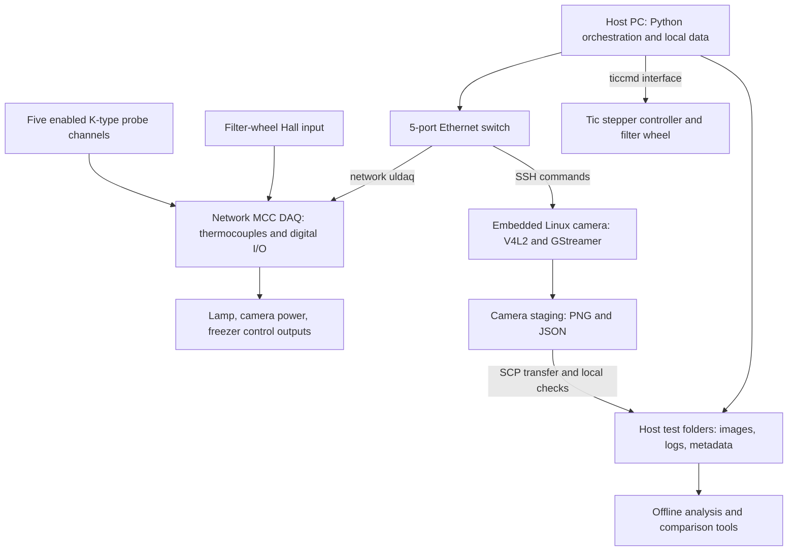
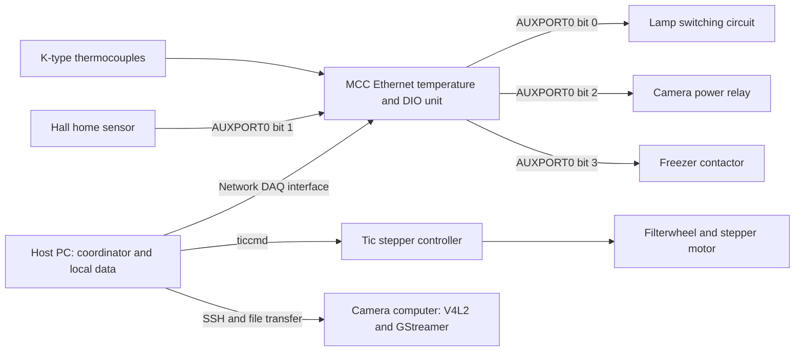
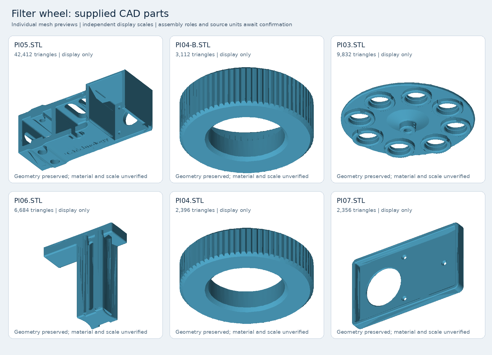

# FreezerTest knowledge base — portable edition

Version 0.3.1 · Owner review in progress · 2026-10-29

Generated from the canonical Markdown pages. Import this file OR another export, not both.


<a id="doc-README"></a>

<a id="doc-README-freezertest-knowledge-base"></a>
# FreezerTest knowledge base

Version: **0.3.1 — owner review, component photographs and confirmed supply map** · Updated: **29 October 2026**

This knowledge base explains the FreezerTest apparatus, control software, test sequence, data, and analysis methodology. It is intended for operators, colleagues, and a local AI answering questions about the test. It describes a particular source snapshot, not a certified operating procedure or a validated hardware inventory.

The original code review covered **33 shared Python/shell files**, identical to GitHub commit `df4ccebbbd0f41e32f5ae415e967728e5845d56b` (12 October 2026), plus the local configuration. Three project chats supplied historical context. Owner reviews on **27 and 29 October** add component identities, nine component photographs, six filter-wheel CAD files, the usual probe map, target/illumination details, and operating corrections. Those confirmations supersede conflicting historical assumptions. Unanswered questions remain in one [review register](#doc-09-review-questions-and-gaps). See [sources and maintenance](#doc-10-sources-and-maintenance) for provenance.

<a id="doc-README-find-information"></a>
## Find information

| Document | Use it for |
|---|---|
| [01 — Purpose and system overview](#doc-01-purpose-and-system-overview) | What is measured, system diagram, vocabulary, and scope |
| [02 — Hardware and connections](#doc-02-hardware-and-connections) | Components, digital I/O, temperature probes, filter wheel, and camera interfaces |
| [03 — Software and configuration](#doc-03-software-and-configuration) | Modules, dependencies, deployment, defaults, and local overrides |
| [04 — Running the test](#doc-04-running-the-test) | Pre-cool, measurement, sweeps, repeats, stopping, and recovery |
| [05 — Data and metadata](#doc-05-data-and-metadata) | Folder structure, files, metadata, timestamps, and transfer |
| [06 — Analysis methodology](#doc-06-analysis-methodology) | Spectral and spatial metrics, signal/noise, ROIs, units, and limitations |
| [07 — Analysis tools and troubleshooting](#doc-07-analysis-tools-and-troubleshooting) | Analysis commands, comparisons, preview tools, and common problems |
| [08 — Project context and owner review](#doc-08-project-context) | Camera-family scope, confirmed context, and relevant historical distinctions |
| [09 — Review questions and gaps](#doc-09-review-questions-and-gaps) | Prioritized questions for our review, including missing hardware details |
| [10 — Sources and maintenance](#doc-10-sources-and-maintenance) | Evidence, exact source version, history coverage, and update procedure |
| [11 — Using this with a local AI](#doc-11-local-ai-guide) | Import options, answer rules, and retrieval checks |
| [12 — Glossary](#doc-12-glossary) | Terminology used in the code and documentation |

<a id="doc-README-evidence-labels"></a>
## Evidence labels

- **Implemented / source-derived:** visible behavior in the reviewed code. This does not prove the deployed camera has the same files.
- **Configured:** a value in the reviewed configuration. Local overrides take precedence where the consuming module uses the value. A setting's presence alone does not implement a feature.
- **Owner-confirmed:** a dated description of installed hardware or procedure. Usual arrangements may change by test; use that test's recorded setup when it differs.
- **Photographed:** a visible part/label in the supplied images. A nameplate rating is not a measured load, and visible wiring is not a complete circuit drawing.
- **Proposed / unverified:** an earlier suggestion, an interpretation, or a feature not established by the reviewed sources.
- **Unknown:** evidence is missing. These gaps are deliberately left open.

<a id="doc-README-read-these-distinctions-first"></a>
## Read these distinctions first

1. **Normal pre-cool ends at `probe_5 <= 5 °C`.** Probe 5 is usually attached to the underside of the upper aluminium tray. The historical 12 °C setting was for a shorter trial. Probe placement can change and must be recorded per test; neither threshold establishes thermal equilibrium of the whole camera.
2. The test covers **Qtec Hypervision variants**, both to establish reproducibility across units and to investigate design changes. There is no single fixed reference-camera revision. Record the unit, revision, focus/setup, and run settings for meaningful comparisons.
3. **Freezer on/camera off for cooling → freezer off → camera on for measurement.** Camera heat and intermittent lamp heat warm the chamber toward the endpoint. Normal operation never powers camera and freezer together, or lamp and freezer together. The XDR powers lamp/contactor coil; the NDR powers the camera. There is no controlled heater ramp or stability hold.
4. Analysis widths and shifts are in **pixels**. Signal and image-noise metrics are in **digital numbers (DN)**. The code does not establish calibrated spectral resolution in nm, temporal read noise, or acceptance limits.
5. Preflight and diagnostic scripts can switch real outputs. They are not all read-only checks. Do not run them alongside an acquisition.

<a id="doc-README-scope-and-delivery"></a>
## Scope and delivery

Individual runs, images, measured performance, camera rankings, and causal conclusions about camera development are excluded. Setup-related failure modes and measurement validity concerns are retained. The root `calibration_temperature_log.jsonl` and compiled `__pycache__` files are not part of the knowledge corpus.

The numbered Markdown files are the editable source of truth. `exports/FreezerTest_Knowledge_Base.md` is a single-file copy for import. `exports/documents.jsonl` provides one record per document, and `exports/chunks.jsonl` provides section-level records. Import **one representation only**, so the local AI does not retrieve duplicate copies. [The local AI guide](#doc-11-local-ai-guide) explains the details.

The [component photographs](../reference/component-photos/README.md), [CAD reference](../reference/filterwheel-cad/README.md), and AI exports are all under `knowledge_base/`, outside the scripts-only test-PC checkout. The owner confirms that the local AI already accesses GitHub through a deploy SSH key; the guide describes content/version checks, not a missing connection. No acquisition code or deployed camera files were changed in this update.

---


<a id="doc-01-purpose-and-system-overview"></a>

<a id="doc-01-purpose-and-system-overview-purpose-and-system-overview"></a>
# Purpose and system overview

Status: owner review, second batch · Updated: 29 October 2026 · Code snapshot reviewed: 23 October 2026

<a id="doc-01-purpose-and-system-overview-what-freezertest-does"></a>
## What FreezerTest does

FreezerTest automates temperature-dependent optical measurements of a camera using a freezer, temperature probes, a switched light source, and a motorized filter wheel. A host PC coordinates the apparatus and asks an embedded Linux camera computer to capture images. Offline analysis extracts image position, line/edge width, signal, and image-noise indicators, then compares their evolution within a test and across repeated tests.

The camera sits on an aluminium tray in the upper freezer. The target is **white PTFE with a black 3D-printed cage** to form sharp dark lines, illuminated by a **halogen tube and silver-coated parabolic reflector** focused onto the target. PTFE was chosen by the owner for reflection over the intended 400–1700 nm span; no calibrated reflectance standard is implied. [Owner review R2](#doc-10-sources-and-maintenance-r2-owner-review-and-component-photos-29-october-2026), [hardware and photographs](#doc-02-hardware-and-connections).

The devices under test are **variants of the Qtec Hypervision camera family**, using Qtec computer logic and hardware. There is no single fixed reference-camera revision: multiple units of the same kind are tested to build evidence of reproducibility, while deliberate camera changes are also tested to investigate their consequences. The method and apparatus belong here; individual outcomes and development decisions remain outside this corpus. [Owner review R1](#doc-10-sources-and-maintenance-r1-owner-review-27-october-2026).

Qtec describes Hypervision as an Offner push-broom hyperspectral camera based on its C-series platform. The owner describes the relevant camera range as approximately 400–1700 nm; Qtec's current VIS-SWIR family documentation specifies 430–1700 nm. The exact configuration, detector, optics, and revision should be recorded for each tested unit rather than copied wholesale from a generic product page. See [Qtec Hypervision](https://docs.qtec.com/hsi/hypervision/intro/), [project context](#doc-08-project-context), and [hardware](#doc-02-hardware-and-connections).

Primary source: [long-test runner](https://github.com/JcpeNewtec/FreezerTest/blob/df4ccebbbd0f41e32f5ae415e967728e5845d56b/Scripts/run_long_test.py#L441), [single sweep](https://github.com/JcpeNewtec/FreezerTest/blob/df4ccebbbd0f41e32f5ae415e967728e5845d56b/Scripts/run_single_sweep_remote.py#L201), [analysis configuration](https://github.com/JcpeNewtec/FreezerTest/blob/df4ccebbbd0f41e32f5ae415e967728e5845d56b/Config/analysis_config.py#L14), and [chat T2](#doc-10-sources-and-maintenance-t2-freezer-camera-drift-analysis).

<a id="doc-01-purpose-and-system-overview-functional-architecture"></a>
## Functional architecture



This is a software-level diagram. The [hardware page](#doc-02-hardware-and-connections) records the owner-confirmed supply/load groups and usual physical arrangement; detailed terminal wiring, protection and relay-role assignments still need an as-built drawing.

<a id="doc-01-purpose-and-system-overview-acquisition-hierarchy"></a>
## Acquisition hierarchy

| Term | Meaning in this project |
|---|---|
| Repeat sequence | A configured number of complete tests, with one shared repeat-group identifier |
| Test / repeat | One test folder containing pre-cool events, temperature logging, a measurement phase, and cleanup |
| Sweep | One ordered visit to all configured filter positions, normally producing four images plus metadata |
| Capture | One image at one filter position; filters are captured sequentially, not simultaneously |
| Analysis row | A per-sweep result assembled from available images, metrics, and associated temperatures |

This distinction matters: a filter-4 image is taken later than the filter-1 image in the same sweep. A sweep-associated temperature is not automatically the exact optical-component temperature at every individual exposure. See [data and metadata](#doc-05-data-and-metadata).

<a id="doc-01-purpose-and-system-overview-current-configured-measurement-channels"></a>
## Current configured measurement channels

| Wheel position | Analysis name | Intended role | Nominal optical filter setting | Exposure control value |
|---|---|---|---|---|
| 1 | `no_filter` | Spatial edge/line-spread analysis and signal ROIs | Open/no filter according to analysis configuration | 3000 |
| 2 | `bp_780` | Spectral line profile | Thorlabs **FBH780-3**: 780 nm, nominal FWHM 3 nm | 15000 |
| 3 | `bp_1064` | Spectral line profile | Thorlabs **FLH1064-3**: 1064 nm, nominal FWHM 3 nm | 8000 |
| 4 | `bp_1550` | Spectral line profile and background/noise ROIs | Thorlabs **FBH1550-4**: 1550 nm, nominal FWHM 4 nm | 15000 |

The owner selected these narrow bandpass filters to sample widely separated portions of the camera's wavelength range. They provide three discrete spectral samples, not continuous coverage or absolute wavelength calibration. Component identities are owner-confirmed; nominal wavelengths/widths agree with [Thorlabs' specification table](https://www.thorlabs.us/newgrouppage9.cfm?objectgroup_id=16235&pn=FB1070-10). The position-to-analysis mapping comes from [analysis configuration](https://github.com/JcpeNewtec/FreezerTest/blob/df4ccebbbd0f41e32f5ae415e967728e5845d56b/Config/analysis_config.py#L14); exposures shown are the historical copied profile, from [local configuration](../reference/local_config_snapshot.txt#L58). Per-run filter-position verification remains necessary. Exposure values are passed to `exposure_time_absolute`; their physical unit must be confirmed for the deployed driver. See [camera control](https://github.com/JcpeNewtec/FreezerTest/blob/df4ccebbbd0f41e32f5ae415e967728e5845d56b/Camera_scripts/camera_control.py#L50).

<a id="doc-01-purpose-and-system-overview-current-implemented-test-concept"></a>
## Current implemented test concept

Normal preparation includes verifying filter positions before each long test and manually focusing on the target plane when changing cameras. The runner starts temperature logging, switches lamp and camera off, and runs the freezer until the selected pre-cool threshold is met; the owner-confirmed normal threshold is **`probe_5 <= 5 °C`**. The copied configuration used 12 °C for a shorter trial. A pre-cool timeout aborts the test. On successful pre-cool, the runner switches the freezer off, waits 60 seconds, powers the camera on, waits 45 seconds, and starts keepalive streaming when enabled. It then captures sweeps during warm-up until the selected endpoint logic ends measurement. The historical copied profile ends after three consecutive new records observed at `probe_5 >= 40 °C`, with a 14-hour measurement deadline checked between operations, and requests eight repeats. Blocking operations and the final sweep can extend that deadline. These trial-specific settings should not be treated as universal protocol requirements. [Owner review R1](#doc-10-sources-and-maintenance-r1-owner-review-27-october-2026).

The **camera and lamp supply the heat during measurement** after freezer power has been switched off. Normal operation never enables camera and freezer simultaneously. In the reviewed code the lamp is on during sweep captures and off between them, so its heating contribution is intermittent; the camera stays powered and streams between sweeps when keepalive is enabled. This describes the actual warming mechanism without implying a controlled heating rate or a continuously illuminated lamp. Routine camera shutdown is by cutting its power, as confirmed by the owner. [Owner review R2](#doc-10-sources-and-maintenance-r2-owner-review-and-component-photos-29-october-2026), [sweep lamp sequence](https://github.com/JcpeNewtec/FreezerTest/blob/df4ccebbbd0f41e32f5ae415e967728e5845d56b/Scripts/run_single_sweep_remote.py#L301).

In the usual probe arrangement, probes **1–3 measure the outer shell** (non-computer side, computer/hot side, and the side between them). Probe **4 is on the upper/camera-facing tray surface** and probe **5 is underneath the same tray**, both away from camera/lamp heat sources. Thus the usual pre-cool/end condition is based on **tray-underside temperature**, not a direct camera-core or free-air reading. Placements can change by test and the actual map must be recorded. [Usual probe map](#doc-02-hardware-and-connections-thermocouple-channels).

The runner does not command a controlled heating rate, establish thermal equilibrium at setpoints, or check humidity. These distinctions are central to interpreting temperature-associated measurements. See [running the test](#doc-04-running-the-test), [review gaps](#doc-09-review-questions-and-gaps), and [pre-cool code](https://github.com/JcpeNewtec/FreezerTest/blob/df4ccebbbd0f41e32f5ae415e967728e5845d56b/Scripts/run_long_test.py#L330).

<a id="doc-01-purpose-and-system-overview-what-the-analysis-can-answer"></a>
## What the analysis can answer

- How spectral profile peak positions and FWHM change in image coordinates.
- How the selected spatial edge and its fitted line-spread width change.
- How selected signal-region mean DN and background-region spatial scatter change.
- How those metrics relate to associated external probe temperatures, selected internal camera temperatures, sweep index, and repeat identity. Recorded timestamps support additional time-based analysis, but the supplied viewers do not offer an elapsed-time axis.

The methodology does not, by itself, establish absolute wavelength accuracy, intrinsic spectrometer resolution independently of the bandpass filters, radiometric response, temporal noise, MTF, or a root cause of drift. It does not supply pass/fail specifications. [Analysis methodology](#doc-06-analysis-methodology) records the exact calculations and limits.

<a id="doc-01-purpose-and-system-overview-boundaries-with-a-future-camera-development-knowledge-base"></a>
## Boundaries with a future camera-development knowledge base

This corpus keeps apparatus details, operating behavior, analytical definitions, configuration provenance, and known threats to measurement validity. A future camera-development corpus should own individual test outcomes, comparisons between camera units, drift histories, design experiments, proposed root causes, and decisions about optical or mechanical redesign.

The historical camera construction details in [project context](#doc-08-project-context) are retained only to explain the device under test and to guide the hardware review. Earlier assistant hypotheses about glue, expansion, or mechanical settling are not treated as established facts.

---


<a id="doc-02-hardware-and-connections"></a>

<a id="doc-02-hardware-and-connections-hardware-and-connections"></a>
# Hardware and connections

Status: owner review updated 29 October 2026; original source snapshot 23 October 2026. The [27 October component review](#doc-10-sources-and-maintenance-r1-owner-review-27-october-2026) and [29 October owner descriptions and photographs](#doc-10-sources-and-maintenance-r2-owner-review-and-component-photos-29-october-2026) establish the identities and usual arrangement below. Software settings, photographed nameplate ratings and generic manufacturer specifications are distinguished from one another. The remaining wiring allocation and dimensions still need an as-built drawing.

<a id="doc-02-hardware-and-connections-system-arrangement"></a>
## System arrangement

The host PC runs the test coordinator, reads an Ethernet MCC temperature/DIO unit, commands a Tic stepper controller, and triggers image capture on the camera computer over SSH. The camera computer exposes a V4L2 video device and saves PNG images before transferring the sweep to the host. The freezer, lamp, and camera power are switched through the MCC digital outputs. The Hall home sensor is read through an MCC digital input. These are software relationships; cable routes and terminal numbers have not been established from a drawing. [Temperature and DIO controller](https://github.com/JcpeNewtec/FreezerTest/blob/df4ccebbbd0f41e32f5ae415e967728e5845d56b/Control/temperature_control.py#L69), [filterwheel driver](https://github.com/JcpeNewtec/FreezerTest/blob/df4ccebbbd0f41e32f5ae415e967728e5845d56b/Control/filterwheel_control.py#L42), [remote capture](https://github.com/JcpeNewtec/FreezerTest/blob/df4ccebbbd0f41e32f5ae415e967728e5845d56b/Scripts/run_single_sweep_remote.py#L51).



The diagram is a logical interface map. It does not specify load-side power wiring, isolation, connector pin numbers, or electrical polarity beyond the configured logic levels below.

<a id="doc-02-hardware-and-connections-component-inventory-and-evidence"></a>
## Component inventory and evidence

| Component | Established identity, owner description or code interface | Still to confirm physically |
|---|---|---|
| Host PC | Python programs coordinate tests, store data, run analysis and Streamlit comparison views. | Machine identity, operating-system version, interface configuration, environment/package versions, backup location. |
| Camera and embedded computer | Owner identifies the Qtec Hypervision family, with variations tested rather than one fixed hardware revision. SSH control, `/dev/video4`, V4L2 and GStreamer are implemented. | Per-test camera/revision identity, sensor, serial number, firmware/driver versions, optics, TEC hardware and setpoint. |
| MCC temperature and digital-I/O unit | Owner supplies Digilent/MCC **E-TC**, part **6069-410-025**. Ethernet `uldaq` access; eight configured thermocouple channels and `AUXPORT0` bit I/O. | Serial number, terminal map, common/reference connections and calibration status. |
| Thermocouples and extension | **Omega 5SRTC-TT-KI-36-1M**, **Labfacility XF-1275-FAR** KX extension and owner-linked **Omega DRTB-2 series** DIN-rail thermocouple terminal blocks. Usual five-probe positions are documented below. | Exact fitted terminal-block calibration suffix, attachment details, installed extension lengths, reference measurements and uncertainty. |
| Tic controller and stepper motor | **Pololu 3132, Tic T834** and NEMA 17 motor labelled **SY42STH38-1684B**. Owner confirms 5 V controller supply; `ticcmd` controls motion. | Motor electrical datasheet, winding wiring, serial/lot record and mechanical drive ratio. |
| Filterwheel and Hall home sensor | Owner confirms sensor on the fixed base and magnet on the rotating part; supplied datasheet identifies Honeywell **SL353 series**, with HT/LT variants. Four configured measurement positions and active-low Hall logic. Six CAD meshes are preserved below. | Exact HT/LT suffix, fitted supply/interface circuit, physical datum, assembled dimensions and optical alignment. |
| Filters | Owner identifies **Thorlabs FBH780-3**, **FLH1064-3** and **FBH1550-4**, plus the open position. Nominal wavelengths/widths agree with analysis configuration. | Per-unit transmission data/certificates, orientation, installed mounting and serial/lot records. |
| Illumination | Box reference **641840875**, **24–28 V, 100 W, 118 mm R7S ECO HALOGEN**; owner describes silver-coated parabolic reflector focusing the light. DIO bit 0 switches the lamp, with 2 s configured capture delay. | Brand, installed operating voltage/current, spectral output, optical alignment/distances and measured warm-up stability. |
| Freezer and contactor | **Tefcold UF400V** freezer; photographed **Allen-Bradley 100-C09E\*400, Series A** contactor marking. DIO bit 3 controls freezer enable; freezer is off during measurement. | Exact contactor coil suffix/rating, load-side wiring and compressor/controller operating requirements. The printed asterisk is not a resolved coil code. |
| Switching relays | Three photographed **Schneider Electric SSD1D520BDC1** solid-state relays. Software switches lamp, camera power and freezer control through DIO. | Mapping of each physical relay to its load, contactor-coil circuit and exact terminal wiring. |
| DC supplies | **Mean Well XDR-240E-24** supplies lamp and freezer-contactor coil; **NDR-120-24** supplies camera; **MDR-40-5** supplies small components. | As-built protection, terminal numbers and common/reference wiring. |
| Ethernet switch | **Telenty industrial switch**, labelled **5 × 10/100/1000 Mbps**, **DC 5 V 1 A**. | Exact model is hidden by cabling; port allocation. |
| Camera mounting, grating and target | Camera stands on the aluminium tray inside the freezer. Owner describes white **PTFE** target with black **3D-printed cage**, plus the Offner construction below. | Dimensioned optical/mechanical drawing, cage material, grating properties, distances and orientation. |

Sources: [29 October review](#doc-10-sources-and-maintenance-r2-owner-review-and-component-photos-29-october-2026), [component photograph inventory](../reference/component-photos/README.md), [camera defaults](https://github.com/JcpeNewtec/FreezerTest/blob/df4ccebbbd0f41e32f5ae415e967728e5845d56b/Camera_scripts/camera_config.py#L2), [DAQ interface](https://github.com/JcpeNewtec/FreezerTest/blob/df4ccebbbd0f41e32f5ae415e967728e5845d56b/Control/temperature_control.py#L12), [temperature configuration](https://github.com/JcpeNewtec/FreezerTest/blob/df4ccebbbd0f41e32f5ae415e967728e5845d56b/Config/temperature_config.py#L8), [system motion and I/O settings](https://github.com/JcpeNewtec/FreezerTest/blob/df4ccebbbd0f41e32f5ae415e967728e5845d56b/Config/system_config.py#L1), [filter identities](https://github.com/JcpeNewtec/FreezerTest/blob/df4ccebbbd0f41e32f5ae415e967728e5845d56b/Config/analysis_config.py#L12), [target analysis setup](https://github.com/JcpeNewtec/FreezerTest/blob/df4ccebbbd0f41e32f5ae415e967728e5845d56b/Config/analysis_config.py#L41), [local metadata](../reference/local_config_snapshot.txt#L66).

<a id="doc-02-hardware-and-connections-manufacturer-specifications-and-their-limits"></a>
### Manufacturer specifications and their limits

The owner's camera description is approximately **400–1700 nm**. Qtec's public Hypervision documentation lists its VIS-SWIR version as **430–1700 nm**, describes an Offner spectrograph, and places it on a Linux computer platform. Preserve these as separate owner and public-product descriptions: the public specifications do not establish the exact range, detector or revision of every camera tested here. Record the camera identity for each run, and perform the owner's stated manual focus adjustment when changing camera. [Qtec Hypervision documentation](https://docs.qtec.com/hsi/hypervision/intro/), [owner review](#doc-10-sources-and-maintenance-r1-owner-review-27-october-2026).

Digilent identifies **6069-410-025** as **MCC E-TC**, with eight thermocouple inputs, 24-bit conversion, maximum 4 samples/s/channel and eight digital I/O. These are device capabilities, not the project's logging cadence or whole-chain accuracy. The code's logger requests a nominal 1 s interval. [Digilent E-TC product page](https://digilent.com/shop/mcc-e-tc-thermocouple-measurement-ethernet-daq-device/), [logger interval](https://github.com/JcpeNewtec/FreezerTest/blob/df4ccebbbd0f41e32f5ae415e967728e5845d56b/Control/temperature_logger.py#L21).

Pololu identifies item **3132** as the **Tic T834 with soldered connectors**, using a DRV8834 driver. Its manufacturer supply range is **2.5–10.8 V**, with approximately **1.5 A continuous per phase** without additional cooling. The owner confirms that the installed controller uses the **5 V rail**; the two 24 V supplies serve the lamp/contactor and camera loads listed below. The photographed board also carries the **Tic T834** marking. [Pololu 3132](https://www.pololu.com/product/3132), [board photograph](../reference/component-photos/IMG_5290.jpg), [29 October review](#doc-10-sources-and-maintenance-r2-owner-review-and-component-photos-29-october-2026).

<a id="doc-02-hardware-and-connections-chamber-illumination-and-thermal-arrangement"></a>
## Chamber, illumination and thermal arrangement

The **Tefcold UF400V** nameplate shows **230 V, 50 Hz, 300 W, 2.5 A**, net volume **249 L**, and **R290 refrigerant, 80 g**. These are photographed appliance ratings, not measured running power or a verified chamber temperature specification. The camera sits on the **top face of an aluminium tray inside the freezer**; camera power and Ethernet leads and the thermocouple terminal bank are visible in the chamber photograph. [Freezer nameplate](../reference/component-photos/IMG_5293.jpg), [chamber arrangement](../reference/component-photos/IMG_5292.jpg), [owner review](#doc-10-sources-and-maintenance-r2-owner-review-and-component-photos-29-october-2026).

The owner identifies the optical test target as **white PTFE with a black 3D-printed cage**. A **silver-coated parabolic reflector** focuses the lamp's light. The lamp box is labelled **641840875, 24–28 V, 100 W, 118 mm R7S, ECO HALOGEN, 900 lm, 2000 h**; its brand is not visible. Lumens and service life are packaging ratings, not measured irradiance, spectrum or stability at the target. [Lamp packaging](../reference/component-photos/IMG_5295.jpg), [owner review](#doc-10-sources-and-maintenance-r2-owner-review-and-component-photos-29-october-2026).

During the owner's normal test, the freezer cools with the camera off. At the cold threshold the freezer switches off, then camera power is enabled. **Heat from the camera and lamp warms the chamber toward the endpoint**; there is no dedicated controlled heater or commanded warming ramp in the supplied runner. The lamp is powered during sweep capture and switched off afterward, while the camera remains on between sweeps. The owner states that camera and freezer are never intentionally powered together during a normal run and accepts direct camera power removal as the normal shutdown method. This describes the test's operating practice, not a new guarantee from the power-switching hardware. [Pre-cool and camera start](https://github.com/JcpeNewtec/FreezerTest/blob/df4ccebbbd0f41e32f5ae415e967728e5845d56b/Scripts/run_long_test.py#L330), [lamp sequence](https://github.com/JcpeNewtec/FreezerTest/blob/df4ccebbbd0f41e32f5ae415e967728e5845d56b/Scripts/run_single_sweep_remote.py#L299), [owner review](#doc-10-sources-and-maintenance-r2-owner-review-and-component-photos-29-october-2026).

Two dishes of orange beads, apparently desiccant, are visible below the tray. The photograph establishes their presence; it does not establish material identity, dryness, humidity achieved, regeneration procedure or condensation prevention. [Chamber photograph](../reference/component-photos/IMG_5292.jpg).

<a id="doc-02-hardware-and-connections-optical-and-mechanical-setup-reported-in-project-chats"></a>
## Optical and mechanical setup reported in project chats

In the 31 August 2026 project discussion, the user described an **Offner setup**, with the slit in a steel cup, rods made from **SS304**, and a **polycarbonate (PC) grating holder** intended to provide thermal compensation. The user discussed an approximately four-times-expansion rationale for that design; this is an engineering explanation from the chat, not a validated material property or established athermal performance measurement. The steel-cup grade was not established by the retrieved wording and should not be assumed to be SS304 merely because the rods are. [Project context](#doc-08-project-context), [retrieved chat source T2](#doc-10-sources-and-maintenance-t2-freezer-camera-drift-analysis).

The same user description identifies an unspecified **Loctite superglue** for the grating and **Casco SuperFix+** for the mirror-to-top-plate bond. Exact Loctite product, bond thickness/geometry, cure conditions, substrate preparation and resulting thermal/mechanical properties are not documented. This is evidence of adhesive choices reported for that build; it does not establish whether a later build changed them. No adhesive material constants have been inferred from product names. [Project context](#doc-08-project-context), [retrieved chat source T2](#doc-10-sources-and-maintenance-t2-freezer-camera-drift-analysis).

Other retrieved user discussion reports the freezer fan running during cooling, thermocouples and 24 V wiring, and prior condensation. A chamber fan and the apparent desiccant dishes are visible in the later photograph, but no humidity measurement or validated drying procedure has been supplied. Previously proposed remedies are not automatically treated as installed measures. See [project context](#doc-08-project-context) and [chamber photograph](../reference/component-photos/IMG_5292.jpg).

<a id="doc-02-hardware-and-connections-network-and-device-interfaces"></a>
## Network and device interfaces

| Connection | Configured value | Interpretation |
|---|---|---|
| Host to camera | Camera endpoint `10.100.10.100`; SSH account selected by `CAMERA_USER` | Noninteractive SSH is used; connection and authentication must already work. No password or key belongs in this knowledge base. |
| Host to MCC | Host `10.100.10.101`, port `54211`, interface `None` | Values passed to `get_net_daq_device_descriptor`; a specific interface is not selected in configuration. |
| Camera video | `/dev/video4` | Shared by PNG capture, keepalive streaming and sensor-temperature refresh by default. |
| Host to Tic | `ticcmd`, with `TIC_SERIAL=None` | No explicit device serial is selected in the current settings. Record the intended controller before using a host with multiple Tic devices. |
| Camera-side program directory | `/root/scripts/` | Capture and camera-temperature programs are expected here. |
| Camera-side image staging | `/root/scripts/data` | Sweeps are stored here before host transfer. |

These are configuration values, not confirmation that the devices are currently reachable. Sources: [camera network and paths](https://github.com/JcpeNewtec/FreezerTest/blob/df4ccebbbd0f41e32f5ae415e967728e5845d56b/Config/system_config.py#L82), [MCC endpoint](https://github.com/JcpeNewtec/FreezerTest/blob/df4ccebbbd0f41e32f5ae415e967728e5845d56b/Config/temperature_config.py#L8), [Tic device selection](https://github.com/JcpeNewtec/FreezerTest/blob/df4ccebbbd0f41e32f5ae415e967728e5845d56b/Control/filterwheel_control.py#L42), [SSH options](https://github.com/JcpeNewtec/FreezerTest/blob/df4ccebbbd0f41e32f5ae415e967728e5845d56b/Scripts/run_single_sweep_remote.py#L51).

<a id="doc-02-hardware-and-connections-digital-input-and-output-map"></a>
## Digital input and output map

All four signals use the MCC `DigitalPortType.AUXPORT0`. A bit index is a software channel designation, not a connector pin number. [Port setup](https://github.com/JcpeNewtec/FreezerTest/blob/df4ccebbbd0f41e32f5ae415e967728e5845d56b/Control/temperature_control.py#L35).

| Logical function | AUXPORT0 bit | Direction | Active/on state | Inactive/off state | Where set |
|---|---:|---|---:|---:|---|
| Lamp | 0 | Output | 1 | 0 | Hard-coded in `temperature_control.py` |
| Filterwheel Hall sensor | 1 | Input | 0 | Any value other than 0 evaluates inactive | Configured `HALL_DIO_BIT`, `HALL_ACTIVE_STATE` |
| Camera power relay | 2 | Output | 1 | 0 | Configured camera-power constants |
| Freezer contactor | 3 | Output | 1 | 0 | Configured freezer constants |

The camera and freezer active levels are configurable; their off levels are calculated as the inverse. Connecting the controller turns the lamp and freezer off and configures the camera-power bit as an output. The connection method does **not** explicitly turn camera power off at that point; the pre-cool workflow does this later. Disconnect attempts to turn the lamp, freezer and camera power off. [Connection behavior](https://github.com/JcpeNewtec/FreezerTest/blob/df4ccebbbd0f41e32f5ae415e967728e5845d56b/Control/temperature_control.py#L69), [signal read/write functions](https://github.com/JcpeNewtec/FreezerTest/blob/df4ccebbbd0f41e32f5ae415e967728e5845d56b/Control/temperature_control.py#L102), [disconnect](https://github.com/JcpeNewtec/FreezerTest/blob/df4ccebbbd0f41e32f5ae415e967728e5845d56b/Control/temperature_control.py#L168).

The recorded `lamp_state`, `freezer_state`, and `camera_power_state` represent the program's commanded state. There is no separate feedback measurement in this controller proving that the relay operated, power reached the load, the lamp emitted light, or the compressor ran. [State fields and readings](https://github.com/JcpeNewtec/FreezerTest/blob/df4ccebbbd0f41e32f5ae415e967728e5845d56b/Control/temperature_control.py#L199).

<a id="doc-02-hardware-and-connections-power-supplies-and-switching-arrangement"></a>
### Power supplies and switching arrangement

The supply photograph establishes the installed Mean Well models and label outputs; the owner's follow-up confirms the load groups:

| Supply | Label output | Owner-confirmed loads |
|---|---|---|
| **XDR-240E-24** | 24 V, 10 A, 240 W; adjustment marking 24–29 VDC | Lamp and freezer-contactor coil |
| **NDR-120-24** | 24 V, 5 A | Camera |
| **MDR-40-5** | 5 V, 6 A | MCC unit, Tic controller, network switch and Hall sensor |

The larger **XDR** is used for the lamp because of its high startup current. The lamp shares that supply with the freezer-contactor coil, and **lamp and freezer are never enabled together in normal operation**. The camera has its own **NDR** supply because lamp startup previously interrupted camera power when they shared a supply. These are the owner's confirmed load allocation and operating practice, not measured inrush values or a hardware interlock. The freezer appliance itself is rated **230 V**; the XDR powers its contactor coil, not the freezer's mains load. Do not interpret the “40” in the MDR model name as this 5 V unit's output power. [Supply photograph](../reference/component-photos/IMG_5285.jpg), [freezer nameplate](../reference/component-photos/IMG_5293.jpg), [owner review and follow-up](#doc-10-sources-and-maintenance-r2-owner-review-and-component-photos-29-october-2026).

The panel contains **three Schneider Electric SSD1D520BDC1 SSRs** and an **Allen-Bradley contactor marked 100-C09E\*400, Series A**. Photographs identify the hardware but do not map the individual SSRs to DIO/load functions or resolve the contactor coil option represented by the printed asterisk. [SSR photograph](../reference/component-photos/IMG_5286.jpg), [contactor photograph](../reference/component-photos/IMG_5287.jpg).

A calibration-code comment says that the freezer contactor uses the camera's 24 V supply. **That wiring comment is superseded by the owner's confirmed map above:** the contactor shares the XDR with the lamp, while the camera uses the NDR. The calibration action still turns the freezer off before camera power on, consistent with normal camera/freezer exclusion. Low-level output methods do not enforce camera/freezer or lamp/freezer mutual interlocks; normal sequencing is handled higher in the test program. The reviewed acquisition code has not been changed by this documentation correction. [Calibration comment and action](https://github.com/JcpeNewtec/FreezerTest/blob/df4ccebbbd0f41e32f5ae415e967728e5845d56b/Scripts/calibrate_filterwheel.py#L187), [low-level outputs](https://github.com/JcpeNewtec/FreezerTest/blob/df4ccebbbd0f41e32f5ae415e967728e5845d56b/Control/temperature_control.py#L108), [pre-cool sequencing](https://github.com/JcpeNewtec/FreezerTest/blob/df4ccebbbd0f41e32f5ae415e967728e5845d56b/Scripts/run_long_test.py#L330).

<a id="doc-02-hardware-and-connections-thermocouple-channels"></a>
## Thermocouple channels

The owner identifies the thermocouples as **Omega 5SRTC-TT-KI-36-1M**. Omega lists that exact model as type K, **36 AWG / approximately 0.13 mm wire diameter**, **PFA insulation**, and **1 m lead length**; the 5SRTC style includes a miniature thermocouple plug and strain relief. These product details do not establish the physical placement or calibration of any particular probe. [Omega IEC series and exact model listing](https://www.jp.omega.com/pptst/5LSC_5SRTC_IEC.html).

The thermocouple connectors are **inside the freezer**, extended outside with **Labfacility XF-1275-FAR** KX wire, [Farnell order reference 2918721](https://dk.farnell.com/labfacility/xf-1275-far/thermocouple-wire-type-kx-10m/dp/2918721). The owner now identifies the DIN-rail terminal blocks through the **Omega DRTB-2 series** product link. That series has screw terminals and a built-in miniature female thermocouple connector, with variants for K, J and other thermocouple types. Type K is used in this test, but an exact fitted SKU such as **DRTB-K-2** has not been read from a label and should not be assumed solely from the series link. The terminal bank and plug connections are visible in the chamber. Actual extension lengths and termination details remain to be recorded. [Omega DRTB-2 series](https://www.dwyeromega.com/en-nl/thermocouple-din-rail-terminal-blocks-narrow-10-7-mm-width/p/DRTB-2), [chamber photograph](../reference/component-photos/IMG_5292.jpg), [owner review](#doc-10-sources-and-maintenance-r2-owner-review-and-component-photos-29-october-2026).

| MCC channel | Logical probe name | Thermocouple type | Enabled in supplied configuration | Physical placement |
|---:|---|---|---|---|
| 0 | `probe_1` | K | Yes | Camera outer case on the side without the computer. |
| 1 | `probe_2` | K | Yes | Camera outer case on the computer side, described by the owner as the hot side. |
| 2 | `probe_3` | K | Yes | Side of the camera between the above two sides. |
| 3 | `probe_4` | K | Yes | Top, camera-facing surface of the aluminium tray, away from camera and lamp. |
| 4 | `probe_5` | K | Yes | Underside of the same tray, away from heat sources; normal pre-cool and measurement-end reference. |
| 5 | `probe_6` | K | No | Unconfirmed |
| 6 | `probe_7` | K | No | Unconfirmed |
| 7 | `probe_8` | K | No | Unconfirmed |

Sources: [channel map](https://github.com/JcpeNewtec/FreezerTest/blob/df4ccebbbd0f41e32f5ae415e967728e5845d56b/Config/temperature_config.py#L12), [29 October owner placement description](#doc-10-sources-and-maintenance-r2-owner-review-and-component-photos-29-october-2026). These are the **usual placements**, which may change with test configuration. Record exceptions with each run. Probes 1–3 measure case surfaces; probes 4–5 measure tray surfaces. In particular, `probe_5` is not a direct chamber-air or internal-optics temperature measurement. Its selected role as the endpoint sensor is a protocol choice.

The owner reports **5 °C at probe 5** as the normal cold threshold and explains that **12 °C** was used recently to shorten testing. The archived local configuration contains 12 °C. These are protocol choices, not probe specifications or verified temperatures of the optics; retain the actual selected threshold with each test. [Owner review](#doc-10-sources-and-maintenance-r1-owner-review-27-october-2026), [configuration snapshot](../reference/local_config_snapshot.txt#L27).

At connection, the controller sets a thermocouple type for every entry, including disabled channels. During a read it skips disabled channels, asks the device for Celsius values, and records `ULException` errors per probe. It does not apply a project-specific offset or scale correction in this code. Factory/device calibration and cold-junction behavior must be documented from the actual MCC model and its setup rather than inferred here. [Type setup](https://github.com/JcpeNewtec/FreezerTest/blob/df4ccebbbd0f41e32f5ae415e967728e5845d56b/Control/temperature_control.py#L77), [temperature reading](https://github.com/JcpeNewtec/FreezerTest/blob/df4ccebbbd0f41e32f5ae415e967728e5845d56b/Control/temperature_control.py#L210).

The default logger interval is 1 s, with a sleep after each reading cycle, so this is a nominal cadence rather than a guaranteed exact 1 Hz sample clock. [Logger defaults](https://github.com/JcpeNewtec/FreezerTest/blob/df4ccebbbd0f41e32f5ae415e967728e5845d56b/Control/temperature_logger.py#L21), [logger loop](https://github.com/JcpeNewtec/FreezerTest/blob/df4ccebbbd0f41e32f5ae415e967728e5845d56b/Control/temperature_logger.py#L79).

<a id="doc-02-hardware-and-connections-filterwheel-filters-and-position-calibration"></a>
## Filterwheel, filters and position calibration

The owner identifies the three installed filter models below. Their nominal center wavelengths and FWHM values agree with the [analysis configuration](https://github.com/JcpeNewtec/FreezerTest/blob/df4ccebbbd0f41e32f5ae415e967728e5845d56b/Config/analysis_config.py#L12) and Thorlabs' product descriptions; no individual filter transmission certificate has been supplied. The three narrow passbands sample separated wavelengths across the broad camera range. They do not provide continuous spectral coverage of that range. [Thorlabs filter table](https://www.thorlabs.us/newgrouppage9.cfm?objectgroup_id=16235&pn=FB1070-10), [owner review](#doc-10-sources-and-maintenance-r1-owner-review-27-october-2026).

| Filter number | Analysis name and role | Owner-supplied model | Nominal wavelength | Nominal filter FWHM | Archived local position | Base-file position | Capture exposure control value |
|---:|---|---|---:|---:|---:|---:|---:|
| 1 | `no_filter`, spatial/open | Open position | — | — | -51 | -57 | 3000 |
| 2 | `bp_780`, spectral | [Thorlabs FBH780-3](https://www.thorlabs.com/item/FBH780-3) | 780 nm | 3 nm | -251 | -257 | 15000 |
| 3 | `bp_1064`, spectral | [Thorlabs FLH1064-3](https://www.thorlabs.com/item/FLH1064-3) | 1064 nm | 3 nm | -451 | -457 | 8000 |
| 4 | `bp_1550`, spectral | [Thorlabs FBH1550-4](https://www.thorlabs.com/item/FBH1550-4) | 1550 nm | 4 nm | -651 | -657 | 15000 |

The local positions override the base positions. The owner reports checking filterwheel positions for each long run; the archived numbers are not a permanent alignment guarantee. Values are Tic position units under the configured step mode, not verified angles or absolute physical positions. Adjacent configured slots are separated by 200 position units; no steps-per-revolution or gear ratio is established in the source. Exposure values are passed to the camera driver's `exposure_time_absolute` control. Their time unit and valid range require camera/driver verification; do not convert them into milliseconds using a generic camera convention. [Base positions and motion settings](https://github.com/JcpeNewtec/FreezerTest/blob/df4ccebbbd0f41e32f5ae415e967728e5845d56b/Config/system_config.py#L3), [local positions and exposures](../reference/local_config_snapshot.txt#L52), [exposure command](https://github.com/JcpeNewtec/FreezerTest/blob/df4ccebbbd0f41e32f5ae415e967728e5845d56b/Camera_scripts/camera_control.py#L50), [owner review](#doc-10-sources-and-maintenance-r1-owner-review-27-october-2026).

<a id="doc-02-hardware-and-connections-mechanical-reference-and-hall-arrangement"></a>
### Mechanical reference and Hall arrangement

The owner confirms that the **Hall sensor is attached to the fixed base** and the **magnet is on the rotating part**. The supplied datasheet is Honeywell's **SL353 series micropower omnipolar digital Hall sensor**, covering **SL353HT** and **SL353LT**. It specifies a **2.2–5.5 V** operating supply, **−40 to +85 °C** operation, and a **push-pull output** that goes low with an activating magnetic field and high when it is removed. That logic agrees with the configured active-low read. Either magnetic pole can activate the device. [Honeywell datasheet supplied via RS, pp. 2–4](https://docs.rs-online.com/9a79/A700000007013601.pdf), [Hall configuration](https://github.com/JcpeNewtec/FreezerTest/blob/df4ccebbbd0f41e32f5ae415e967728e5845d56b/Config/system_config.py#L25).

The exact fitted **HT/LT suffix remains unknown**: the nominal sampling periods differ (45 microseconds for HT versus 45 milliseconds for LT at the datasheet's nominal conditions). Record the actual suffix and interface wiring when documenting the homing response; no sensor-response/repeatability validation is inferred from the family datasheet. Its IC pin diagram is not an as-built pin map for the rig.

Six supplied STL files are preserved in the [filterwheel CAD inventory](../reference/filterwheel-cad/README.md), with a preview below. The meshes provide mechanical reference; their assembled roles, exact current-build correspondence and dimensions should be established from the inventory and owner review rather than guessed from filenames or this preview.



The motor's photographed label resolves the earlier generic NEMA 17 identity to **SY42STH38-1684B**. The label does not give phase current, winding resistance or step angle, so those values are not inferred from the suffix. [Motor photograph](../reference/component-photos/IMG_5289.jpg).

Current coordinator settings are step mode `8`, current limit `1500 mA`, max speed `4000000`, starting speed `0`, max acceleration/deceleration `40000`, position tolerance `5`, settle time `0.2 s`, and move timeout `10 s`. Speed and acceleration numbers are passed directly to `ticcmd`; this knowledge base does not convert their units without the actual controller documentation. Class constructor defaults differ from the coordinator configuration, so use the passed configuration when interpreting production behavior. [Configured values](https://github.com/JcpeNewtec/FreezerTest/blob/df4ccebbbd0f41e32f5ae415e967728e5845d56b/Config/system_config.py#L10), [driver constructor](https://github.com/JcpeNewtec/FreezerTest/blob/df4ccebbbd0f41e32f5ae415e967728e5845d56b/Control/filterwheel_control.py#L13), [coordinator passes settings](https://github.com/JcpeNewtec/FreezerTest/blob/df4ccebbbd0f41e32f5ae415e967728e5845d56b/Scripts/run_single_sweep_remote.py#L241).

The controller is energized for motion, then de-energized at idle and during image capture by default to reduce stepper heating. During homing it stays energized between the search steps. De-energization is an intended thermal behavior; whether the wheel can drift while unpowered must be checked physically. Controller-reported position is not an independent measurement of optical alignment. [Move behavior](https://github.com/JcpeNewtec/FreezerTest/blob/df4ccebbbd0f41e32f5ae415e967728e5845d56b/Control/filterwheel_control.py#L119), [homing current behavior](https://github.com/JcpeNewtec/FreezerTest/blob/df4ccebbbd0f41e32f5ae415e967728e5845d56b/Control/filterwheel_control.py#L172).

<a id="doc-02-hardware-and-connections-hall-homing"></a>
### Hall homing

With the normal configuration, home search direction is `-1`, coarse increment `50`, fine increment `1`, and maximum coarse travel counter `3000`. The algorithm:

1. If Hall is already active, move away until inactive.
2. Search coarsely toward the magnet until Hall becomes active.
3. Move away in fine increments until inactive.
4. Approach in fine increments until the active edge is found, then set Tic position to zero.

The result records the starting, coarse-hit, inactive-edge and final-edge positions plus duration. The 3000 counter limits the initial move-away and coarse-search stages. The fine back-away/approach loops do not have their own travel or elapsed-time bound in this implementation. A successful software home therefore establishes a sensor-edge reference, not an independently measured repeatability specification. [Homing configuration](https://github.com/JcpeNewtec/FreezerTest/blob/df4ccebbbd0f41e32f5ae415e967728e5845d56b/Config/system_config.py#L25), [homing implementation](https://github.com/JcpeNewtec/FreezerTest/blob/df4ccebbbd0f41e32f5ae415e967728e5845d56b/Control/filterwheel_control.py#L158).

<a id="doc-02-hardware-and-connections-calibration-workflow-supported-by-the-code"></a>
### Calibration workflow supported by the code

`Scripts/calibrate_filterwheel.py` provides `home`, position readout, absolute movement (`g`), relative jog (`j`), move-to-filter (`f`), save-current-position-to-filter (`s`), lamp/camera switching, and a `save` command. A useful documented sequence is to home, identify each optically aligned slot, record the current position for that filter number, save, then transfer the reviewed positions into `Config/local_config.py`.

The calibration program writes `calibrated_filter_positions.json`. The test runner does **not** load that file automatically; it uses `FILTER_POSITIONS` from configuration. The help text mentions filters 1–8, while the supplied running map defines four. The existence of a calibration command for a number does not prove the physical wheel has that many populated slots. [Calibration commands](https://github.com/JcpeNewtec/FreezerTest/blob/df4ccebbbd0f41e32f5ae415e967728e5845d56b/Scripts/calibrate_filterwheel.py#L39), [position saving](https://github.com/JcpeNewtec/FreezerTest/blob/df4ccebbbd0f41e32f5ae415e967728e5845d56b/Scripts/calibrate_filterwheel.py#L144), [JSON write](https://github.com/JcpeNewtec/FreezerTest/blob/df4ccebbbd0f41e32f5ae415e967728e5845d56b/Scripts/calibrate_filterwheel.py#L204), [runtime map use](https://github.com/JcpeNewtec/FreezerTest/blob/df4ccebbbd0f41e32f5ae415e967728e5845d56b/Scripts/run_single_sweep_remote.py#L314).

<a id="doc-02-hardware-and-connections-camera-internal-temperature-channels-and-tec"></a>
## Camera internal temperature channels and TEC

There are two sources of internal readings:

- `sensors -j` supplies whatever hardware-monitor sensors exist on the camera computer. The program maps driver families to friendly names such as CPU, GPU, FPGA, Sensor PCB and PCB. These names are software labels, not proof that every component exists or is measured at the exact location implied by a label.
- V4L2 supplies `sensor_temperature`; the program treats its integer value as millidegrees Celsius and divides by 1000, then rounds to 0.1 °C. It also reads `temperature_control` and records a Boolean when parseable. It does not set or regulate a TEC setpoint.

Sources: [driver name map](https://github.com/JcpeNewtec/FreezerTest/blob/df4ccebbbd0f41e32f5ae415e967728e5845d56b/Camera_scripts/read_camera_temperatures.py#L22), [hardware-monitor parsing](https://github.com/JcpeNewtec/FreezerTest/blob/df4ccebbbd0f41e32f5ae415e967728e5845d56b/Camera_scripts/read_camera_temperatures.py#L66), [V4L2 conversion and control status](https://github.com/JcpeNewtec/FreezerTest/blob/df4ccebbbd0f41e32f5ae415e967728e5845d56b/Camera_scripts/read_camera_temperatures.py#L277).

The camera-side code states that this camera's sensor-temperature control updates only while video is actively streaming. It therefore keeps a temporary stream alive while reading, or uses the existing keepalive stream. An exactly 20.0 °C camera reading receives a possible-default/stale warning; that is a diagnostic flag, not evidence that all 20 °C readings are invalid. [Refresh rationale](https://github.com/JcpeNewtec/FreezerTest/blob/df4ccebbbd0f41e32f5ae415e967728e5845d56b/Camera_scripts/read_camera_temperatures.py#L152), [warning](https://github.com/JcpeNewtec/FreezerTest/blob/df4ccebbbd0f41e32f5ae415e967728e5845d56b/Camera_scripts/read_camera_temperatures.py#L327).

<a id="doc-02-hardware-and-connections-hardware-information-to-add-during-review"></a>
## Hardware information to add during review

1. Annotate the supplied chamber photograph with probe labels and optical-path dimensions; record exact attachment details and any run-specific placement changes.
2. Per-test camera/revision and serial records, MCC/controller serials, SL353HT/LT suffix, motor electrical datasheet, lamp brand, switch model and contactor coil option.
3. Wiring drawing recording the confirmed supply/load groups and identifying each physical SSR, with connector/terminal numbers, logic references and load-side switching.
4. Individual filter transmission certificates/lot records, grating/lens/holder details, target dimensions and cage material.
5. Temperature calibration/uncertainty evidence, wheel alignment/repeatability check, illumination stabilization evidence and camera exposure-control units.
6. Confirmed operating temperature bounds and the actual camera/TEC initialization and control behavior.
7. Confirm the historical Offner/material/adhesive/fan description against the present build; record humidity/condensation monitoring and desiccant handling.
8. Exact fitted DRTB-2 calibration suffix and installed extension lengths for the identified Omega probes and Labfacility KX extension wire.

---


<a id="doc-03-software-and-configuration"></a>

<a id="doc-03-software-and-configuration-software-and-configuration"></a>
# Software and configuration

Status: source inspected on 23 October 2026; normal procedure clarified by the owner on 27 and 29 October 2026. No hardware-control program was executed to build this documentation. The owner-confirmed normal settings and the earlier copied source profile are distinguished below. [Owner review R1](#doc-10-sources-and-maintenance-r1-owner-review-27-october-2026), [owner review R2](#doc-10-sources-and-maintenance-r2-owner-review-and-component-photos-29-october-2026).

The 33 shared Python/shell files in the supplied local copy were verified against repository commit `df4ccebbbd0f41e32f5ae415e967728e5845d56b` dated 12 October 2026 and matched byte for byte. The additional `Config/local_config.py` was preserved as a [historical snapshot](../reference/local_config_snapshot.txt). Its 12 °C pre-cool setting was a deliberate shorter trial; normal pre-cool uses `probe_5` at **5 °C**. Reproducing that old profile and preparing a normal run are different configuration choices. See [source provenance and maintenance](#doc-10-sources-and-maintenance) and [owner review R1](#doc-10-sources-and-maintenance-r1-owner-review-27-october-2026).

<a id="doc-03-software-and-configuration-software-layers"></a>
## Software layers

The host PC owns sequencing, MCC I/O, wheel movement, temperature logging, data transfer, and analysis. The camera computer owns the V4L2 video device, image-capture pipeline, and internal temperature queries. Camera-side Python modules are deployed separately; editing the local copy does not update the running camera. [Sweep orchestration](https://github.com/JcpeNewtec/FreezerTest/blob/df4ccebbbd0f41e32f5ae415e967728e5845d56b/Scripts/run_single_sweep_remote.py#L201), [camera deployment](https://github.com/JcpeNewtec/FreezerTest/blob/df4ccebbbd0f41e32f5ae415e967728e5845d56b/Scripts/deploy_camera_scripts.sh#L7).

| File or group | Responsibility |
|---|---|
| `Config/system_config.py` | Base host configuration: motion, DIO, network endpoints, control features, test timing, recovery and metadata; imports local overrides at the end. |
| `Config/local_config.py` | Site/run overrides, including the required local results path. The original copied profile is preserved as historical evidence; its trial settings are not the normal protocol. |
| `Config/temperature_config.py` | MCC network endpoint and thermocouple channel definitions; imported directly by the temperature controller. |
| `Config/analysis_config.py` | Filter identities, nominal wavelengths/widths, image ROIs and analysis options; imported directly by analysis. |
| `Control/temperature_control.py` | MCC connection, thermocouple readings, Hall input, lamp/freezer/camera output switching. |
| `Control/temperature_logger.py` | Background nominal 1 s logging, latest-record access and forwarding control methods through one owned controller. |
| `Control/filterwheel_control.py` | Calls `ticcmd`, sets motion/current parameters, moves to positions, Hall homing and shutdown. |
| `Control/camera_keepalive_stream.py` | Starts, checks and stops a remote camera stream to `/dev/null`; captures process/event details. |
| `Scripts/run_long_test.py` | Repeated tests, pre-cool, camera power sequence, stop conditions, scheduled sweeps, storage checks, event/summary files and bounded camera recovery. |
| `Scripts/run_single_sweep_remote.py` | One wheel sweep, optional homing, illumination timing, internal camera readings, per-filter remote capture, transfer and local presence checks. |
| `Camera_scripts/camera_config.py` | Camera-side video format, resolution, frame rate, default exposure and gain. |
| `Camera_scripts/camera_control.py` | Applies V4L2 settings, runs a one-frame GStreamer PNG pipeline, checks file existence/size, and writes per-image metadata. |
| `Camera_scripts/capture_remote.py` | Camera-side entry point accepting output path and optional exposure-control value. |
| `Camera_scripts/read_camera_temperatures.py` | Camera-side JSON readout from `sensors -j` and V4L2, including temporary-stream refresh. |
| `Scripts/analyze_test_folder.py` | Single-test image metrics, temperature columns, CSVs, plots and profile diagnostics. |
| `Scripts/preview_analysis_rois.py` | Image/ROI previews used to review analysis regions. |
| `Scripts/analyze_repeat_tests.py` | Batch single-test analysis, cross-cycle diagnostics and repeatability summaries. |
| `Scripts/compare_tests_streamlit.py` | Interactive comparison application with metadata editing. |
| `Scripts/compare_tests_streamlit_updated.py` | A second comparison implementation with expanded test/repeat-group browsing. The authoritative entry point needs owner confirmation. |
| `Scripts/repair_repeat_group_metadata.py` and `Scripts/repair_and_rename_repeat_folders.py` | Historical metadata/folder repair tools. They modify stored records or names and are not required for a normal new acquisition. |

The analysis methods and data interpretation belong to the analysis chapter; this chapter records their software entry points and environment requirements.

<a id="doc-03-software-and-configuration-configuration-precedence"></a>
## Configuration precedence

`Config/system_config.py` defines base values, then performs `from Config.local_config import *` inside an `ImportError` handler. Therefore the supplied local values win for consumers that import from `Config.system_config`. Editing a base value with an existing local override will not change the effective value. [Override mechanism](https://github.com/JcpeNewtec/FreezerTest/blob/df4ccebbbd0f41e32f5ae415e967728e5845d56b/Config/system_config.py#L169).

Important boundaries:

- `Config/temperature_config.py` and `Config/analysis_config.py` are separate configurations; the wildcard import does not replace the direct imports from those modules.
- The camera imports `camera_config.py` on the camera computer. Host overrides are not automatically shared with it. The host explicitly passes each filter's exposure value to the camera capture entry point.
- Many constants are imported by value when a program starts. Restart the appropriate process after changing configuration; do not expect live reload.
- `LOCAL_DATA_ROOT` is defined only in the supplied `local_config.py`, although acquisition/preflight import it from `system_config.py`. Removing the local file does not produce a complete working base-only configuration. Its current path refers to a different Linux user's home directory; choose a reviewed, writable results location on the intended host.

Sources: [temperature import](https://github.com/JcpeNewtec/FreezerTest/blob/df4ccebbbd0f41e32f5ae415e967728e5845d56b/Control/temperature_control.py#L23), [analysis import](https://github.com/JcpeNewtec/FreezerTest/blob/df4ccebbbd0f41e32f5ae415e967728e5845d56b/Scripts/analyze_test_folder.py#L13), [camera-side import](https://github.com/JcpeNewtec/FreezerTest/blob/df4ccebbbd0f41e32f5ae415e967728e5845d56b/Camera_scripts/capture_remote.py#L4), [explicit exposure transfer](https://github.com/JcpeNewtec/FreezerTest/blob/df4ccebbbd0f41e32f5ae415e967728e5845d56b/Scripts/run_single_sweep_remote.py#L319), [local results definition](../reference/local_config_snapshot.txt#L5), [host imports](https://github.com/JcpeNewtec/FreezerTest/blob/df4ccebbbd0f41e32f5ae415e967728e5845d56b/Scripts/run_long_test.py#L15).

<a id="doc-03-software-and-configuration-normal-pre-cool-and-the-historical-copied-profile"></a>
## Normal pre-cool and the historical copied profile

For normal operation, the owner specifies cooling until **`probe_5` is at or below 5 °C**, then switching the freezer off before the camera starts. The copied profile's **12 °C** threshold was deliberately chosen for a shorter recent trial. Neither the old base default of −5 °C nor the historical 12 °C trial should be substituted for the normal 5 °C threshold. [Owner review R1](#doc-10-sources-and-maintenance-r1-owner-review-27-october-2026), [implemented threshold check](https://github.com/JcpeNewtec/FreezerTest/blob/df4ccebbbd0f41e32f5ae415e967728e5845d56b/Scripts/run_long_test.py#L383).

The table retains the earlier source profile for provenance. “Base” means the original value before local overrides; “historical copied profile” means the effective values from the preserved local snapshot. Settings in that column describe the copied trial profile, not a standing instruction to reuse every value for future runs. [Base timing and pre-cool settings](https://github.com/JcpeNewtec/FreezerTest/blob/df4ccebbbd0f41e32f5ae415e967728e5845d56b/Config/system_config.py#L62), [base endpoint settings](https://github.com/JcpeNewtec/FreezerTest/blob/df4ccebbbd0f41e32f5ae415e967728e5845d56b/Config/system_config.py#L119), [historical local overrides](../reference/local_config_snapshot.txt#L5).

| Setting | Original base | Historical copied profile | Meaning |
|---|---|---|---|
| `PRECOOL_BEFORE_TEST_ENABLED` | `True` | `True` | Automated pre-cool before each test. |
| `PRECOOL_SENSOR_NAME` | `probe_2` | `probe_5` | Probe used for the cooling threshold. |
| `PRECOOL_TARGET_C` | -5 °C | 12 °C | Historical shorter trial; normal threshold is 5 °C on `probe_5` (owner review R1). |
| `PRECOOL_TIMEOUT_HOURS` | 4 h | 7 h | Maximum pre-cool wait. |
| `PRECOOL_POLL_INTERVAL_S` | 5 s | 5 s | Threshold polling cadence. |
| `PRECOOL_SETTLE_AFTER_FREEZER_OFF_S` | 60 s | 60 s | Delay after switching freezer off. |
| `TEST_END_MODE` | `time` | `temperature` | Copied profile uses a probe threshold. |
| `TEST_END_SENSOR_NAME` | `probe_2` | `probe_5` | Probe used for measurement endpoint. |
| `TEST_END_TARGET_C` | 40 °C | 40 °C | Measurement threshold. |
| `TEST_END_DIRECTION` | `above` | `above` | Endpoint requires temperature at or above threshold. |
| `TEST_END_REQUIRED_CONSECUTIVE_READS` | 3 | 3 | Several new logger records must satisfy endpoint. |
| `TEST_END_SAFETY_TIMEOUT_HOURS` | 14 h | 14 h | Temperature-mode deadline checked between operations; blocking work and the endpoint sweep can extend wall-clock duration. |
| `TEST_END_FINAL_SWEEP_ENABLED` | `True` | `True` | Immediate final sweep when endpoint/timeout occurs between scheduled sweeps. |
| `TEST_DURATION_HOURS` | 1 h | 12 h | Duration setting for time mode; not the copied temperature-mode endpoint. |
| `SWEEP_INTERVAL_SECONDS` | 180 s | 120 s | Wait scheduled after each attempt; capture/transfer time adds to start-to-start spacing. |
| `MAX_SWEEPS` | 25 | 500 | Cap on numbered attempts including failures; can terminate before temperature endpoint. |
| `REPEAT_TEST_COUNT` | 1 | 8 | Number requested in the repeat sequence. |
| `REPEAT_DELAY_BETWEEN_TESTS_S` | 0 s | 60 s | Delay between completed tests. |
| `REPEAT_CONTINUE_AFTER_FAILURE` | `False` | `False` | A failed test normally ends the repeat sequence. |
| `REPEAT_STOP_FILE_NAME` | `STOP_REPEAT` | `STOP_REPEAT` | Stop-sequence marker in the local results root. |
| `CAMERA_KEEPALIVE_STREAM_ENABLED` | `False` | `True` | Keep video pipeline active between image sweeps. |

The implemented sequence keeps camera power off during pre-cool, switches the freezer off at the threshold, waits the settle period, and then switches camera power on for the configured 45 s boot wait. There is no camera warm-start feature in the reviewed runner. [Implemented pre-cool](https://github.com/JcpeNewtec/FreezerTest/blob/df4ccebbbd0f41e32f5ae415e967728e5845d56b/Scripts/run_long_test.py#L330), [implemented power-on](https://github.com/JcpeNewtec/FreezerTest/blob/df4ccebbbd0f41e32f5ae415e967728e5845d56b/Scripts/run_long_test.py#L559).

<a id="doc-03-software-and-configuration-thermal-sequence-and-probe-meaning"></a>
### Thermal sequence and probe meaning

The owner confirms the normal sequence: **freezer on / camera off** while cooling to the 5 °C threshold, then freezer off, the configured 60 s settle, camera on, and its configured 45 s boot wait. The camera and freezer are never on together during normal operation. Heat from the operating camera and the lamp warms the chamber during measurement toward the selected end temperature. This is the intended warm-up mechanism; the runner does not drive a separate heater or command a closed-loop temperature ramp. [Owner review R2](#doc-10-sources-and-maintenance-r2-owner-review-and-component-photos-29-october-2026), [pre-cool and freezer-off](https://github.com/JcpeNewtec/FreezerTest/blob/df4ccebbbd0f41e32f5ae415e967728e5845d56b/Scripts/run_long_test.py#L330), [camera startup](https://github.com/JcpeNewtec/FreezerTest/blob/df4ccebbbd0f41e32f5ae415e967728e5845d56b/Scripts/run_long_test.py#L559).

The lamp's contribution is **intermittent in the reviewed software**: each managed sweep switches it on, waits 2 s, captures the configured filter images (normally four), then switches it off. It is not held on throughout the measurement phase. The owner's camera-and-lamp thermal description therefore does not imply continuous lamp power in this source revision. [Lamp sequence](https://github.com/JcpeNewtec/FreezerTest/blob/df4ccebbbd0f41e32f5ae415e967728e5845d56b/Scripts/run_single_sweep_remote.py#L299), [lamp off](https://github.com/JcpeNewtec/FreezerTest/blob/df4ccebbbd0f41e32f5ae415e967728e5845d56b/Scripts/run_single_sweep_remote.py#L344).

The usual `probe_5` placement is on the underside of an aluminium tray in the upper freezer, away from camera and lamp heat; `probe_4` is on the camera-facing top of that tray. Probes 1–3 are on the camera case. These placements can change between tests, so record the actual map rather than treating a probe label as a permanent physical quantity. In particular, `probe_5` is not a free-air or camera-core reading. See [the usual probe map](#doc-02-hardware-and-connections-thermocouple-channels) and [operator preparation](#doc-04-running-the-test-operator-preparation). [Owner review R2](#doc-10-sources-and-maintenance-r2-owner-review-and-component-photos-29-october-2026).

<a id="doc-03-software-and-configuration-other-control-recovery-and-timing-settings"></a>
### Other control, recovery and timing settings

| Setting group | Current value or behavior | Source |
|---|---|---|
| Camera power control | Enabled; active-high DIO bit 2; 45 s boot wait; end-of-test off flag enabled. Removing camera power is the owner-confirmed routine shutdown method. | [System settings](https://github.com/JcpeNewtec/FreezerTest/blob/df4ccebbbd0f41e32f5ae415e967728e5845d56b/Config/system_config.py#L34), [owner review R2](#doc-10-sources-and-maintenance-r2-owner-review-and-component-photos-29-october-2026) |
| Freezer control | Enabled; active-high DIO bit 3. Duplicate base declarations have the same values. | [System settings](https://github.com/JcpeNewtec/FreezerTest/blob/df4ccebbbd0f41e32f5ae415e967728e5845d56b/Config/system_config.py#L51) |
| Lamp capture delay | 2 s after lamp-on; lamp stays on for the sweep's image loop and switches off afterward. It is off between managed sweeps. | [Setting](https://github.com/JcpeNewtec/FreezerTest/blob/df4ccebbbd0f41e32f5ae415e967728e5845d56b/Config/system_config.py#L159), [sequence](https://github.com/JcpeNewtec/FreezerTest/blob/df4ccebbbd0f41e32f5ae415e967728e5845d56b/Scripts/run_single_sweep_remote.py#L299), [off](https://github.com/JcpeNewtec/FreezerTest/blob/df4ccebbbd0f41e32f5ae415e967728e5845d56b/Scripts/run_single_sweep_remote.py#L344) |
| Acquisition retry | 30 s retry delay; maximum consecutive failures 3. | [Settings](https://github.com/JcpeNewtec/FreezerTest/blob/df4ccebbbd0f41e32f5ae415e967728e5845d56b/Config/system_config.py#L142) |
| Storage threshold | 5 GiB (`1024**3` bytes per unit) free-space threshold on the local output filesystem. | [Setting](https://github.com/JcpeNewtec/FreezerTest/blob/df4ccebbbd0f41e32f5ae415e967728e5845d56b/Config/system_config.py#L146), [check](https://github.com/JcpeNewtec/FreezerTest/blob/df4ccebbbd0f41e32f5ae415e967728e5845d56b/Scripts/run_long_test.py#L73) |
| Automatic camera recovery | Enabled; up to 3 per test; camera off wait 15 s, then boot wait and keepalive restoration. Triggered by recognized capture-error strings. | [Settings](https://github.com/JcpeNewtec/FreezerTest/blob/df4ccebbbd0f41e32f5ae415e967728e5845d56b/Config/system_config.py#L41), [implementation](https://github.com/JcpeNewtec/FreezerTest/blob/df4ccebbbd0f41e32f5ae415e967728e5845d56b/Scripts/run_long_test.py#L185) |
| Manual freezer diagnostic | Configured on-time 600 s and final off wait 600 s. | [Settings](https://github.com/JcpeNewtec/FreezerTest/blob/df4ccebbbd0f41e32f5ae415e967728e5845d56b/Config/system_config.py#L76), [diagnostic](https://github.com/JcpeNewtec/FreezerTest/blob/df4ccebbbd0f41e32f5ae415e967728e5845d56b/Scripts/test_freezer_relay.py#L51) |

The 600 s minimum-off constant is used by the manual freezer diagnostic's final wait; it is not a general interlock inside `freezer_on()` and is not imported by the long-test runner. The diagnostic initially waits only 2 s between commanding off and then on. Its name/comment does not establish protection against a compressor that was switched off immediately before the diagnostic. Review the actual freezer requirements and sequencing before interpreting this setting as enforced protection. [Diagnostic initial sequence](https://github.com/JcpeNewtec/FreezerTest/blob/df4ccebbbd0f41e32f5ae415e967728e5845d56b/Scripts/test_freezer_relay.py#L80), [low-level freezer output](https://github.com/JcpeNewtec/FreezerTest/blob/df4ccebbbd0f41e32f5ae415e967728e5845d56b/Control/temperature_control.py#L116), [runner imports](https://github.com/JcpeNewtec/FreezerTest/blob/df4ccebbbd0f41e32f5ae415e967728e5845d56b/Scripts/run_long_test.py#L15).

<a id="doc-03-software-and-configuration-camera-capture-configuration-and-behavior"></a>
## Camera capture configuration and behavior

| Camera-side setting | Supplied value |
|---|---|
| Video device | `/dev/video4` |
| Frame size | 1296 × 1032 pixels |
| Pixel format | `GRAY8` |
| Frame rate | 24 frames/s requested |
| Gain | 0 requested |
| Default exposure control | `exposure_time_absolute=20000` |
| Image staging root | `/root/scripts/data` |
| Configured log root | `/root/scripts/logs`; the capture controller shown here does not itself use `LOG_ROOT` |

Source: [camera configuration](https://github.com/JcpeNewtec/FreezerTest/blob/df4ccebbbd0f41e32f5ae415e967728e5845d56b/Camera_scripts/camera_config.py#L2).

The host normally overrides exposure per filter: 3000, 15000, 8000 and 15000 for filters 1–4 respectively. A missing mapping uses host `DEFAULT_EXPOSURE_TIME_ABSOLUTE=20000`. The optional CLI argument to `capture_remote.py` takes precedence over the camera-side default. These numbers are driver-control values; unit/range confirmation remains open. [Exposure settings](https://github.com/JcpeNewtec/FreezerTest/blob/df4ccebbbd0f41e32f5ae415e967728e5845d56b/Config/system_config.py#L148), [CLI override](https://github.com/JcpeNewtec/FreezerTest/blob/df4ccebbbd0f41e32f5ae415e967728e5845d56b/Camera_scripts/capture_remote.py#L16).

Before each frame, the camera program applies requested frame rate, exposure and gain through `v4l2-ctl`, waits 0.1 s, and queries settings. It then runs `gst-launch-1.0 -e` with `v4l2src num-buffers=1`, raw `GRAY8` caps, `pngenc`, and `filesink`. The output is one PNG from an 8-bit grayscale input pipeline, plus a JSON sidecar. This does not establish the sensor's native bit depth or record higher-bit raw samples. [Settings](https://github.com/JcpeNewtec/FreezerTest/blob/df4ccebbbd0f41e32f5ae415e967728e5845d56b/Camera_scripts/camera_control.py#L80), [pipeline](https://github.com/JcpeNewtec/FreezerTest/blob/df4ccebbbd0f41e32f5ae415e967728e5845d56b/Camera_scripts/camera_control.py#L106).

The sidecar records requested and before/after applied exposure/gain, stream parameters, image dimensions and encoding, capture status, file size, timestamp and the pipeline command. Success requires a nonempty image file. It does not include an image-content/saturation/alignment acceptance check at capture time. The timestamp is recorded before launching the pipeline, not a hardware exposure timestamp. [Capture verification and metadata](https://github.com/JcpeNewtec/FreezerTest/blob/df4ccebbbd0f41e32f5ae415e967728e5845d56b/Camera_scripts/camera_control.py#L126).

<a id="doc-03-software-and-configuration-streaming-and-internal-temperature-configuration"></a>
## Streaming and internal-temperature configuration

The copied local profile enables a long `v4l2-ctl --stream-mmap` stream on `/dev/video4`, with `100000000` requested frames, 2 s startup wait, frames discarded to `/dev/null`, PID file `/tmp/freezertest_keepalive_stream.pid`, and log file `/tmp/freezertest_keepalive_stream.log`. It is finite by frame count, despite being called continuous/keepalive. The code tests process existence for status, not actual frame progress or sensor freshness. [Settings](https://github.com/JcpeNewtec/FreezerTest/blob/df4ccebbbd0f41e32f5ae415e967728e5845d56b/Config/system_config.py#L99), [historical local enablement](../reference/local_config_snapshot.txt#L36), [status](https://github.com/JcpeNewtec/FreezerTest/blob/df4ccebbbd0f41e32f5ae415e967728e5845d56b/Control/camera_keepalive_stream.py#L91), [launch](https://github.com/JcpeNewtec/FreezerTest/blob/df4ccebbbd0f41e32f5ae415e967728e5845d56b/Control/camera_keepalive_stream.py#L126).

Normal capture shares the same video node, so the sweep reads internal temperatures while the keepalive is active, stops it, waits 2 s for buffers/device release, captures all filters, then restarts it and reads temperatures again. The sweep avoids starting a second refresh stream if a keepalive object was supplied. [Sweep sequence](https://github.com/JcpeNewtec/FreezerTest/blob/df4ccebbbd0f41e32f5ae415e967728e5845d56b/Scripts/run_single_sweep_remote.py#L282).

Keepalive startup can terminate stale matching `v4l2-ctl` streams to `/dev/null`, including streams whose PID file was lost. This is useful cleanup but matters if someone is using another such diagnostic stream on the camera. Stop first requests termination and waits about 3 s, then force-kills if necessary. [Stale cleanup](https://github.com/JcpeNewtec/FreezerTest/blob/df4ccebbbd0f41e32f5ae415e967728e5845d56b/Control/camera_keepalive_stream.py#L134), [stop](https://github.com/JcpeNewtec/FreezerTest/blob/df4ccebbbd0f41e32f5ae415e967728e5845d56b/Control/camera_keepalive_stream.py#L184).

For reads without keepalive, the temporary sensor-refresh stream requests 300 frames and waits 1 s before reading `sensor_temperature` while the stream remains running. Internal temperature collection is enabled but non-fatal: the sweep retains failure/error details and continues capture. A successful remote JSON read can still contain sensor-specific errors, so inspect `remote_payload.errors` and per-sensor warnings rather than relying on outer `status=success`. [Refresh configuration](https://github.com/JcpeNewtec/FreezerTest/blob/df4ccebbbd0f41e32f5ae415e967728e5845d56b/Config/system_config.py#L88), [temporary stream](https://github.com/JcpeNewtec/FreezerTest/blob/df4ccebbbd0f41e32f5ae415e967728e5845d56b/Camera_scripts/read_camera_temperatures.py#L152), [host wrapper](https://github.com/JcpeNewtec/FreezerTest/blob/df4ccebbbd0f41e32f5ae415e967728e5845d56b/Scripts/run_single_sweep_remote.py#L81), [combined payload](https://github.com/JcpeNewtec/FreezerTest/blob/df4ccebbbd0f41e32f5ae415e967728e5845d56b/Camera_scripts/read_camera_temperatures.py#L335).

<a id="doc-03-software-and-configuration-dependencies-and-environment"></a>
## Dependencies and environment

No requirements manifest, lockfile, or packaged environment was present among the supplied files. The following dependencies are established by imports and external commands; versions and complete installation procedure remain to be recorded from the working test systems.

| Environment | Dependencies used by the supplied source | Notes |
|---|---|---|
| Host acquisition | Python 3.10+ syntax, `uldaq`, MCC runtime/driver capable of the configured network device, `ticcmd`, OpenSSH `ssh` and `scp` | `str \| None` type hints require Python 3.10 or later in files without postponed annotation evaluation. The correct MCC runtime and permissions depend on the actual installed unit/system. |
| Host preflight | Above, plus `ping`; writable output storage | Includes device connection and output-state changes; not purely passive. |
| Camera computer | Python 3.10+ syntax, `v4l2-ctl`, `gst-launch-1.0`, V4L2 device/driver, GStreamer elements `v4l2src`, raw-video caps, `pngenc`, `filesink` | Camera scripts use standard-library Python modules; actual capture depends on external binaries/plugins. |
| Camera internal readings | `sensors` with JSON output, `v4l2-ctl` | Missing optional hardware-monitor readings are returned as errors. |
| Host offline analysis | NumPy, pandas, Matplotlib, Pillow; SciPy for Gaussian fitting | SciPy import failure is caught, but enabled Gaussian fit metrics cannot then be treated as available. |
| Interactive comparison | Streamlit, pandas, Plotly | Two application files exist; confirm which one is maintained. |

Sources: [DAQ imports](https://github.com/JcpeNewtec/FreezerTest/blob/df4ccebbbd0f41e32f5ae415e967728e5845d56b/Control/temperature_control.py#L12), [Tic call](https://github.com/JcpeNewtec/FreezerTest/blob/df4ccebbbd0f41e32f5ae415e967728e5845d56b/Control/filterwheel_control.py#L42), [SSH](https://github.com/JcpeNewtec/FreezerTest/blob/df4ccebbbd0f41e32f5ae415e967728e5845d56b/Scripts/run_single_sweep_remote.py#L51), [capture pipeline](https://github.com/JcpeNewtec/FreezerTest/blob/df4ccebbbd0f41e32f5ae415e967728e5845d56b/Camera_scripts/camera_control.py#L114), [hardware-monitor command](https://github.com/JcpeNewtec/FreezerTest/blob/df4ccebbbd0f41e32f5ae415e967728e5845d56b/Camera_scripts/read_camera_temperatures.py#L99), [analysis imports and SciPy fallback](https://github.com/JcpeNewtec/FreezerTest/blob/df4ccebbbd0f41e32f5ae415e967728e5845d56b/Scripts/analyze_test_folder.py#L4), [dashboard imports](https://github.com/JcpeNewtec/FreezerTest/blob/df4ccebbbd0f41e32f5ae415e967728e5845d56b/Scripts/compare_tests_streamlit_updated.py#L31).

Run host commands from the repository root with the project available on the Python import path, as shown by the diagnostic scripts' examples: `PYTHONPATH=. python3 Scripts/<entry_point>.py`. Camera-side files are colocated and import their sibling modules directly. Do not use hardware-control scripts as an automated test suite simply because their names begin with `test_`.

<a id="doc-03-software-and-configuration-deployment-and-diagnostics"></a>
## Deployment and diagnostics

`Scripts/deploy_camera_scripts.sh` copies four camera-side files using SCP and then creates data/log directories over SSH. Its camera endpoint/account are hard-coded inside the shell script rather than read from `Config/system_config.py`; changing the Python endpoint does not update this deployment destination. It copies into `/root/scripts/` **before** creating subdirectories, so `/root/scripts/` must already exist for a first deployment. It does not install dependencies or compare deployed checksums. [Deployment script](https://github.com/JcpeNewtec/FreezerTest/blob/df4ccebbbd0f41e32f5ae415e967728e5845d56b/Scripts/deploy_camera_scripts.sh#L4).

| Program | Intended use | Material actions and limitations |
|---|---|---|
| `preflight_check.py` | Connectivity, SSH, camera script/data presence, Tic availability/status, output storage, MCC temperature/Hall read | Creates/deletes a storage test file; MCC connect/disconnect changes outputs and can turn camera off. `--test-camera-capture` creates/deletes a remote capture; `--test-lamp` toggles lamp. It is not suitable to run alongside an active test. |
| `read_temp_loop.py` | Print/log thermocouple readings nominally every second | Uses full `TemperatureController`; connect/disconnect output side effects apply. Writes `temperature_log.jsonl` in working directory. |
| `test_hall_sensor.py` | Watch raw Hall state while manually moving wheel | Standalone hard-coded MCC endpoint, AUXPORT0 bit 1; does not consume the shared host/channel configuration. Runs at top level when executed/imported. |
| `calibrate_filterwheel.py` | Manual wheel alignment and saved position map | Operator verifies/calibrates filter positions before each run because the internal motor reference may drift. Moves/energizes motor and optionally controls lamp/camera; saved JSON is not auto-applied to running configuration. |
| `test_homing_repeatability.py` | Three home cycles with +250 position offset between cycles | Produces diagnostic JSON and temperature log; controller positions are not a calibrated optical repeatability measurement. |
| `test_filterwheel_idle_current.py` | Move each configured filter, wait 10 s for manual idle-current/heating check | Does not perform Hall homing itself; current state/position reference must be understood before motion. |
| `test_freezer_relay.py` | Exercise freezer contactor | Switches real freezer and waits; CLI can override waits. Does not enforce a global minimum-off interlock. |
| `test_camera_internal_temperatures.py` | One remote camera-temperature JSON read | Can create a temporary video stream; not just a file read. |
| `test_capture_with_keepalive_stream.py` | Diagnostic experiment capturing while streaming | Deliberately probes the concurrent-access case that the production sequence normally avoids. |
| `test_keepalive_pause_capture.py` | Exercise pause/capture/restart sequence | Changes streaming state and captures an image; production-like control diagnostic. |

Sources: [preflight main](https://github.com/JcpeNewtec/FreezerTest/blob/df4ccebbbd0f41e32f5ae415e967728e5845d56b/Scripts/preflight_check.py#L275), [MCC preflight cleanup](https://github.com/JcpeNewtec/FreezerTest/blob/df4ccebbbd0f41e32f5ae415e967728e5845d56b/Scripts/preflight_check.py#L185), [temperature loop](https://github.com/JcpeNewtec/FreezerTest/blob/df4ccebbbd0f41e32f5ae415e967728e5845d56b/Scripts/read_temp_loop.py#L19), [standalone Hall watcher](https://github.com/JcpeNewtec/FreezerTest/blob/df4ccebbbd0f41e32f5ae415e967728e5845d56b/Scripts/test_hall_sensor.py#L16), [homing diagnostic](https://github.com/JcpeNewtec/FreezerTest/blob/df4ccebbbd0f41e32f5ae415e967728e5845d56b/Scripts/test_homing_repeatability.py#L33), [idle-current diagnostic](https://github.com/JcpeNewtec/FreezerTest/blob/df4ccebbbd0f41e32f5ae415e967728e5845d56b/Scripts/test_filterwheel_idle_current.py#L38), [freezer diagnostic](https://github.com/JcpeNewtec/FreezerTest/blob/df4ccebbbd0f41e32f5ae415e967728e5845d56b/Scripts/test_freezer_relay.py#L51), [internal reading diagnostic](https://github.com/JcpeNewtec/FreezerTest/blob/df4ccebbbd0f41e32f5ae415e967728e5845d56b/Scripts/test_camera_internal_temperatures.py#L17), [concurrent-stream experiment](https://github.com/JcpeNewtec/FreezerTest/blob/df4ccebbbd0f41e32f5ae415e967728e5845d56b/Scripts/test_capture_with_keepalive_stream.py#L4), [pause/capture diagnostic](https://github.com/JcpeNewtec/FreezerTest/blob/df4ccebbbd0f41e32f5ae415e967728e5845d56b/Scripts/test_keepalive_pause_capture.py#L4).

<a id="doc-03-software-and-configuration-configuration-review-checklist-for-the-next-revision"></a>
## Configuration review checklist for the next revision

1. Confirm which copied source version matches the running host and deployed camera; record commit/checksums and environment versions.
2. Select the intended local results path and confirm it is writable on the host actually running tests.
3. Confirm current camera identity/operator/notes rather than carrying them into every future run unchanged. Their supplied values describe one configured run context.
4. Check the normal `probe_5` pre-cool threshold of 5 °C; retain deliberate trial departures as explicitly identified run settings.
5. Record terminal wiring for the confirmed supply groups (XDR: lamp/contactor coil; NDR: camera), identify individual physical relays, and record actual compressor limits and whether protections should be enforced centrally.
6. Record exposure-control units/range, controller motion units and required current against the actual hardware.
7. Choose the maintained Streamlit entry point; preserve historical repair tools as explicitly manual utilities.
8. Record actual per-run probe placement and any departure from the usual map. Keep probe names and end-condition settings aligned with that record; the usual `probe_5` is a tray-underside measurement, not camera core or free air. [Owner review R2](#doc-10-sources-and-maintenance-r2-owner-review-and-component-photos-29-october-2026).
9. Verify/calibrate filter positions before each run and manually focus on the target plane whenever the camera is changed. These are owner-confirmed preparation tasks; preflight does not perform them. [Owner review R1](#doc-10-sources-and-maintenance-r1-owner-review-27-october-2026), [operating preparation](#doc-04-running-the-test-operator-preparation).

---


<a id="doc-04-running-the-test"></a>

<a id="doc-04-running-the-test-running-the-freezer-test"></a>
# Running the freezer test

This chapter combines the reviewed source behavior with the owner's operating clarifications of 27 and 29 October 2026. Normal pre-cool uses **`probe_5` at 5 °C**. The freezer cools with the camera off; afterward the freezer is off while camera heat and intermittent lamp operation warm the chamber during measurement. Filter positions are verified/calibrated before each run, and focus is adjusted manually to the target plane when the camera changes. Individual test results are outside this knowledge base. [Owner review R1](#doc-10-sources-and-maintenance-r1-owner-review-27-october-2026), [owner review R2](#doc-10-sources-and-maintenance-r2-owner-review-and-component-photos-29-october-2026).

<a id="doc-04-running-the-test-what-a-run-does"></a>
## What a run does

The main entry point is `Scripts/run_long_test.py`. For each configured repeat it creates a separate test folder, starts continuous MCC temperature logging, pre-cools with the camera off, turns the freezer off, starts the camera and optional continuous stream, collects periodic filter sweeps, and shuts down the controlled outputs. The next repeat starts a fresh pre-cool cycle. **The camera and freezer are never on together in normal operation.** During measurement the freezer stays off; heat from the camera and lamp warms the chamber toward the end-temperature condition. The runner commands no separate heater or closed-loop temperature ramp. [Owner review R2](#doc-10-sources-and-maintenance-r2-owner-review-and-component-photos-29-october-2026), [run setup](https://github.com/JcpeNewtec/FreezerTest/blob/df4ccebbbd0f41e32f5ae415e967728e5845d56b/Scripts/run_long_test.py#L441), [pre-cool](https://github.com/JcpeNewtec/FreezerTest/blob/df4ccebbbd0f41e32f5ae415e967728e5845d56b/Scripts/run_long_test.py#L287), [measurement startup](https://github.com/JcpeNewtec/FreezerTest/blob/df4ccebbbd0f41e32f5ae415e967728e5845d56b/Scripts/run_long_test.py#L537), [repeat loop](https://github.com/JcpeNewtec/FreezerTest/blob/df4ccebbbd0f41e32f5ae415e967728e5845d56b/Scripts/run_long_test.py#L1025).

```text
Initialize folder and logger
  → Wait for a valid pre-cool probe reading
  → Camera/lamp off; freezer on
  → Pre-cool threshold reached; freezer off; timed settle
  → Camera on; boot wait; keepalive stream if enabled
  → Measurement clock starts
  → Camera heat + sweep-switched lamp warm the chamber
  → Sweep → wait interval → sweep … until end condition/stop/failure
  → Stop stream; freezer off; lamp off; camera off; stop logger
  → Inter-repeat delay → next repeat
```

The diagram represents the normal path when the relevant control features are enabled. Normal pre-cool ends when `probe_5` reaches **5 °C or below**. The lamp is on for each sweep's 2 s warm-up and image loop, then off between sweeps; it is not continuously on during the thermal warm-up phase. **Lamp and freezer are never enabled together in normal operation**, as the owner also confirms in the supply-map follow-up. Pre-cooling can be skipped by configuration, sweeps can fail, and stop requests or timeouts can interrupt the path. [Owner review R1](#doc-10-sources-and-maintenance-r1-owner-review-27-october-2026), [owner follow-up R2](#doc-10-sources-and-maintenance-r2-owner-review-and-component-photos-29-october-2026), [lamp control](https://github.com/JcpeNewtec/FreezerTest/blob/df4ccebbbd0f41e32f5ae415e967728e5845d56b/Scripts/run_single_sweep_remote.py#L299).

<a id="doc-04-running-the-test-configuration-to-review-before-starting"></a>
## Configuration to review before starting

`Config/system_config.py` imports `Config.local_config` at the end using a wildcard import. Matching names in `local_config.py` therefore override the base settings. Before a normal run, confirm `PRECOOL_SENSOR_NAME="probe_5"` and `PRECOOL_TARGET_C=5.0`. [Source: override import](https://github.com/JcpeNewtec/FreezerTest/blob/df4ccebbbd0f41e32f5ae415e967728e5845d56b/Config/system_config.py#L169), [owner review R1](#doc-10-sources-and-maintenance-r1-owner-review-27-october-2026).

The table below preserves the **historical copied profile** for traceability. Its **12 °C pre-cool threshold was a deliberate shorter recent trial**. It is not the normal 5 °C procedure, and the original snapshot is retained as evidence rather than silently rewritten. Review all run-specific settings before acquisition. [Historical snapshot](../reference/local_config_snapshot.txt), [owner review R1](#doc-10-sources-and-maintenance-r1-owner-review-27-october-2026).

| Setting | Original base setting | Historical copied local setting | Meaning |
|---|---|---|---|
| `LOCAL_DATA_ROOT` | Required from local configuration | `/home/henrik/Documents/FreezerTest_Results` | Result folder on the acquisition host; verify that it exists/is writable on the actual host |
| `PRECOOL_BEFORE_TEST_ENABLED` | `True` | `True` | Run pre-cool before each repeat |
| `PRECOOL_SENSOR_NAME` | `probe_2` | `probe_5` | Probe used to decide pre-cool completion |
| `PRECOOL_TARGET_C` | −5 °C | 12 °C | Shorter trial value; normal pre-cool is `probe_5` ≤5 °C |
| `PRECOOL_TIMEOUT_HOURS` | 4 h | 7 h | Maximum pre-cool polling duration, checked at loop boundaries |
| `PRECOOL_POLL_INTERVAL_S` | 5 s | 5 s | Pre-cool decision polling interval |
| `PRECOOL_SETTLE_AFTER_FREEZER_OFF_S` | 60 s | 60 s | Fixed wait after switching freezer off |
| `TEST_END_MODE` | `time` | `temperature` | Selects measurement end logic |
| `TEST_DURATION_HOURS` | 1 h | 12 h | Measurement duration in time mode; not the selected end criterion in copied temperature mode |
| `TEST_END_SENSOR_NAME` | `probe_2` | `probe_5` | End-condition probe |
| `TEST_END_TARGET_C` / direction | 40 °C / `above` | 40 °C / `above` | End condition is selected reading ≥40 °C |
| `TEST_END_REQUIRED_CONSECUTIVE_READS` | 3 | 3 | New observed records satisfying end threshold |
| `TEST_END_SAFETY_TIMEOUT_HOURS` | 14 h | 14 h | Measurement deadline in temperature mode |
| `TEST_END_FINAL_SWEEP_ENABLED` | `True` | `True` | Request endpoint sweep for temperature target or temperature-mode timeout |
| `SWEEP_INTERVAL_SECONDS` | 180 s | 120 s | Wait scheduled **after** a sweep attempt finishes |
| `MAX_SWEEPS` | 25 | 500 | Maximum numbered sweep attempts, including failures |
| `CAMERA_KEEPALIVE_STREAM_ENABLED` | `False` | `True` | Keep camera video stream active between image sweeps |
| `REPEAT_TEST_COUNT` | 1 | 8 | Maximum repeats for one invocation |
| `REPEAT_DELAY_BETWEEN_TESTS_S` | 0 s | 60 s | Delay after a repeat before the next one |
| `REPEAT_CONTINUE_AFTER_FAILURE` | `False` | `False` | Stop sequence after a fatal test failure |

Sources: [base pre-cool/repeats](https://github.com/JcpeNewtec/FreezerTest/blob/df4ccebbbd0f41e32f5ae415e967728e5845d56b/Config/system_config.py#L62), [base end/cadence](https://github.com/JcpeNewtec/FreezerTest/blob/df4ccebbbd0f41e32f5ae415e967728e5845d56b/Config/system_config.py#L119), [local overrides](../reference/local_config_snapshot.txt#L5), [local pre-cool/stream](../reference/local_config_snapshot.txt#L27), [local repeats](../reference/local_config_snapshot.txt#L46).

Also check camera identity, operator, notes, filter positions, and exposures. The copied profile's filter positions are −51, −251, −451, and −651 controller position units, with requested exposure controls 3000, 15000, 8000, and 15000 respectively. Positions must be verified/calibrated for each run; these numbers are not permanent alignment references. The code passes exposure values to `exposure_time_absolute`; the physical unit must be confirmed from the camera/driver documentation. [Sources: historical filter and exposure settings](../reference/local_config_snapshot.txt#L52), [capture control](https://github.com/JcpeNewtec/FreezerTest/blob/df4ccebbbd0f41e32f5ae415e967728e5845d56b/Camera_scripts/camera_control.py#L50), [owner review R1](#doc-10-sources-and-maintenance-r1-owner-review-27-october-2026).

<a id="doc-04-running-the-test-operator-preparation"></a>
## Operator preparation

1. Identify the camera under test, including its family variant and individual unit. The setup supports Qtec Hypervision variants rather than one fixed reference camera. Keep the same-type unit comparison and evaluation of a camera change identifiable in the run context.
2. **Whenever the camera is changed, manually focus it on the target plane.** Focus is an operator adjustment; the acquisition code does not perform autofocus.
3. **Before every run, verify/calibrate the filter positions.** The owner reports that the motor's internal reference may drift. Hall homing supplies a home reference during managed sweeps, but does not replace this per-run optical-position verification.
4. Use the calibration interface as needed, then ensure the reviewed positions are in the effective `FILTER_POSITIONS` configuration. `calibrated_filter_positions.json` is not loaded automatically by the test runner.
5. Record the actual probe positions for this run, including any changes from the usual map below. Confirm which physical measurement is selected for pre-cool and measurement end.
6. Check the intended pre-cool threshold, camera identity/operator/notes, capture settings, storage path, and stop-file state before the preflight/acquisition sequence.

The manual focus and per-run calibration requirements are owner-confirmed. Their detailed acceptance criteria and adjustment method still need to be recorded. [Owner review R1](#doc-10-sources-and-maintenance-r1-owner-review-27-october-2026), [calibration workflow](#doc-02-hardware-and-connections-calibration-workflow-supported-by-the-code), [calibration save](https://github.com/JcpeNewtec/FreezerTest/blob/df4ccebbbd0f41e32f5ae415e967728e5845d56b/Scripts/calibrate_filterwheel.py#L207), [runtime position use](https://github.com/JcpeNewtec/FreezerTest/blob/df4ccebbbd0f41e32f5ae415e967728e5845d56b/Scripts/run_single_sweep_remote.py#L314).

<a id="doc-04-running-the-test-usual-probe-positions"></a>
### Usual probe positions

| Probe | Usual owner-reported placement |
|---|---|
| `probe_1` | Camera case on the side without the computer |
| `probe_2` | Camera case on the computer side, at the hotter area |
| `probe_3` | Side of the camera case midway between the non-computer and computer sides |
| `probe_4` | Camera-facing top surface of an aluminium tray in the upper freezer, away from the camera and lamp |
| `probe_5` | Underside of the same tray, away from heat sources |

This is the usual arrangement, not a permanent assignment for every experiment. `probe_5` normally measures the tray underside, **not free air or camera core temperature**. A 5 °C threshold at that probe does not establish uniform camera or chamber temperature. Keep the actual run map with the test context so temperature-associated results remain interpretable. [Owner review R2](#doc-10-sources-and-maintenance-r2-owner-review-and-component-photos-29-october-2026).

<a id="doc-04-running-the-test-starting-a-run"></a>
## Starting a run

These commands are verified from the source entry points; they were **not executed against hardware** while preparing this knowledge base. Run them from the repository root in the configured acquisition environment.

```bash
PYTHONPATH=. python3 Scripts/preflight_check.py
PYTHONPATH=. python3 Scripts/run_long_test.py
```

Preflight is a separate command. The long-test runner does not automatically run it. Its default checks are camera and MCC ping, camera SSH, remote capture-script/data-folder presence, `ticcmd` availability/device/status, local storage write/free space, and an MCC temperature/Hall read. It exits with status 1 if any check fails. [Source: preflight main](https://github.com/JcpeNewtec/FreezerTest/blob/df4ccebbbd0f41e32f5ae415e967728e5845d56b/Scripts/preflight_check.py#L275).

**Preflight operates real outputs.** Its MCC check connects a `TemperatureController`; connection switches the lamp and enabled freezer output off, and disconnection attempts lamp/freezer/camera power off. Consequently, even default preflight must not be treated as a passive diagnostic to run during acquisition. Optional flags add a real capture, deleted afterward, or a brief lamp toggle. [Sources: MCC check](https://github.com/JcpeNewtec/FreezerTest/blob/df4ccebbbd0f41e32f5ae415e967728e5845d56b/Scripts/preflight_check.py#L185), [connect](https://github.com/JcpeNewtec/FreezerTest/blob/df4ccebbbd0f41e32f5ae415e967728e5845d56b/Control/temperature_control.py#L69), [disconnect](https://github.com/JcpeNewtec/FreezerTest/blob/df4ccebbbd0f41e32f5ae415e967728e5845d56b/Control/temperature_control.py#L168), [optional checks](https://github.com/JcpeNewtec/FreezerTest/blob/df4ccebbbd0f41e32f5ae415e967728e5845d56b/Scripts/preflight_check.py#L107), [optional lamp](https://github.com/JcpeNewtec/FreezerTest/blob/df4ccebbbd0f41e32f5ae415e967728e5845d56b/Scripts/preflight_check.py#L223).

```bash
PYTHONPATH=. python3 Scripts/preflight_check.py --test-camera-capture --test-lamp
```

The camera deployment helper is `bash Scripts/deploy_camera_scripts.sh`. It copies `capture_remote.py`, `camera_control.py`, `camera_config.py`, and `read_camera_temperatures.py` to `/root/scripts/`, then creates the remote `data` and `logs` subfolders. It has its own hard-coded camera address/user and assumes `/root/scripts/` already exists for the copy step. Check those before using it; editing host configuration alone does not update the helper. [Source: deployment script](https://github.com/JcpeNewtec/FreezerTest/blob/df4ccebbbd0f41e32f5ae415e967728e5845d56b/Scripts/deploy_camera_scripts.sh#L4).

<a id="doc-04-running-the-test-what-preflight-does-not-establish"></a>
### What preflight does not establish

Successful preflight does not verify optical alignment, correct filter identity, probe placement/calibration, compressor protection, environmental equilibrium, or image-analysis quality. The default preflight does not capture an image or perform filter-wheel homing. It checks that the capture script exists, rather than comparing all deployed camera files with the local versions. The configured camera must already be reachable for its SSH checks. [Source: implemented checks](https://github.com/JcpeNewtec/FreezerTest/blob/df4ccebbbd0f41e32f5ae415e967728e5845d56b/Scripts/preflight_check.py#L275).

<a id="doc-04-running-the-test-pre-cooling-and-the-start-of-measurement"></a>
## Pre-cooling and the start of measurement

1. Start the MCC logger with a requested 1 s interval, before pre-cool and before measurement timing begins.
2. Wait up to 60 s for a value from `PRECOOL_SENSOR_NAME`. This wait occurs even if pre-cooling will subsequently be skipped.
3. When pre-cooling and freezer control are enabled, attempt lamp off and camera off, then freezer on. Errors while forcing lamp/camera off are printed and do not themselves stop pre-cooling.
4. Poll the latest logger record until selected temperature ≤ target; normal settings are **`probe_5` ≤5 °C**. This is one threshold crossing, **not a temperature stability window or soak hold**. If the probe is already at/below target, pre-cool may finish almost immediately after freezer-on.
5. Switch freezer off and wait the fixed settle duration.
6. Power camera on when enabled, wait 45 s by default, then start keepalive if enabled. Failure to establish keepalive at measurement startup aborts the test.
7. Only now set `measurement_start_time`, calculate the end deadline, and allow the first sweep immediately.

Sources: [first record](https://github.com/JcpeNewtec/FreezerTest/blob/df4ccebbbd0f41e32f5ae415e967728e5845d56b/Scripts/run_long_test.py#L266), [pre-cool sequence](https://github.com/JcpeNewtec/FreezerTest/blob/df4ccebbbd0f41e32f5ae415e967728e5845d56b/Scripts/run_long_test.py#L287), [measurement startup](https://github.com/JcpeNewtec/FreezerTest/blob/df4ccebbbd0f41e32f5ae415e967728e5845d56b/Scripts/run_long_test.py#L537), [boot wait](https://github.com/JcpeNewtec/FreezerTest/blob/df4ccebbbd0f41e32f5ae415e967728e5845d56b/Config/system_config.py#L34), [measurement clock](https://github.com/JcpeNewtec/FreezerTest/blob/df4ccebbbd0f41e32f5ae415e967728e5845d56b/Scripts/run_long_test.py#L586).

The owner confirms that the operating camera and lamp provide the heat for the measurement warm-up with freezer power off. In the supplied code the camera remains powered during this phase, while the lamp is switched only for sweep capture. No lamp duty-cycle change or extra heater is implied by the thermal description. [Owner review R2](#doc-10-sources-and-maintenance-r2-owner-review-and-component-photos-29-october-2026), [sweep lamp sequence](https://github.com/JcpeNewtec/FreezerTest/blob/df4ccebbbd0f41e32f5ae415e967728e5845d56b/Scripts/run_single_sweep_remote.py#L299).

There is no explicit probe-freshness limit, stability slope check, or finite-number validation in the threshold helper: it converts the selected value with `float()`. Pre-cool polls the latest available record rather than requiring a new record on each poll. Confirm that logged readings are advancing when interpreting a run. [Sources: conversion helper](https://github.com/JcpeNewtec/FreezerTest/blob/df4ccebbbd0f41e32f5ae415e967728e5845d56b/Scripts/run_long_test.py#L118), [pre-cool loop](https://github.com/JcpeNewtec/FreezerTest/blob/df4ccebbbd0f41e32f5ae415e967728e5845d56b/Scripts/run_long_test.py#L352).

<a id="doc-04-running-the-test-what-happens-during-one-sweep"></a>
## What happens during one sweep

Each long-test sweep receives the logger's latest external-temperature record, Hall reader, lamp callbacks, and optional keepalive object. Its normal sequence is:

1. Create a local sweep folder and matching temporary camera-side folder.
2. Initialize filter-wheel controller. If enabled, home using the Hall input and the configured search parameters.
3. Read internal camera temperatures with label `before_capture`.
4. Stop keepalive before capture, if configured, and wait the default 2 s for video-device buffers to release.
5. Switch lamp on and wait the default 2 s warm-up.
6. Visit filters in ascending numerical order. For each: move to configured target, read actual controller position, select per-filter exposure or default exposure, and invoke the remote PNG capture.
7. In the capture cleanup block, switch lamp off, restart keepalive if configured, and read internal camera temperatures with label `after_capture`.
8. Return wheel to zero and read its final position on successful capture path. Shutdown of the wheel controller is attempted in the outer `finally` block, including on failure.
9. Write local `sweep_summary.json`, copy the remote folder to local disk, check for all expected filenames, and only then remove the remote folder.
10. Write transfer timing. The long-test runner then adds its latest `temperature_after_sweep` record to the summary.

Sources: [sweep arguments and folder creation](https://github.com/JcpeNewtec/FreezerTest/blob/df4ccebbbd0f41e32f5ae415e967728e5845d56b/Scripts/run_single_sweep_remote.py#L201), [initialization and capture](https://github.com/JcpeNewtec/FreezerTest/blob/df4ccebbbd0f41e32f5ae415e967728e5845d56b/Scripts/run_single_sweep_remote.py#L256), [capture cleanup](https://github.com/JcpeNewtec/FreezerTest/blob/df4ccebbbd0f41e32f5ae415e967728e5845d56b/Scripts/run_single_sweep_remote.py#L344), [return/shutdown/transfer](https://github.com/JcpeNewtec/FreezerTest/blob/df4ccebbbd0f41e32f5ae415e967728e5845d56b/Scripts/run_single_sweep_remote.py#L364), [long-run after-sweep record](https://github.com/JcpeNewtec/FreezerTest/blob/df4ccebbbd0f41e32f5ae415e967728e5845d56b/Scripts/run_long_test.py#L819).

One image per filter is captured by a GStreamer pipeline using `v4l2src` with `num-buffers=1` and `pngenc`. Camera settings are applied before capture, and requested/applied settings are recorded in an image sidecar. The copied camera configuration requests 1296 × 1032 pixels, `GRAY8`, 24 frames/s, and gain 0. There is no image averaging or multi-frame selection in this capture function. [Sources: camera configuration](https://github.com/JcpeNewtec/FreezerTest/blob/df4ccebbbd0f41e32f5ae415e967728e5845d56b/Camera_scripts/camera_config.py#L2), [settings and pipeline](https://github.com/JcpeNewtec/FreezerTest/blob/df4ccebbbd0f41e32f5ae415e967728e5845d56b/Camera_scripts/camera_control.py#L80).

<a id="doc-04-running-the-test-standalone-single-sweep-entry-point"></a>
### Standalone single-sweep entry point

```bash
PYTHONPATH=. python3 Scripts/run_single_sweep_remote.py
```

This creates a `manual_test_<timestamp>` folder and calls `run_single_sweep()` with its defaults. It **does not** create an MCC logger, power-cycle the camera, pre-cool, home via Hall, control the lamp, or pass a keepalive object. The operator must arrange appropriate illumination, camera availability, wheel reference, and video-device availability. Its behavior is not equivalent to one fully managed long-test repeat. [Sources: standalone main](https://github.com/JcpeNewtec/FreezerTest/blob/df4ccebbbd0f41e32f5ae415e967728e5845d56b/Scripts/run_single_sweep_remote.py#L421), [function defaults](https://github.com/JcpeNewtec/FreezerTest/blob/df4ccebbbd0f41e32f5ae415e967728e5845d56b/Scripts/run_single_sweep_remote.py#L201).

<a id="doc-04-running-the-test-timing-and-end-conditions"></a>
## Timing and end conditions

| Mechanism | Implemented meaning |
|---|---|
| Sweep interval | After every attempt, the runner schedules the next normal sweep for current time + interval. Capture, homing, internal-temperature reads, transfer, and cleanup add to start-to-start spacing. This is not a fixed 120 s sampling grid. |
| Time mode | Ends when elapsed measurement time reaches `TEST_DURATION_HOURS`, checked between sweep attempts/waits. No extra endpoint sweep is requested in this branch. |
| Temperature mode | Ends when selected probe meets inclusive `above` (≥ target) or `below` (≤ target) condition for the required count of new records observed by the runner. A nonmeeting or missing-value record resets the count. |
| Record uniqueness | Uses the temperature record's `timestamp` to avoid repeatedly counting one record; falls back to object identity when timestamp is missing. |
| Temperature safety timeout | Uses `TEST_END_SAFETY_TIMEOUT_HOURS` from measurement start. Does not include pre-cool, settle, or camera boot time. |
| Endpoint images | When enabled in temperature mode, threshold or timeout forces an immediate final sweep regardless of next normal trigger. Completion follows a successful final sweep. Failures can cause further attempts, until another stopping condition intervenes. |
| Maximum sweeps | Caps numbered attempts. Failed sweeps increment the index too. Reaching the cap can complete a test before the temperature target. |

Sources: [end-mode helpers](https://github.com/JcpeNewtec/FreezerTest/blob/df4ccebbbd0f41e32f5ae415e967728e5845d56b/Scripts/run_long_test.py#L133), [record identity](https://github.com/JcpeNewtec/FreezerTest/blob/df4ccebbbd0f41e32f5ae415e967728e5845d56b/Scripts/run_long_test.py#L163), [deadlines](https://github.com/JcpeNewtec/FreezerTest/blob/df4ccebbbd0f41e32f5ae415e967728e5845d56b/Scripts/run_long_test.py#L590), [end logic](https://github.com/JcpeNewtec/FreezerTest/blob/df4ccebbbd0f41e32f5ae415e967728e5845d56b/Scripts/run_long_test.py#L681), [consecutive observations](https://github.com/JcpeNewtec/FreezerTest/blob/df4ccebbbd0f41e32f5ae415e967728e5845d56b/Scripts/run_long_test.py#L733), [rescheduling/max attempts](https://github.com/JcpeNewtec/FreezerTest/blob/df4ccebbbd0f41e32f5ae415e967728e5845d56b/Scripts/run_long_test.py#L919).

The runner does not examine the end-condition temperature during a blocking sweep or transfer. “Three consecutive reads” means consecutive **new records observed by this loop**, not necessarily every record written by the logger. The 14 h deadline is a logical measurement deadline, not a guaranteed wall-clock cutoff: a current operation, recovery, or requested endpoint sweep can extend it. For example, SSH capture has a 60 s host timeout, but `scp` is invoked without a subprocess timeout. [Sources: measurement loop](https://github.com/JcpeNewtec/FreezerTest/blob/df4ccebbbd0f41e32f5ae415e967728e5845d56b/Scripts/run_long_test.py#L646), [remote capture timeout](https://github.com/JcpeNewtec/FreezerTest/blob/df4ccebbbd0f41e32f5ae415e967728e5845d56b/Scripts/run_single_sweep_remote.py#L71), [copy implementation](https://github.com/JcpeNewtec/FreezerTest/blob/df4ccebbbd0f41e32f5ae415e967728e5845d56b/Scripts/run_single_sweep_remote.py#L157).

`completed` alone does not prove target temperature was reached. Inspect `completion_reason`: `time_limit`, `temperature_target`, `temperature_safety_timeout`, or `max_sweeps`. [Sources: time completion](https://github.com/JcpeNewtec/FreezerTest/blob/df4ccebbbd0f41e32f5ae415e967728e5845d56b/Scripts/run_long_test.py#L685), [temperature completion](https://github.com/JcpeNewtec/FreezerTest/blob/df4ccebbbd0f41e32f5ae415e967728e5845d56b/Scripts/run_long_test.py#L778), [post-sweep completion](https://github.com/JcpeNewtec/FreezerTest/blob/df4ccebbbd0f41e32f5ae415e967728e5845d56b/Scripts/run_long_test.py#L932).

<a id="doc-04-running-the-test-keepalive-and-internal-temperature-behavior"></a>
## Keepalive and internal-temperature behavior

Keepalive runs a remote `v4l2-ctl` memory-mapped video stream to `/dev/null`, retaining no image file. Its purpose in the code is to keep the camera/TEC/video pipeline active between sweeps; it is not an independent implementation of temperature regulation. PID and log files live under `/tmp` by default. Starting it can terminate stale `v4l2-ctl` streams to `/dev/null` on that camera. [Sources: rationale](https://github.com/JcpeNewtec/FreezerTest/blob/df4ccebbbd0f41e32f5ae415e967728e5845d56b/Control/camera_keepalive_stream.py#L4), [start command](https://github.com/JcpeNewtec/FreezerTest/blob/df4ccebbbd0f41e32f5ae415e967728e5845d56b/Control/camera_keepalive_stream.py#L126), [configured files](https://github.com/JcpeNewtec/FreezerTest/blob/df4ccebbbd0f41e32f5ae415e967728e5845d56b/Config/system_config.py#L99).

Because keepalive and PNG capture use the same V4L2 device, keepalive normally stops before image capture and restarts afterward. Stop first sends a normal termination, waits about 3 s, and may force termination. The status check establishes that a PID is alive; it does not inspect frame content or prove streaming health. Startup at measurement begin and after camera recovery requires `running=True`; ordinary post-sweep restart events are saved but are not explicitly rejected by the sweep if `running=False`. [Sources: status](https://github.com/JcpeNewtec/FreezerTest/blob/df4ccebbbd0f41e32f5ae415e967728e5845d56b/Control/camera_keepalive_stream.py#L91), [stop](https://github.com/JcpeNewtec/FreezerTest/blob/df4ccebbbd0f41e32f5ae415e967728e5845d56b/Control/camera_keepalive_stream.py#L184), [sweep restart](https://github.com/JcpeNewtec/FreezerTest/blob/df4ccebbbd0f41e32f5ae415e967728e5845d56b/Scripts/run_single_sweep_remote.py#L350), [startup enforcement](https://github.com/JcpeNewtec/FreezerTest/blob/df4ccebbbd0f41e32f5ae415e967728e5845d56b/Scripts/run_long_test.py#L571).

Without a keepalive object, the camera-temperature script may briefly stream so `sensor_temperature` updates while it is read. With a keepalive object, sweeps request no temporary refresh to avoid a second stream on the same device. Internal-temperature reads are nonfatal: missing script, SSH trouble, or unavailable sensor records produce failure/error information in the sweep summary while image acquisition may continue. A wrapper status of `success` means JSON was received; inspect the payload's `errors` too. [Sources: wrapper](https://github.com/JcpeNewtec/FreezerTest/blob/df4ccebbbd0f41e32f5ae415e967728e5845d56b/Scripts/run_single_sweep_remote.py#L81), [refresh selection](https://github.com/JcpeNewtec/FreezerTest/blob/df4ccebbbd0f41e32f5ae415e967728e5845d56b/Scripts/run_single_sweep_remote.py#L282), [camera sensor reading](https://github.com/JcpeNewtec/FreezerTest/blob/df4ccebbbd0f41e32f5ae415e967728e5845d56b/Camera_scripts/read_camera_temperatures.py#L248).

<a id="doc-04-running-the-test-stops-repeats-and-cleanup"></a>
## Stops, repeats, and cleanup

| Operator action | Scope and behavior |
|---|---|
| Create `STOP` inside the current test folder | Checked during pre-cool and at measurement loop boundaries. During measurement, marks `stopped_by_user`; it does not necessarily prevent the main repeat loop from starting the next repeat. During pre-cool it raises an error and records pre-cool failure. |
| Create `STOP_REPEAT` in `LOCAL_DATA_ROOT` (or configured stop filename) | Stops the active measurement at a loop boundary and prevents the next repeat. Also checked during pre-cool and between repeats. |
| Remove old stop files before a new intended sequence | Existing root-level repeat-stop file prevents any repeat from starting. The runner does not delete it automatically. |

Sources: [stop-file helpers](https://github.com/JcpeNewtec/FreezerTest/blob/df4ccebbbd0f41e32f5ae415e967728e5845d56b/Scripts/run_long_test.py#L96), [pre-cool checks](https://github.com/JcpeNewtec/FreezerTest/blob/df4ccebbbd0f41e32f5ae415e967728e5845d56b/Scripts/run_long_test.py#L352), [measurement checks](https://github.com/JcpeNewtec/FreezerTest/blob/df4ccebbbd0f41e32f5ae415e967728e5845d56b/Scripts/run_long_test.py#L646), [repeat-delay and main loop](https://github.com/JcpeNewtec/FreezerTest/blob/df4ccebbbd0f41e32f5ae415e967728e5845d56b/Scripts/run_long_test.py#L1006).

Stop files do not interrupt an image capture, transfer, recovery power-cycle, fixed settle, or boot wait in progress. Between repeats, the stop file is checked in chunks up to 60 s. [Sources: boot wait](https://github.com/JcpeNewtec/FreezerTest/blob/df4ccebbbd0f41e32f5ae415e967728e5845d56b/Scripts/run_long_test.py#L559), [recovery waits](https://github.com/JcpeNewtec/FreezerTest/blob/df4ccebbbd0f41e32f5ae415e967728e5845d56b/Scripts/run_long_test.py#L231), [repeat delay](https://github.com/JcpeNewtec/FreezerTest/blob/df4ccebbbd0f41e32f5ae415e967728e5845d56b/Scripts/run_long_test.py#L1006).

Normal and exception cleanup attempt, in order, keepalive stop, freezer off, lamp off, optional explicit camera off, then logger stop. Output-command failures are recorded or printed. These are attempts through software control, not physical feedback proving contacts opened. The logger's own stop/disconnect path also attempts camera power off, so setting `CAMERA_POWER_OFF_AT_TEST_END=False` does **not** reliably keep the camera on in the supplied implementation. Abrupt process termination, host power loss, or broken communication cannot be assumed to execute cleanup. [Sources: runner cleanup](https://github.com/JcpeNewtec/FreezerTest/blob/df4ccebbbd0f41e32f5ae415e967728e5845d56b/Scripts/run_long_test.py#L959), [logger stop](https://github.com/JcpeNewtec/FreezerTest/blob/df4ccebbbd0f41e32f5ae415e967728e5845d56b/Control/temperature_logger.py#L44), [controller disconnect](https://github.com/JcpeNewtec/FreezerTest/blob/df4ccebbbd0f41e32f5ae415e967728e5845d56b/Control/temperature_control.py#L168).

**Routine camera shutdown is by removing its power.** The owner confirms this as the accepted procedure for the rig, matching the relay-based shutdown in the runner. [Owner review R2](#doc-10-sources-and-maintenance-r2-owner-review-and-component-photos-29-october-2026), [camera power-off call](https://github.com/JcpeNewtec/FreezerTest/blob/df4ccebbbd0f41e32f5ae415e967728e5845d56b/Scripts/run_long_test.py#L988).

Ctrl-C raises `KeyboardInterrupt`, which bypasses the runner's `except Exception` status handlers. Its `finally` cleanup is still attempted, but a saved summary can remain `running` or `precooling` without a terminal status or `end_time`. Use the documented stop-file path for a normal recorded stop; the status left in a folder is not by itself proof that a process is still running. [Exception and cleanup path](https://github.com/JcpeNewtec/FreezerTest/blob/df4ccebbbd0f41e32f5ae415e967728e5845d56b/Scripts/run_long_test.py#L945).

<a id="doc-04-running-the-test-failures-and-recovery"></a>
## Failures and recovery

Storage is checked initially and after each attempted sweep against the default 5 GiB free threshold (calculated with 1024³ bytes). It is not a continuous disk monitor while a sweep is capturing/transferring. Low space raises an error. [Sources: storage check](https://github.com/JcpeNewtec/FreezerTest/blob/df4ccebbbd0f41e32f5ae415e967728e5845d56b/Scripts/run_long_test.py#L73), [post-attempt check](https://github.com/JcpeNewtec/FreezerTest/blob/df4ccebbbd0f41e32f5ae415e967728e5845d56b/Scripts/run_long_test.py#L919), [threshold](https://github.com/JcpeNewtec/FreezerTest/blob/df4ccebbbd0f41e32f5ae415e967728e5845d56b/Config/system_config.py#L142).

Ordinary sweep errors increment both failed-attempt count and consecutive failures. The default retry wait is 30 s; afterward the normal post-attempt sweep interval is also scheduled, so ordinary retry timing is longer than 30 s. Three consecutive ordinary failures abort by default. Successful capture resets the streak. [Sources: failure handling](https://github.com/JcpeNewtec/FreezerTest/blob/df4ccebbbd0f41e32f5ae415e967728e5845d56b/Scripts/run_long_test.py#L853), [rescheduling](https://github.com/JcpeNewtec/FreezerTest/blob/df4ccebbbd0f41e32f5ae415e967728e5845d56b/Scripts/run_long_test.py#L919), [defaults](https://github.com/JcpeNewtec/FreezerTest/blob/df4ccebbbd0f41e32f5ae415e967728e5845d56b/Config/system_config.py#L142).

Automatic camera recovery matches a small set of error strings: required-memory allocation, buffer-pool activation, `VIDIOC_REQBUFS`, and device/resource-busy errors. With recovery enabled, it stops keepalive, forces lamp off, powers **only the camera** off, waits 15 s by default, powers it on, waits 45 s, and restarts keepalive. The MCC logger and host process continue; freezer control is unchanged and the freezer is normally off during measurement. Up to three recoveries per test are configured by default; a successful recovery resets ordinary failure streak and schedules the next numbered sweep immediately. The failed attempt remains a failure; recovery does not recreate that same sweep index. [Sources: markers](https://github.com/JcpeNewtec/FreezerTest/blob/df4ccebbbd0f41e32f5ae415e967728e5845d56b/Scripts/run_long_test.py#L176), [recovery procedure](https://github.com/JcpeNewtec/FreezerTest/blob/df4ccebbbd0f41e32f5ae415e967728e5845d56b/Scripts/run_long_test.py#L191), [recovery decision](https://github.com/JcpeNewtec/FreezerTest/blob/df4ccebbbd0f41e32f5ae415e967728e5845d56b/Scripts/run_long_test.py#L864), [recovery defaults](https://github.com/JcpeNewtec/FreezerTest/blob/df4ccebbbd0f41e32f5ae415e967728e5845d56b/Config/system_config.py#L41).

Capture failure can leave images on the camera because transfer/removal happens only after the successful sweep block. Transfer verification checks expected filename existence, not checksums or PNG decodability. A transfer/removal failure can leave a local `sweep_summary.json` already marked `success` while the test-level event records that the attempt failed. Review both levels and file integrity before treating a partial sweep as usable. [Source: summary and transfer ordering](https://github.com/JcpeNewtec/FreezerTest/blob/df4ccebbbd0f41e32f5ae415e967728e5845d56b/Scripts/run_single_sweep_remote.py#L364).

<a id="doc-04-running-the-test-physical-procedure-still-to-confirm"></a>
## Physical procedure still to confirm

- Detailed installation checks for the enclosure, target, optics, filters, lamp, camera, thermocouples, and cabling, plus acceptance criteria for manual focus and per-run filter-position verification/calibration.
- Record any per-run departures from the usual probe map and the detailed attachment/contact method; the usual positions are now owner-confirmed above.
- Record ambient conditions and any additional thermal influences for each test; the owner-confirmed measurement heat sources are the camera and intermittent lamp operation with freezer power off.
- The required compressor minimum-off behavior. `FREEZER_MIN_OFF_TIME_S=600` is used by the dedicated relay test script; the long-run `freezer_on()` path does not enforce that delay. [Sources: manual protection setting](https://github.com/JcpeNewtec/FreezerTest/blob/df4ccebbbd0f41e32f5ae415e967728e5845d56b/Config/system_config.py#L76), [relay-test wait](https://github.com/JcpeNewtec/FreezerTest/blob/df4ccebbbd0f41e32f5ae415e967728e5845d56b/Scripts/test_freezer_relay.py#L87), [direct output control](https://github.com/JcpeNewtec/FreezerTest/blob/df4ccebbbd0f41e32f5ae415e967728e5845d56b/Control/temperature_control.py#L116).
- The required response to condensation, an out-of-range sensor, unavailable network, or a command that failed to switch an output. These procedures should come from the actual apparatus and operator experience.

For output files and interpretation of timestamps, see [Data and metadata](#doc-05-data-and-metadata).

---


<a id="doc-05-data-and-metadata"></a>

<a id="doc-05-data-and-metadata-data-and-metadata"></a>
# Data and metadata

This chapter documents file structure and field meanings in the supplied acquisition code. It describes the schema and provenance needed to understand future datasets; it includes no individual test measurements, comparisons, or camera-development conclusions. All example folder names below are placeholders.

<a id="doc-05-data-and-metadata-storage-hierarchy"></a>
## Storage hierarchy

Long-test outputs are written under `LOCAL_DATA_ROOT`. Temporary image files are first written under `REMOTE_DATA_ROOT` on the camera, then copied to the acquisition host. The supplied local configuration selects `/home/henrik/Documents/FreezerTest_Results`; camera-side base configuration selects `/root/scripts/data`. These paths describe the copied acquisition profile, not the documentation folder on this computer. [Sources: local root](../reference/local_config_snapshot.txt#L5), [remote root](https://github.com/JcpeNewtec/FreezerTest/blob/df4ccebbbd0f41e32f5ae415e967728e5845d56b/Config/system_config.py#L116), [sweep paths](https://github.com/JcpeNewtec/FreezerTest/blob/df4ccebbbd0f41e32f5ae415e967728e5845d56b/Scripts/run_single_sweep_remote.py#L214).

```text
<LOCAL_DATA_ROOT>/
├── STOP_REPEAT                         optional operator-created sequence-stop file
└── <camera_id>_repeat_001_<YYYYMMDD_HHMMSS>/
    ├── test_metadata.json
    ├── test_summary.json
    ├── test_log.jsonl
    ├── temperature_log.jsonl
    ├── STOP                            optional operator-created test-stop file
    └── sweep_0001_<YYYYMMDD_HHMMSS>/
        ├── sweep_summary.json
        ├── <YYYYMMDD_HHMMSS>_filter_1.png
        ├── <YYYYMMDD_HHMMSS>_filter_1.json
        ├── <YYYYMMDD_HHMMSS>_filter_2.png
        ├── <YYYYMMDD_HHMMSS>_filter_2.json
        ├── <YYYYMMDD_HHMMSS>_filter_3.png
        ├── <YYYYMMDD_HHMMSS>_filter_3.json
        ├── <YYYYMMDD_HHMMSS>_filter_4.png
        └── <YYYYMMDD_HHMMSS>_filter_4.json
```

For a single configured repeat, the long-test root omits `_repeat_001`: `<camera_id>_<timestamp>`. The standalone sweep command instead creates `manual_test_<timestamp>`. Camera IDs are sanitized to letters, digits, underscore, period, and hyphen; unsupported runs of characters become underscores. [Sources: camera-safe name](https://github.com/JcpeNewtec/FreezerTest/blob/df4ccebbbd0f41e32f5ae415e967728e5845d56b/Scripts/run_long_test.py#L62), [root naming](https://github.com/JcpeNewtec/FreezerTest/blob/df4ccebbbd0f41e32f5ae415e967728e5845d56b/Scripts/run_long_test.py#L429), [manual root](https://github.com/JcpeNewtec/FreezerTest/blob/df4ccebbbd0f41e32f5ae415e967728e5845d56b/Scripts/run_single_sweep_remote.py#L421).

JSON files contain one formatted JSON object. JSONL files contain one JSON object per line and may be read incrementally during a run. Expected files vary when filters are reconfigured; the current four-filter expectation follows sorted `FILTER_POSITIONS` keys rather than a separate hard-coded file list. [Sources: JSON/event writing](https://github.com/JcpeNewtec/FreezerTest/blob/df4ccebbbd0f41e32f5ae415e967728e5845d56b/Scripts/run_long_test.py#L104), [expected sweep files](https://github.com/JcpeNewtec/FreezerTest/blob/df4ccebbbd0f41e32f5ae415e967728e5845d56b/Scripts/run_single_sweep_remote.py#L179).

<a id="doc-05-data-and-metadata-three-levels-of-acquisition-metadata"></a>
## Three levels of acquisition metadata

| Level | File | Primary use |
|---|---|---|
| Whole test/repeat | `test_metadata.json` | Camera/operator/context, repeat grouping, selected end/pre-cool configuration |
| Whole test/repeat | `test_summary.json` | Current/final state, sweep counts, event list, completion reason, recovery/cleanup records |
| Whole test/repeat | `test_log.jsonl` | Append-only sequence of pre-cool, sweep-attempt, stop, and end-condition events |
| Whole test/repeat | `temperature_log.jsonl` | External thermocouple records, output-state variables, and logger errors |
| One sweep | `sweep_summary.json` | Filter order/positions/exposures, trigger reason, timing, external-temperature snapshots and internal-temperature readings |
| One image | `<timestamp>_filter_<n>.json` | Capture device/format, requested/applied settings, image size and GStreamer command |
| One image | `<timestamp>_filter_<n>.png` | Monochrome captured image used by downstream analysis |

Sources: [test files](https://github.com/JcpeNewtec/FreezerTest/blob/df4ccebbbd0f41e32f5ae415e967728e5845d56b/Scripts/run_long_test.py#L451), [metadata object](https://github.com/JcpeNewtec/FreezerTest/blob/df4ccebbbd0f41e32f5ae415e967728e5845d56b/Scripts/run_long_test.py#L464), [test summary](https://github.com/JcpeNewtec/FreezerTest/blob/df4ccebbbd0f41e32f5ae415e967728e5845d56b/Scripts/run_long_test.py#L492), [sweep summary](https://github.com/JcpeNewtec/FreezerTest/blob/df4ccebbbd0f41e32f5ae415e967728e5845d56b/Scripts/run_single_sweep_remote.py#L224), [image metadata](https://github.com/JcpeNewtec/FreezerTest/blob/df4ccebbbd0f41e32f5ae415e967728e5845d56b/Camera_scripts/camera_control.py#L148).

<a id="doc-05-data-and-metadata-test-metadata-fields"></a>
## Test metadata fields

The initial `test_metadata.json` contains the following groups. It records selected settings, **not a complete snapshot of every effective configuration value**. [Source: object creation](https://github.com/JcpeNewtec/FreezerTest/blob/df4ccebbbd0f41e32f5ae415e967728e5845d56b/Scripts/run_long_test.py#L464).

| Fields | Meaning |
|---|---|
| `camera_id`, `operator`, `notes` | Explicit context from configuration; identity strings are not inferred from the captured image |
| `test_date`, `folder_created_at` | Date/time the repeat folder is created, before pre-cool; not measurement-start time |
| `test_duration_hours` | Configured time-mode duration, present even when temperature mode is selected |
| `test_end_mode`, `test_end_sensor`, `test_end_target_c`, `test_end_direction` | Chosen measurement termination rule |
| `test_end_safety_timeout_hours`, `test_end_required_consecutive_reads`, `test_end_final_sweep_enabled` | Temperature-mode deadline/confirmation/endpoint behavior |
| `repeat_index`, `repeat_count` | Position in configured repeat sequence and configured sequence length; a failed/stopped sequence may produce fewer folders |
| `repeat_group_id`, `repeat_group_start_date` | Link repeat folders to one sequence start |
| `precool_enabled`, `precool_sensor`, `precool_target_c` | Selected pre-cool configuration |
| `camera_keepalive_stream_enabled`, `camera_auto_recovery_enabled`, `camera_auto_recovery_max_per_test` | Selected runtime stream/recovery configuration |

The current runner derives `repeat_group_id` as `<safe_camera_id>_<YYYY-MM-DD>` from sequence start, then gives every repeat in that invocation the same ID. It is not guaranteed unique if two sequences for the same camera start on the same date. Older repair tools can produce different group formats, so do not infer precise grouping solely from a string pattern. [Sources: group ID](https://github.com/JcpeNewtec/FreezerTest/blob/df4ccebbbd0f41e32f5ae415e967728e5845d56b/Scripts/run_long_test.py#L69), [main sequence](https://github.com/JcpeNewtec/FreezerTest/blob/df4ccebbbd0f41e32f5ae415e967728e5845d56b/Scripts/run_long_test.py#L1025), [older repair format](https://github.com/JcpeNewtec/FreezerTest/blob/df4ccebbbd0f41e32f5ae415e967728e5845d56b/Scripts/repair_repeat_group_metadata.py#L137).

The owner uses the apparatus both for reproducibility across same-type camera units and for investigating design changes. Record a unique unit identity plus its tested revision/configuration, change under investigation, actual pre-cool threshold, verified wheel positions, and manual focus/setup state. Existing `camera_id` and `notes` can carry some of this context, but the runner does not create dedicated structured fields for every item. Do not treat the family name as a unique unit/revision ID or pool different revisions as an unchanged population. [Owner review R1](#doc-10-sources-and-maintenance-r1-owner-review-27-october-2026), [analysis comparisons](#doc-06-analysis-methodology-repeat-cycle-comparison).

Also record the **actual probe-placement map for each test**. The usual arrangement is shell probes 1–3, tray upper surface probe 4 and tray underside probe 5, but the owner can move probes between experiments. The numeric `probe_n` labels alone do not encode placement; the runner does not automatically store the map. Use the existing notes or an accompanying setup record. The PTFE/cage target, focus, halogen/reflector arrangement and camera/lamp-driven warming form part of that setup context. [Owner review R2](#doc-10-sources-and-maintenance-r2-owner-review-and-component-photos-29-october-2026).

<a id="doc-05-data-and-metadata-test-summary-and-event-log"></a>
## Test summary and event log

`test_summary.json` starts with status `initializing`, changes to `precooling` and `running`, then may finish as `completed`, `stopped_by_user`, or `aborted`. It stores `completed_sweeps` and `failed_sweeps`, initial storage information, configured limits, and an `events` array. Events are appended to both `test_log.jsonl` and the summary; the latter also gains `last_update` on each append. [Sources: initial summary](https://github.com/JcpeNewtec/FreezerTest/blob/df4ccebbbd0f41e32f5ae415e967728e5845d56b/Scripts/run_long_test.py#L492), [append mechanism](https://github.com/JcpeNewtec/FreezerTest/blob/df4ccebbbd0f41e32f5ae415e967728e5845d56b/Scripts/run_long_test.py#L109), [status transitions](https://github.com/JcpeNewtec/FreezerTest/blob/df4ccebbbd0f41e32f5ae415e967728e5845d56b/Scripts/run_long_test.py#L537), [termination](https://github.com/JcpeNewtec/FreezerTest/blob/df4ccebbbd0f41e32f5ae415e967728e5845d56b/Scripts/run_long_test.py#L945).

Additional fields appear as execution progresses:

- `precool_result`: assigned after completed or skipped pre-cool; successful pre-cool includes target/sensor/final temperature, duration, freezer on/off records, and last temperature record. A failed pre-cool appends a `precool_failed` event and raises before this field is assigned.
- `measurement_start_time`, `planned_end_time`, `planned_end_time_type`: measurement-phase timing, created after pre-cool, settle, camera boot, and optional stream startup.
- `end_time`, `completion_reason`: actual loop termination time/reason. `completed` can mean temperature target, time limit, temperature safety timeout, or maximum attempts; inspect the reason.
- `fatal_error`: text when the test aborts through an ordinary exception.
- `camera_keepalive_stream_events`, `camera_auto_recovery_count`, `camera_auto_recovery_events`: stream lifecycle and successful camera-recovery information recorded by the runner.
- `final_freezer_off_record`, `final_lamp_off_record`, `camera_power_off_record` or associated error fields: cleanup command outcomes/latest readbacks. They are not relay-contact feedback measurements.

Sources: [pre-cool results](https://github.com/JcpeNewtec/FreezerTest/blob/df4ccebbbd0f41e32f5ae415e967728e5845d56b/Scripts/run_long_test.py#L398), [pre-cool result assignment](https://github.com/JcpeNewtec/FreezerTest/blob/df4ccebbbd0f41e32f5ae415e967728e5845d56b/Scripts/run_long_test.py#L550), [measurement timing](https://github.com/JcpeNewtec/FreezerTest/blob/df4ccebbbd0f41e32f5ae415e967728e5845d56b/Scripts/run_long_test.py#L604), [completion/fatal errors](https://github.com/JcpeNewtec/FreezerTest/blob/df4ccebbbd0f41e32f5ae415e967728e5845d56b/Scripts/run_long_test.py#L932), [cleanup fields](https://github.com/JcpeNewtec/FreezerTest/blob/df4ccebbbd0f41e32f5ae415e967728e5845d56b/Scripts/run_long_test.py#L959).

An interrupted process can leave a nonterminal summary. In particular, Ctrl-C (`KeyboardInterrupt`) bypasses the `except Exception` status handler while still entering cleanup, so `status` can remain `precooling` or `running` without an `end_time`. Distinguish an incomplete record from a currently active process; compare the process state and logs rather than relying solely on that field. [Exception/cleanup handling](https://github.com/JcpeNewtec/FreezerTest/blob/df4ccebbbd0f41e32f5ae415e967728e5845d56b/Scripts/run_long_test.py#L945).

The JSONL event stream includes `event_type` for pre-cool, stop, and end-condition records. Sweep-attempt events instead include `sweep_index`, `trigger_reason`, `status`, and temperature/path/error fields; do not assume every log object has `event_type`. A sweep event is constructed as `started` but appended after the attempt, when it is usually `success` or `failed`. Its original `timestamp` is retained, so file append order/time and event timestamp have different meanings. [Sources: pre-cool event](https://github.com/JcpeNewtec/FreezerTest/blob/df4ccebbbd0f41e32f5ae415e967728e5845d56b/Scripts/run_long_test.py#L321), [sweep event construction](https://github.com/JcpeNewtec/FreezerTest/blob/df4ccebbbd0f41e32f5ae415e967728e5845d56b/Scripts/run_long_test.py#L806), [event append after attempt](https://github.com/JcpeNewtec/FreezerTest/blob/df4ccebbbd0f41e32f5ae415e967728e5845d56b/Scripts/run_long_test.py#L919).

<a id="doc-05-data-and-metadata-external-temperature-log-schema"></a>
## External temperature log schema

Normal `temperature_log.jsonl` records contain:

| Field | Type/meaning |
|---|---|
| `timestamp` | Host local ISO timestamp created before controller reads the enabled channels |
| `temperatures_c` | Object mapping enabled probe names to successfully returned temperatures in °C |
| `errors` | Object mapping probe names to individual MCC read error text |
| `lamp_state` | Controller's last commanded logical lamp state |
| `freezer_state` | Controller's last commanded logical freezer state |
| `camera_power_state` | Controller's last commanded camera state, possibly `null` before a command |
| `logger_timestamp` | Host local ISO timestamp added after `read_all()` returns |

Sources: [controller schema](https://github.com/JcpeNewtec/FreezerTest/blob/df4ccebbbd0f41e32f5ae415e967728e5845d56b/Control/temperature_control.py#L199), [logger record/write](https://github.com/JcpeNewtec/FreezerTest/blob/df4ccebbbd0f41e32f5ae415e967728e5845d56b/Control/temperature_logger.py#L79).

The supplied channel configuration enables K-type `probe_1` through `probe_5` (channels 0–4) and disables probes 6–8. A disabled probe is absent, not a zero-temperature measurement. An enabled probe whose read fails can be absent from `temperatures_c` and present in `errors`. The usual physical locations are now described in [the hardware map](#doc-02-hardware-and-connections-thermocouple-channels); sensor labels in a data file still require the actual run's placement record before that map is assumed. [Sources: channel configuration](https://github.com/JcpeNewtec/FreezerTest/blob/df4ccebbbd0f41e32f5ae415e967728e5845d56b/Config/temperature_config.py#L12), [per-channel read handling](https://github.com/JcpeNewtec/FreezerTest/blob/df4ccebbbd0f41e32f5ae415e967728e5845d56b/Control/temperature_control.py#L210).

If the whole logger iteration raises an exception, an error record has `logger_timestamp`, `logger_status="error"`, and `error`; it need not have normal temperatures or output-state keys. The logger continues attempting reads. The requested interval is 1 s, but sleep happens after reading/writing, so actual spacing includes operation time. The latest record supplied to sweep snapshots can also come from a relay wrapper's `read_all()` and may lack `logger_timestamp`. [Sources: logger loop](https://github.com/JcpeNewtec/FreezerTest/blob/df4ccebbbd0f41e32f5ae415e967728e5845d56b/Control/temperature_logger.py#L79), [relay wrappers](https://github.com/JcpeNewtec/FreezerTest/blob/df4ccebbbd0f41e32f5ae415e967728e5845d56b/Control/temperature_logger.py#L106).

Output states are software variables updated after output commands. They do not prove lamp light output, actual freezer compressor operation, physical contactor state, or camera boot completion. [Source: output methods](https://github.com/JcpeNewtec/FreezerTest/blob/df4ccebbbd0f41e32f5ae415e967728e5845d56b/Control/temperature_control.py#L108).

<a id="doc-05-data-and-metadata-sweep-summary-schema"></a>
## Sweep summary schema

`sweep_summary.json` records:

| Fields | Meaning |
|---|---|
| `run_timestamp`, `sweep_name`, `sweep_index` | Host-generated name/time and numbered attempt; failed attempts can leave gaps among usable sweeps |
| `trigger_reason` | `time_interval`, `temperature_target_final`, or `temperature_safety_timeout_final` in the long runner; callers may supply another string |
| `camera_ip`, `remote_run_dir`, `local_run_dir` | Acquisition endpoint and original paths, which may become stale after data is moved |
| `status`, `error` | Capture/sweep-stage result; see transfer caveat below |
| `sweep_started_at`, `sweep_finished_at`, `sweep_duration_s` | Sweep-stage wall-clock endpoints and monotonic duration; transfer is timed separately |
| `transfer_started_at`, `transfer_finished_at`, `transfer_duration_s` | Added after successful copy, filename verification, and remote removal |
| `temperature_before_sweep`, `temperature_after_sweep` | Latest external logger/controller records around the sweep; the long runner fills the after-record after transfer |
| `homing`, `final_position` | Homing configuration/result and return-to-zero position when the successful path reaches those steps |
| `lamp` | Whether callbacks control it, warm-up duration, on/off flags |
| `filters` | Ordered list of successfully captured filters with position/exposure/path information |
| `camera_internal_temperature_readings` | Normally `before_capture` and `after_capture` read wrappers, including failure/disabled status if applicable |
| `camera_keepalive_stream_events` | Sweep-level stop/restart diagnostics |

Sources: [initial fields](https://github.com/JcpeNewtec/FreezerTest/blob/df4ccebbbd0f41e32f5ae415e967728e5845d56b/Scripts/run_single_sweep_remote.py#L224), [homing/lamp/filter fields](https://github.com/JcpeNewtec/FreezerTest/blob/df4ccebbbd0f41e32f5ae415e967728e5845d56b/Scripts/run_single_sweep_remote.py#L263), [timing and transfer fields](https://github.com/JcpeNewtec/FreezerTest/blob/df4ccebbbd0f41e32f5ae415e967728e5845d56b/Scripts/run_single_sweep_remote.py#L364), [after-sweep update](https://github.com/JcpeNewtec/FreezerTest/blob/df4ccebbbd0f41e32f5ae415e967728e5845d56b/Scripts/run_long_test.py#L835).

Each `filters` entry includes `filter_number`, `target_position`, `actual_position`, `exposure_time_absolute`, `remote_image_path`, and `remote_metadata_path`. The entry is appended only after that filter's remote capture call returns. Controller position is a motor-control coordinate, not an independently measured optical wavelength or alignment result. [Source: filter entry](https://github.com/JcpeNewtec/FreezerTest/blob/df4ccebbbd0f41e32f5ae415e967728e5845d56b/Scripts/run_single_sweep_remote.py#L314).

**Interpretation caveat:** the sweep-stage status becomes `success` before transfer. Copy, filename verification, or remote removal can later fail, while this summary remains successful and lacks transfer timing. Test-level event/counts may report failure in that case. Check both levels plus actual files. `verify_local_sweep()` establishes file existence only; it does not compare hashes, parse JSON, or decode PNGs. [Sources: transfer ordering](https://github.com/JcpeNewtec/FreezerTest/blob/df4ccebbbd0f41e32f5ae415e967728e5845d56b/Scripts/run_single_sweep_remote.py#L364), [filename check](https://github.com/JcpeNewtec/FreezerTest/blob/df4ccebbbd0f41e32f5ae415e967728e5845d56b/Scripts/run_single_sweep_remote.py#L179).

<a id="doc-05-data-and-metadata-image-format-and-sidecar-schema"></a>
## Image format and sidecar schema

The supplied camera settings request 1296 × 1032, `GRAY8`, 24 frames/s, gain 0. The pipeline encodes a single camera buffer as PNG. The image is therefore a requested 8-bit grayscale acquisition product; do not describe it as a higher-bit-depth raw sensor dump. The hardware/driver's physical exposure units and radiometric response still need confirmation. [Sources: configuration](https://github.com/JcpeNewtec/FreezerTest/blob/df4ccebbbd0f41e32f5ae415e967728e5845d56b/Camera_scripts/camera_config.py#L2), [capture pipeline](https://github.com/JcpeNewtec/FreezerTest/blob/df4ccebbbd0f41e32f5ae415e967728e5845d56b/Camera_scripts/camera_control.py#L106).

Per-image JSON includes:

- Identity/storage: `timestamp`, `image_file`, `image_path`, `metadata_file`, `camera_device`.
- Requested image description: `width`, `height`, `pixel_format`, `image_encoding`, `actual_size_bytes`, `capture_status`.
- Requested controls: `requested_frame_rate`, `requested_exposure_time_absolute`, `requested_gain`.
- Readbacks as **strings**, retaining the `v4l2-ctl` output: `stream_parameters_before_capture`, `stream_parameters_after_capture`, `applied_exposure_before_capture`, `applied_exposure_after_capture`, `applied_gain_before_capture`, `applied_gain_after_capture`.
- Pipeline provenance: `gst_command` as argument list.
- Remote-entry additions: `capture_type="remote_trigger"`, `requested_exposure_from_cli`.

Sources: [sidecar object](https://github.com/JcpeNewtec/FreezerTest/blob/df4ccebbbd0f41e32f5ae415e967728e5845d56b/Camera_scripts/camera_control.py#L148), [remote-entry metadata](https://github.com/JcpeNewtec/FreezerTest/blob/df4ccebbbd0f41e32f5ae415e967728e5845d56b/Camera_scripts/capture_remote.py#L36).

The camera validates successful pipeline exit plus image existence/nonzero size before writing the sidecar. It does not decode the PNG to verify actual dimensions or image content. A failure after image creation can leave a PNG without its JSON sidecar. The image timestamp is recorded immediately before launching the capture pipeline; it is not a hardware exposure timestamp or an exact timestamp shared by every filter in a sweep. [Source: capture and metadata ordering](https://github.com/JcpeNewtec/FreezerTest/blob/df4ccebbbd0f41e32f5ae415e967728e5845d56b/Camera_scripts/camera_control.py#L126).

<a id="doc-05-data-and-metadata-internal-camera-temperature-schema"></a>
## Internal camera temperature schema

The sweep-level wrapper stores `label`, `host_timestamp`, `enabled`, and `status`, plus `stream_refresh_requested` when applicable. `status` may be `disabled`, `failed` with error text, or `success` with a `remote_payload`. Host wrapper success means the returned JSON was parsed, not that every internal sensor is valid. [Source: read wrapper](https://github.com/JcpeNewtec/FreezerTest/blob/df4ccebbbd0f41e32f5ae415e967728e5845d56b/Scripts/run_single_sweep_remote.py#L81).

`remote_payload` includes `timestamp`, `epoch`, `device`, `sensors`, and `errors`. Sources are the camera computer's `sensors -j` output and the V4L2 `sensor_temperature` control. lm-sensors entries contain chip/adapter/label/temperature and assigned friendly name. Names such as CPU, FPGA, or Sensor PCB are driver-based labels, not a verified wiring inventory. Preserve raw sensor keys to disambiguate them. [Sources: payload](https://github.com/JcpeNewtec/FreezerTest/blob/df4ccebbbd0f41e32f5ae415e967728e5845d56b/Camera_scripts/read_camera_temperatures.py#L335), [friendly mapping](https://github.com/JcpeNewtec/FreezerTest/blob/df4ccebbbd0f41e32f5ae415e967728e5845d56b/Camera_scripts/read_camera_temperatures.py#L20), [lm-sensors parsing](https://github.com/JcpeNewtec/FreezerTest/blob/df4ccebbbd0f41e32f5ae415e967728e5845d56b/Camera_scripts/read_camera_temperatures.py#L66).

The special `camera:sensor_temperature` entry contains `temp_c`, `name="Camera Sensor"`, `control_active`, and `stream_refresh` diagnostics. Code interprets its integer control as millidegrees, divides by 1000, and rounds to one decimal place. `control_active` reads the `temperature_control` control as a boolean when available. Exactly 20.0 °C adds `warning="exactly_20c_possible_default_or_stale_value"`; this is a possible-stale flag, not proof that every 20 °C observation is wrong. [Source: sensor conversion and warning](https://github.com/JcpeNewtec/FreezerTest/blob/df4ccebbbd0f41e32f5ae415e967728e5845d56b/Camera_scripts/read_camera_temperatures.py#L297).

These internal readings bracket a sweep and are not a continuous internal temperature log. External probe logging continues separately throughout pre-cool and measurement. Different sensor series should be aligned using their own timestamps and physical meaning rather than assuming identical sampling times.

<a id="doc-05-data-and-metadata-timestamp-conventions-and-alignment-limits"></a>
## Timestamp conventions and alignment limits

| Timestamp/duration | Clock and meaning |
|---|---|
| Test/sweep folder timestamp | Acquisition-host `datetime.now()`, second precision, format `YYYYMMDD_HHMMSS` |
| Most host JSON timestamps | Acquisition-host local `datetime.now().isoformat(timespec="seconds")`; no explicit UTC offset |
| Image sidecar `timestamp` | Camera-computer local time immediately before GStreamer pipeline launch |
| Internal `host_timestamp` | Host time at the start of the internal-temperature wrapper |
| Internal payload `timestamp` / `epoch` | Camera computer's local ISO conversion / Unix seconds; recorded after its sensor collection |
| Durations such as `sweep_duration_s`, `transfer_duration_s`, pre-cool duration | Host `time.monotonic()` elapsed time, generally rounded to 0.001 s |
| Deadline scheduling | Host wall-clock datetimes, checked by the run loop |

Sources: [host helper](https://github.com/JcpeNewtec/FreezerTest/blob/df4ccebbbd0f41e32f5ae415e967728e5845d56b/Scripts/run_long_test.py#L59), [root names](https://github.com/JcpeNewtec/FreezerTest/blob/df4ccebbbd0f41e32f5ae415e967728e5845d56b/Scripts/run_long_test.py#L429), [sweep time/duration](https://github.com/JcpeNewtec/FreezerTest/blob/df4ccebbbd0f41e32f5ae415e967728e5845d56b/Scripts/run_single_sweep_remote.py#L214), [transfer time](https://github.com/JcpeNewtec/FreezerTest/blob/df4ccebbbd0f41e32f5ae415e967728e5845d56b/Scripts/run_single_sweep_remote.py#L390), [camera image time](https://github.com/JcpeNewtec/FreezerTest/blob/df4ccebbbd0f41e32f5ae415e967728e5845d56b/Camera_scripts/camera_control.py#L126), [internal timestamp](https://github.com/JcpeNewtec/FreezerTest/blob/df4ccebbbd0f41e32f5ae415e967728e5845d56b/Camera_scripts/read_camera_temperatures.py#L355).

No host/camera clock synchronization check or time-zone identifier is written by these acquisition functions. Clock agreement must be confirmed before assigning precise cross-device timing. Do not silently attach the documentation computer's time zone to historical acquisition timestamps. A sweep filename timestamp labels the start of the sweep; sequential filter images can be acquired later. `temperature_after_sweep` is filled after file transfer, while `sweep_finished_at` is set before transfer and before wheel shutdown completes. [Sources: acquisition ordering](https://github.com/JcpeNewtec/FreezerTest/blob/df4ccebbbd0f41e32f5ae415e967728e5845d56b/Scripts/run_single_sweep_remote.py#L376), [after-sweep snapshot](https://github.com/JcpeNewtec/FreezerTest/blob/df4ccebbbd0f41e32f5ae415e967728e5845d56b/Scripts/run_long_test.py#L835).

<a id="doc-05-data-and-metadata-metadata-repair-and-legacy-folders"></a>
## Metadata repair and legacy folders

Two separate repair scripts exist; their grouping conventions differ:

| Script | Group convention and writes |
|---|---|
| `repair_repeat_group_metadata.py` | Infers groups by base name/timestamp/consecutive repeat index; uses `<base>_<anchor_YYYYMMDD_HHMMSS>` as group ID; writes repeat group/index/count/base into test metadata and summary |
| `repair_and_rename_repeat_folders.py` | Infers similar groups, reads camera ID from metadata/summary, uses `<camera_id>_<YYYY-MM-DD>`; updates metadata/summary and can rename root folders to camera-based names |

Sources: [older grouping](https://github.com/JcpeNewtec/FreezerTest/blob/df4ccebbbd0f41e32f5ae415e967728e5845d56b/Scripts/repair_repeat_group_metadata.py#L89), [older writes](https://github.com/JcpeNewtec/FreezerTest/blob/df4ccebbbd0f41e32f5ae415e967728e5845d56b/Scripts/repair_repeat_group_metadata.py#L137), [newer camera ID/grouping](https://github.com/JcpeNewtec/FreezerTest/blob/df4ccebbbd0f41e32f5ae415e967728e5845d56b/Scripts/repair_and_rename_repeat_folders.py#L108), [newer update and rename](https://github.com/JcpeNewtec/FreezerTest/blob/df4ccebbbd0f41e32f5ae415e967728e5845d56b/Scripts/repair_and_rename_repeat_folders.py#L164).

Both offer `--dry-run`. These reference commands inspect proposed changes and were not executed against result folders:

```bash
PYTHONPATH=. python3 Scripts/repair_repeat_group_metadata.py "/path/to/results/root" --dry-run
PYTHONPATH=. python3 Scripts/repair_and_rename_repeat_folders.py "/path/to/results/root" --dry-run --rename-folders
```

The scripts infer membership; they do not recover missing experimental intent. A missing repeat index can split a sequence. They identify folders by `test_summary.json` existence rather than enforcing completed status, and their JSON loader returns an empty object for unreadable/invalid JSON. Review proposals and retain originals before any applied repair. The rename helper checks target-name collisions, but is not a general metadata migration: it updates selected top-level fields, not every nested sweep/event/image path. It instructs users to rerun analysis afterward to refresh CSV paths. [Sources: folder detection/load](https://github.com/JcpeNewtec/FreezerTest/blob/df4ccebbbd0f41e32f5ae415e967728e5845d56b/Scripts/repair_and_rename_repeat_folders.py#L52), [index grouping](https://github.com/JcpeNewtec/FreezerTest/blob/df4ccebbbd0f41e32f5ae415e967728e5845d56b/Scripts/repair_and_rename_repeat_folders.py#L140), [selected writes](https://github.com/JcpeNewtec/FreezerTest/blob/df4ccebbbd0f41e32f5ae415e967728e5845d56b/Scripts/repair_and_rename_repeat_folders.py#L164), [collision checks](https://github.com/JcpeNewtec/FreezerTest/blob/df4ccebbbd0f41e32f5ae415e967728e5845d56b/Scripts/repair_and_rename_repeat_folders.py#L220), [rerun notice](https://github.com/JcpeNewtec/FreezerTest/blob/df4ccebbbd0f41e32f5ae415e967728e5845d56b/Scripts/repair_and_rename_repeat_folders.py#L269).

<a id="doc-05-data-and-metadata-provenance-gaps-to-resolve-in-the-next-version"></a>
## Provenance gaps to resolve in the next version

The acquisition code does not automatically persist a Git commit, a complete merged configuration snapshot, a hardware serial-number inventory, per-run probe placement/calibration records, a schema version, clock synchronization status, environmental preparation details, or file checksums. The usual probe map and photographed component identities are available in this knowledge base, but are not automatically attached to each dataset. Per-filter requests, image readbacks, selected test settings, and events provide useful partial provenance. [Sources: test metadata fields](https://github.com/JcpeNewtec/FreezerTest/blob/df4ccebbbd0f41e32f5ae415e967728e5845d56b/Scripts/run_long_test.py#L464), [sweep fields](https://github.com/JcpeNewtec/FreezerTest/blob/df4ccebbbd0f41e32f5ae415e967728e5845d56b/Scripts/run_single_sweep_remote.py#L224), [image fields](https://github.com/JcpeNewtec/FreezerTest/blob/df4ccebbbd0f41e32f5ae415e967728e5845d56b/Camera_scripts/camera_control.py#L148).

For a reviewed operating procedure, see [Running the freezer test](#doc-04-running-the-test). Keep raw acquisition folders, later analysis products, and this general knowledge base distinguishable so a local AI can explain methods without treating individual results or stale profile values as universal facts.

---


<a id="doc-06-analysis-methodology"></a>

<a id="doc-06-analysis-methodology-freezer-test-analysis-methodology"></a>
# Freezer test analysis methodology

Status: source-derived methodology with owner clarifications through 2026-10-29; remaining validation questions are listed below. Source inspection date: 2026-10-23. This page describes methods and limitations, without reporting individual test results.

<a id="doc-06-analysis-methodology-what-the-analysis-measures"></a>
## What the analysis measures

The analysis follows features in camera images while recording the temperatures associated with each acquisition sweep. A sweep contains images from the configured filter positions. The current filter-to-analysis mapping is:

| Filter position | Analysis name | Filter identity | Processing | Nominal wavelength | Configured optical filter FWHM |
| --- | --- | --- | --- | --- | --- |
| 1 | `no_filter` | Open position | Spatial edge and signal statistics | Not applicable | Not applicable |
| 2 | `bp_780` | Thorlabs [FBH780-3](https://www.thorlabs.com/item/FBH780-3) | Spectral line profile | 780 nm | 3 nm |
| 3 | `bp_1064` | Thorlabs [FLH1064-3](https://www.thorlabs.com/item/FLH1064-3) | Spectral line profile | 1064 nm | 3 nm |
| 4 | `bp_1550` | Thorlabs [FBH1550-4](https://www.thorlabs.com/item/FBH1550-4) | Spectral line profile and background-region statistics | 1550 nm | 4 nm |

The owner confirmed the filter part identities on 27 October 2026, including **FLH1064-3** for the 1064 nm position. The narrow bands were chosen as discrete samples across much of the owner-described 400–1700 nm camera range. They do not provide continuous coverage or verify performance between the sampled wavelengths. The test is used with variants of the **qtec Hypervision** camera family rather than one fixed reference camera. [Owner review](#doc-10-sources-and-maintenance-r1-owner-review-27-october-2026).

The wavelength and FWHM numbers above are the analysis configuration's nominal values; no measured transmission curve is used by the code. Filter bandwidth in nm is metadata; the implemented measured widths and movements are in image pixels. The analysis does not convert pixel widths to wavelength resolution, remove the finite optical filter bandwidth, or establish a physical distance per pixel. For component descriptions and supplier specifications, see [hardware and connections](#doc-02-hardware-and-connections-filterwheel-filters-and-position-calibration). [Filter mapping](https://github.com/JcpeNewtec/FreezerTest/blob/df4ccebbbd0f41e32f5ae415e967728e5845d56b/Config/analysis_config.py#L12), [analysis dispatch and metadata](https://github.com/JcpeNewtec/FreezerTest/blob/df4ccebbbd0f41e32f5ae415e967728e5845d56b/Scripts/analyze_test_folder.py#L776).

The primary quantities are spectral FWHM, spectral line position, spatial line spread function (LSF) Gaussian FWHM, spatial edge position, no-filter signal level, and dark-region level and spatial variation. Width describes the observed feature's sharpness; position tracks its movement. A change in these observables does not by itself identify which mechanical, optical, illumination, or sensor effect caused it.

The target is white **PTFE**, selected by the owner for its reflectance over the approximately 400–1700 nm range. A black 3D-printed cage over the PTFE produces the sharp dark lines used as spatial features. A halogen tube and silver-coated parabolic reflector focus illumination onto the target. These are owner-confirmed construction and selection details; no measured reflectance curve, calibrated Lambertian response, or quantified target-edge quality has been supplied. The analysis does not divide by a calibrated white reference or remove the target's edge response from the measured spatial width. [Owner review R2](#doc-10-sources-and-maintenance-r2-owner-review-and-component-photos-29-october-2026).

<a id="doc-06-analysis-methodology-image-coordinates-and-current-regions-of-interest"></a>
## Image coordinates and current regions of interest

Images are loaded through Pillow into floating-point arrays. The analysis expects a two-dimensional intensity image and crops with `image[y0:y1, x0:x1]`. Coordinates are zero based; `x1` and `y1` are excluded. X is treated as the spatial direction and Y as the spectral direction. Intensity is reported as digital numbers (DN), meaning the stored image values; the scripts do not establish their conversion to electrons or radiometric units. [Image load and crop](https://github.com/JcpeNewtec/FreezerTest/blob/df4ccebbbd0f41e32f5ae415e967728e5845d56b/Scripts/analyze_test_folder.py#L43), [coordinate convention](https://github.com/JcpeNewtec/FreezerTest/blob/df4ccebbbd0f41e32f5ae415e967728e5845d56b/Config/analysis_config.py#L37), [DN plot labels](https://github.com/JcpeNewtec/FreezerTest/blob/df4ccebbbd0f41e32f5ae415e967728e5845d56b/Scripts/analyze_test_folder.py#L1136).

| Region | X interval | Y interval | Purpose |
| --- | --- | --- | --- |
| `central_dark_line_auto_right_edge` | `[450, 640)` | `[460, 500)` | Spatial edge profile in the no-filter image |
| `bp_780 / roi_1` | `[620, 650)` | `[245, 440)` | Spectral line at central spatial sample |
| `bp_780 / roi_2` | `[450, 480)` | `[245, 440)` | Spectral line at another spatial sample |
| `bp_780 / roi_3` | `[760, 790)` | `[245, 440)` | Spectral line at another spatial sample |
| `bp_1064 / roi_1` | `[620, 650)` | `[450, 640)` | Spectral line |
| `bp_1064 / roi_2` | `[450, 480)` | `[450, 640)` | Spectral line |
| `bp_1064 / roi_3` | `[760, 790)` | `[450, 640)` | Spectral line |
| `bp_1550 / roi_1` | `[620, 650)` | `[790, 995)` | Spectral line |
| `bp_1550 / roi_2` | `[450, 480)` | `[790, 995)` | Spectral line |
| `bp_1550 / roi_3` | `[760, 790)` | `[790, 995)` | Spectral line |
| `signal_1` | `[600, 670)` | `[460, 540)` | Signal statistics in the no-filter image |
| `signal_2` | `[600, 670)` | `[540, 620)` | Signal statistics in the no-filter image |
| `noise_1` | `[200, 680)` | `[460, 540)` | Background statistics in the 1550 nm filtered image |
| `noise_2` | `[200, 680)` | `[540, 620)` | Background statistics in the 1550 nm filtered image |

Source: [spatial region](https://github.com/JcpeNewtec/FreezerTest/blob/df4ccebbbd0f41e32f5ae415e967728e5845d56b/Config/analysis_config.py#L41), [spectral regions](https://github.com/JcpeNewtec/FreezerTest/blob/df4ccebbbd0f41e32f5ae415e967728e5845d56b/Config/analysis_config.py#L79), [signal and noise regions](https://github.com/JcpeNewtec/FreezerTest/blob/df4ccebbbd0f41e32f5ae415e967728e5845d56b/Config/analysis_config.py#L98). These coordinates describe the supplied configuration, not a permanent alignment standard. Verify them on images after changes to camera framing, optical alignment, or sensor format. The crop helper does not validate boundaries; NumPy may silently truncate an out-of-bounds crop.

Check that the fixed spatial ROI crosses the intended cage-produced dark line against the white PTFE in the current framing. Also check that the signal regions sample the intended illuminated target areas and that the spectral and background regions remain suitable. Knowing the target construction does not establish that these fixed pixel coordinates select the intended features on every camera or after a focus/alignment change. [Target description and usual setup](#doc-10-sources-and-maintenance-r2-owner-review-and-component-photos-29-october-2026).

The owner verifies the wheel positions before every long test and adjusts manual focus when the camera is changed. Record those setup checks with the run and inspect the analysis regions after a camera change. Focus or framing changes can affect width and position comparisons even when the analysis code is unchanged. The offline analyzer does not verify that these manual checks occurred. [Owner review](#doc-10-sources-and-maintenance-r1-owner-review-27-october-2026).

<a id="doc-06-analysis-methodology-processing-before-measurement"></a>
## Processing before measurement

The loaded images are used directly. There is no dark-frame subtraction, flat-field correction, exposure normalization, image registration, saturation rejection, bad-pixel mask, or calibrated wavelength transformation in `analyze_sweep`. Background-region statistics are measured separately and are not subtracted from the spectral or signal images. [Per-filter processing](https://github.com/JcpeNewtec/FreezerTest/blob/df4ccebbbd0f41e32f5ae415e967728e5845d56b/Scripts/analyze_test_folder.py#L783).

For profile-based FWHM, centroid, and quadratic peak estimation, the common baseline correction is:

```text
b = 10th percentile of the one-dimensional profile p
q[i] = max(p[i] - b, 0)
```

The baseline is a percentile within that profile, rather than an independently acquired background. The spatial Gaussian fit instead fits its own constant offset to a local window of the raw absolute LSF. [Baseline correction](https://github.com/JcpeNewtec/FreezerTest/blob/df4ccebbbd0f41e32f5ae415e967728e5845d56b/Scripts/analyze_test_folder.py#L71), [Gaussian initialization](https://github.com/JcpeNewtec/FreezerTest/blob/df4ccebbbd0f41e32f5ae415e967728e5845d56b/Scripts/analyze_test_folder.py#L268).

The smoothing helper is a moving average with edge-value padding. Windows greater than one must be odd. The supplied configuration enables smoothing but sets both windows to `1`, which means no smoothing. Spectral smoothing, when increased, changes the profile used for spectral metrics. Spatial smoothing changes debug plot profiles only: the primary spatial Gaussian fit and raw diagnostics continue to use the unsmoothed gradient. [Smoothing helper](https://github.com/JcpeNewtec/FreezerTest/blob/df4ccebbbd0f41e32f5ae415e967728e5845d56b/Scripts/analyze_test_folder.py#L51), [spectral use](https://github.com/JcpeNewtec/FreezerTest/blob/df4ccebbbd0f41e32f5ae415e967728e5845d56b/Scripts/analyze_test_folder.py#L479), [spatial use](https://github.com/JcpeNewtec/FreezerTest/blob/df4ccebbbd0f41e32f5ae415e967728e5845d56b/Scripts/analyze_test_folder.py#L540), [current settings](https://github.com/JcpeNewtec/FreezerTest/blob/df4ccebbbd0f41e32f5ae415e967728e5845d56b/Config/analysis_config.py#L110).

<a id="doc-06-analysis-methodology-spectral-profile-width-and-position"></a>
## Spectral profile, width, and position

For each spectral ROI, the script averages over X to obtain an intensity profile along Y:

```text
p[y] = mean of I[y, x] over the ROI's X pixels
```

Each filter has three independent profiles at different X locations. Each profile is measured before the resulting metrics are averaged across ROIs. The script does not average all three image strips into one common profile. [Spectral profile and measurements](https://github.com/JcpeNewtec/FreezerTest/blob/df4ccebbbd0f41e32f5ae415e967728e5845d56b/Scripts/analyze_test_folder.py#L470), [ROI aggregation](https://github.com/JcpeNewtec/FreezerTest/blob/df4ccebbbd0f41e32f5ae415e967728e5845d56b/Scripts/analyze_test_folder.py#L794).

<a id="doc-06-analysis-methodology-spectral-fwhm"></a>
### Spectral FWHM

After the profile's percentile baseline correction, the largest sample defines the main peak. The algorithm walks left and right from this peak until it passes below half the peak height. At each side it linearly interpolates the crossing:

```text
h = max(q) / 2
crossing = i0 + (h - q[i0]) / (q[i1] - q[i0])
FWHM = right_crossing - left_crossing       [px]
```

It measures the connected peak near the maximum, rather than the distance between arbitrary above-half-maximum points across the entire ROI. It returns `NaN` for a nonpositive corrected peak, equal-valued crossing samples, or when the crossing search reaches either endpoint. In particular, reaching the first or last sample is rejected even if those two endpoint-adjacent samples could otherwise bracket a crossing. [FWHM implementation](https://github.com/JcpeNewtec/FreezerTest/blob/df4ccebbbd0f41e32f5ae415e967728e5845d56b/Scripts/analyze_test_folder.py#L83).

The output is `bp_780_fwhm_px_mean`, `bp_1064_fwhm_px_mean`, or `bp_1550_fwhm_px_mean` after ROI aggregation. The bandwidth labels 3, 3, and 4 nm do not mean the measured pixel FWHM has been corrected for filter width.

<a id="doc-06-analysis-methodology-spectral-line-position"></a>
### Spectral line position

The primary position is a local quadratic peak estimate. The algorithm baseline-corrects the profile, finds its maximum, and fits `a*x^2 + b*x + c` to at most five samples centered on the maximum. The peak estimate is `-b/(2*a)`. It falls back to the integer maximum if there are fewer than three samples, fitting fails, the parabola does not open downward, or its vertex lies outside the fit interval. The ROI's `y0` is added to obtain a full-image Y coordinate. [Quadratic estimator](https://github.com/JcpeNewtec/FreezerTest/blob/df4ccebbbd0f41e32f5ae415e967728e5845d56b/Scripts/analyze_test_folder.py#L169), [full-image outputs](https://github.com/JcpeNewtec/FreezerTest/blob/df4ccebbbd0f41e32f5ae415e967728e5845d56b/Scripts/analyze_test_folder.py#L497).

`peak_fit_y_px` therefore means a quadratic peak fit, not a Gaussian spectral fit. Positive Y shift means movement toward larger image row numbers. The code also records the integer peak, profile maximum intensity, ROI mean intensity, and a windowed centroid as diagnostics.

The quadratic estimator has no minimum signal-amplitude or contrast acceptance threshold. A weak or flat profile can still yield a finite integer fallback position even when its width is missing. Position validity therefore needs a profile/signal check, rather than a finite-number check alone.

The centroid is calculated from the baseline-corrected profile around the main peak, with a 20% peak threshold:

```text
centroid = sum(i * q[i]) / sum(q[i])        [px]
```

The summation uses indices strictly between the left and right search boundaries. This is a windowed main-peak centroid, rather than a full-ROI center of mass; endpoint handling can also exclude an endpoint sample. [Centroid implementation](https://github.com/JcpeNewtec/FreezerTest/blob/df4ccebbbd0f41e32f5ae415e967728e5845d56b/Scripts/analyze_test_folder.py#L132).

<a id="doc-06-analysis-methodology-spatial-edge-width-and-position"></a>
## Spatial edge width and position

The no-filter spatial ROI crosses a dark vertical line. Averaging the ROI over Y gives an edge spread profile across X. The code computes a numerical gradient and its magnitude:

```text
ESF[x] = mean of I[y, x] over the ROI's Y pixels
signed_LSF = numpy.gradient(ESF)
LSF = abs(signed_LSF)
```

The differentiation sample spacing is one pixel. The implementation is a direct profile gradient; it does not perform slanted-edge oversampling or calculate an MTF curve. [Spatial profile construction](https://github.com/JcpeNewtec/FreezerTest/blob/df4ccebbbd0f41e32f5ae415e967728e5845d56b/Scripts/analyze_test_folder.py#L538).

<a id="doc-06-analysis-methodology-selecting-the-intended-edge"></a>
### Selecting the intended edge

Current `dark_line_auto` settings first find the ESF minimum inside the ROI near full-image `x = 560`, with search half-width 80 pixels. The code then searches 4–35 pixels to the right of that minimum for the largest positive gradient: the intended dark-to-bright edge on the bar's right side. The search bounds are clipped to the available ROI. These settings reduce the chance of switching to another bar or the opposite edge, but the detected minimum is simply the minimum ESF sample, not a fitted bar center. [Current edge settings](https://github.com/JcpeNewtec/FreezerTest/blob/df4ccebbbd0f41e32f5ae415e967728e5845d56b/Config/analysis_config.py#L41), [dark-line search](https://github.com/JcpeNewtec/FreezerTest/blob/df4ccebbbd0f41e32f5ae415e967728e5845d56b/Scripts/analyze_test_folder.py#L354).

The alternative `fixed_target` mode searches around `target_x` and `search_half_width`; left-edge and negative-polarity searches are also supported. If the requested polarity has no positive candidate, the algorithm tries the absolute gradient. If the search is still empty or zero, it falls back to the strongest absolute gradient across the entire profile. A returned fit is therefore not proof that the intended physical edge was selected. [Alternate mode and fallbacks](https://github.com/JcpeNewtec/FreezerTest/blob/df4ccebbbd0f41e32f5ae415e967728e5845d56b/Scripts/analyze_test_folder.py#L404).

<a id="doc-06-analysis-methodology-gaussian-lsf-fit"></a>
### Gaussian LSF fit

The primary spatial measurement fits a Gaussian plus constant offset to the raw absolute LSF around the selected edge:

```text
g(x) = offset + amplitude * exp(-0.5 * ((x - center) / sigma)^2)
spatial_FWHM = 2.354820045 * abs(sigma)       [px]
edge_position = ROI.x0 + center             [px]
```

The supplied fit half-window is 5, giving at most 11 samples. The fit requires SciPy and at least five samples. Its initial offset is the local 10th percentile, amplitude is the local maximum minus that offset, initial center is the selected gradient maximum, and initial sigma is `max(1, half_window/3)`. Bounds constrain amplitude to nonnegative values, center to the fit interval, and sigma between 0.2 and `max(3*half_window, 1)` pixels. Offset is unbounded. [Fit model and checks](https://github.com/JcpeNewtec/FreezerTest/blob/df4ccebbbd0f41e32f5ae415e967728e5845d56b/Scripts/analyze_test_folder.py#L207), [initialization and bounds](https://github.com/JcpeNewtec/FreezerTest/blob/df4ccebbbd0f41e32f5ae415e967728e5845d56b/Scripts/analyze_test_folder.py#L268), [current fit settings](https://github.com/JcpeNewtec/FreezerTest/blob/df4ccebbbd0f41e32f5ae415e967728e5845d56b/Config/analysis_config.py#L117).

The fit returns `NaN` width and position if disabled, SciPy is unavailable, the profile/window is too short, amplitude is nonpositive, or fitting raises an error. The primary CSV fields are `no_filter_lsf_gaussian_fwhm_px_mean` and the derived spatial position shift. `gaussian_fit_success` records successful numerical fitting; it does not include a residual test, confidence interval, goodness-of-fit threshold, or physical edge validation. The fit covariance returned by SciPy is discarded. [Fit return values](https://github.com/JcpeNewtec/FreezerTest/blob/df4ccebbbd0f41e32f5ae415e967728e5845d56b/Scripts/analyze_test_folder.py#L302), [spatial metrics and diagnostics](https://github.com/JcpeNewtec/FreezerTest/blob/df4ccebbbd0f41e32f5ae415e967728e5845d56b/Scripts/analyze_test_folder.py#L594).

Additional spatial diagnostics include the raw absolute LSF FWHM, raw quadratic peak, windowed centroid, mean image intensity, selected edge position, search bounds, detected dark-line position, and `edge_contrast = percentile95(ESF) - percentile5(ESF)` in DN. The raw FWHM, quadratic peak, and centroid search the strongest peak in the whole absolute LSF. They can describe a different edge from the selected edge used for the Gaussian fit; disagreement is not automatically a fit error. [Diagnostic calculations](https://github.com/JcpeNewtec/FreezerTest/blob/df4ccebbbd0f41e32f5ae415e967728e5845d56b/Scripts/analyze_test_folder.py#L594).

<a id="doc-06-analysis-methodology-signal-and-background-region-measurements"></a>
## Signal and background-region measurements

The no-filter signal ROIs each produce mean, median, population standard deviation, 5th/95th percentiles, minimum, and maximum of all their pixels. The primary signal field, `no_filter_signal_signal_mean_mean`, is the unweighted mean of the two ROI means. It retains background offsets and is not exposure normalized. The field `no_filter_signal_signal_std_mean` is the mean of the within-ROI pixel standard deviations; it is not the uncertainty of the mean signal. [Signal statistics](https://github.com/JcpeNewtec/FreezerTest/blob/df4ccebbbd0f41e32f5ae415e967728e5845d56b/Scripts/analyze_test_folder.py#L517), [aggregation](https://github.com/JcpeNewtec/FreezerTest/blob/df4ccebbbd0f41e32f5ae415e967728e5845d56b/Scripts/analyze_test_folder.py#L839).

The two noise ROIs are measured in the `bp_1550` image, away from the configured 1550 nm line location. For each cropped ROI with N pixels and mean mu:

```text
dark_mean = mean(I)                                      [DN]
noise_std = sqrt(sum((I - mu)^2) / N)                    [DN]
noise_rms = sqrt(mean((I - mean(I))^2))                  [DN]
```

`noise_std` and `noise_rms` are mathematically equivalent here: both are mean-subtracted population scatter across pixels. The script also records median, percentiles, minimum, and maximum. Primary outputs include `dark_noise_dark_mean_mean`, `dark_noise_noise_std_mean`, and `dark_noise_noise_std_std`. [Background calculation](https://github.com/JcpeNewtec/FreezerTest/blob/df4ccebbbd0f41e32f5ae415e967728e5845d56b/Scripts/analyze_test_folder.py#L642), [filter selection](https://github.com/JcpeNewtec/FreezerTest/blob/df4ccebbbd0f41e32f5ae415e967728e5845d56b/Scripts/analyze_test_folder.py#L812).

These measurements can contain fixed-pattern variation, gradients, hot pixels, stray light, and other spatial structure. They are not temporal noise from a stack of repeated frames, independently measured read noise, dark-current rate, an SNR calculation, or confirmation that the shutter/light source was off. Whether the regions are physically dark under the intended setup remains an experimental validation item.

The owner previously reported condensation on bandpass filters together with reduced signal and blurred spatial information. Treat filter condition as a measurement-validity check when interpreting signal and width changes; these effects cannot automatically be attributed to the camera under test. This is an owner-reported setup concern, not an individual-result conclusion. Humidity sensing, purge, and filter heating have not been confirmed as installed. [Recovered freezer and wiring context](#doc-08-project-context-freezer-and-wiring-context).

<a id="doc-06-analysis-methodology-aggregation-deltas-and-temperature-association"></a>
## Aggregation, deltas, and temperature association

<a id="doc-06-analysis-methodology-meaning-of-output-suffixes"></a>
### Meaning of output suffixes

`average_metric_dicts` treats each ROI as one equally weighted measurement. For each numeric metric it writes:

| Suffix | Meaning |
| --- | --- |
| `_mean` | `numpy.nanmean` across ROI metric values |
| `_std` | `numpy.nanstd` across ROI metric values, population convention (`ddof=0`) |
| `_n` | Number of non-NaN ROI metric values |

Missing values are omitted from these summaries. Text diagnostics are skipped; booleans become 0 or 1, so a mean fit-success field is a fraction of ROIs whose fit succeeded. The CSV holds aggregated diagnostics rather than a full table of separate per-ROI metric records. [Aggregation implementation](https://github.com/JcpeNewtec/FreezerTest/blob/df4ccebbbd0f41e32f5ae415e967728e5845d56b/Scripts/analyze_test_folder.py#L663).

The spectral standard deviation describes differences across the three X sample locations; it is not fit uncertainty or repeated-measurement uncertainty. There is currently one spatial edge ROI, so its aggregation standard deviation is zero whenever its metric is finite. Zero spread from one ROI does not establish zero measurement uncertainty.

<a id="doc-06-analysis-methodology-within-test-change"></a>
### Within-test change

For each configured delta metric:

```text
metric_delta[sweep] = metric[sweep] - first_valid_metric_in_this_test
```

The baseline is selected independently for each column, so columns can use different baseline sweeps after missing measurements. The script processes lexically sorted `sweep_*` paths and does not explicitly sort the final rows by timestamp or numeric sweep index. The generated acquisition folder names must preserve chronological order for “first” to mean first in time. [Delta implementation](https://github.com/JcpeNewtec/FreezerTest/blob/df4ccebbbd0f41e32f5ae415e967728e5845d56b/Scripts/analyze_test_folder.py#L943), [sweep ordering](https://github.com/JcpeNewtec/FreezerTest/blob/df4ccebbbd0f41e32f5ae415e967728e5845d56b/Scripts/analyze_test_folder.py#L1311).

Configured deltas cover spectral FWHM, spectral quadratic peak position, spatial Gaussian edge position, and no-filter mean signal. Spatial Gaussian FWHM has an absolute output but is not included in the current `DELTA_COLUMNS`. [Metric lists](https://github.com/JcpeNewtec/FreezerTest/blob/df4ccebbbd0f41e32f5ae415e967728e5845d56b/Scripts/analyze_test_folder.py#L858).

<a id="doc-06-analysis-methodology-temperatures"></a>
### Temperatures

`temp_<probe-name>_c` fields come from `sweep_summary.json / temperature_before_sweep / temperatures_c`. They represent the summary's pre-sweep reading; the analyzer does not average continuously logged temperatures over exposure time. It also calculates `temp_probe_2_minus_probe_1_c` and its absolute value when both columns exist. Those derived differences are in the diagnostic table, but are not in the explicit primary-field list. [Temperature parsing](https://github.com/JcpeNewtec/FreezerTest/blob/df4ccebbbd0f41e32f5ae415e967728e5845d56b/Scripts/analyze_test_folder.py#L702), [difference columns](https://github.com/JcpeNewtec/FreezerTest/blob/df4ccebbbd0f41e32f5ae415e967728e5845d56b/Scripts/analyze_test_folder.py#L929), [primary columns](https://github.com/JcpeNewtec/FreezerTest/blob/df4ccebbbd0f41e32f5ae415e967728e5845d56b/Scripts/analyze_test_folder.py#L888).

The owner's usual probe placement is:

| Field | Usual measured location | Interpretation |
| --- | --- | --- |
| `temp_probe_1_c` | Camera outer case on the side without the computer | Local exterior case temperature |
| `temp_probe_2_c` | Camera outer case on the computer side, described as the hotter side | Local exterior case temperature near the computer side |
| `temp_probe_3_c` | Camera side between the probe 1 and probe 2 locations | Another local exterior case temperature |
| `temp_probe_4_c` | Camera-facing upper surface of an aluminium tray in the upper freezer, away from the camera and lamp | Tray surface temperature |
| `temp_probe_5_c` | Underside of the same tray, away from heat sources | Tray underside temperature; usual pre-cool/endpoint control channel |

This is the owner-confirmed **usual map**, not an immutable channel assignment; record the placement used for each test. Under this map, `temp_probe_2_minus_probe_1_c` means computer-side exterior case temperature minus the opposite exterior case temperature. A positive value means the computer-side measurement is warmer. Its absolute-value field discards that direction. This is a difference between two surface readings, not a measured core-to-case gradient or a spatial gradient per unit distance. Probes 4 and 5 measure the tray surfaces; neither is a free-air probe or an internal camera/optics measurement. [Owner review R2](#doc-10-sources-and-maintenance-r2-owner-review-and-component-photos-29-october-2026).

The test first cools with the freezer on and camera off, then measures with the freezer off and camera on. The owner describes the camera and intermittently operated lamp as heat sources during the subsequent warm-up to the endpoint. In the reviewed runner the lamp is switched on for sweep capture and off afterward, rather than held on throughout measurement. Treat the data as a transient warming history: local case, tray, and internal temperatures can differ and lag each other. Matching two samples by probe 5 alone does not prove equal camera-core or optical temperatures. The code does not impose a steady-temperature hold, a controlled heating ramp, or a correction for thermal lag. [Owner review R2](#doc-10-sources-and-maintenance-r2-owner-review-and-component-photos-29-october-2026), [pre-cool sequencing](https://github.com/JcpeNewtec/FreezerTest/blob/df4ccebbbd0f41e32f5ae415e967728e5845d56b/Scripts/run_long_test.py#L330), [camera startup](https://github.com/JcpeNewtec/FreezerTest/blob/df4ccebbbd0f41e32f5ae415e967728e5845d56b/Scripts/run_long_test.py#L559), [sweep lamp control](https://github.com/JcpeNewtec/FreezerTest/blob/df4ccebbbd0f41e32f5ae415e967728e5845d56b/Scripts/run_single_sweep_remote.py#L301).

Camera-internal readings, if recorded in the sweep summary, are flattened as `camera_internal_<reading-label>_<sensor-name>_c`. Status and error fields are retained in diagnostics. All available camera-internal temperature columns ending `_c` are added to the primary table. Missing camera temperatures are not reconstructed from another source. [Internal-temperature parsing](https://github.com/JcpeNewtec/FreezerTest/blob/df4ccebbbd0f41e32f5ae415e967728e5845d56b/Scripts/analyze_test_folder.py#L725), [primary table inclusion](https://github.com/JcpeNewtec/FreezerTest/blob/df4ccebbbd0f41e32f5ae415e967728e5845d56b/Scripts/analyze_test_folder.py#L960).

<a id="doc-06-analysis-methodology-repeat-cycle-comparison"></a>
## Repeat-cycle comparison

The owner's purposes include statistical repeatability comparisons between camera units and comparisons during camera development. Within-unit repeated thermal cycles and differences between units or revisions are separate comparison questions. Identify the actual camera unit and revision for every test; the family name qtec Hypervision alone is insufficient. For repeatability estimates, compare physically comparable units and setup conditions. For an intentional development comparison, record the changed design and keep other conditions comparable. Individual outcomes remain outside this setup knowledge base. [Owner review](#doc-10-sources-and-maintenance-r1-owner-review-27-october-2026).

`analyze_repeat_tests.py` compares absolute positions, not within-test deltas. For each `repeat_group_id`, `sweep_index`, and available position metric, it chooses the first nonmissing row sorted by `repeat_index` and then `test_folder`, and subtracts that value from each cycle:

```text
repeat_delta_px[cycle, sweep] = absolute_position[cycle, sweep]
                             - earliest_valid_cycle_position[sweep]
```

The four quantities are the three spectral quadratic peak positions and spatial Gaussian edge position. If cycle 1 is missing or invalid for a metric, a later valid cycle becomes that metric's reference. Both comparison viewers apply this calculation to the tests currently loaded, so excluding the original reference cycle changes the plotted baseline. [Batch repeat calculation](https://github.com/JcpeNewtec/FreezerTest/blob/df4ccebbbd0f41e32f5ae415e967728e5845d56b/Scripts/analyze_repeat_tests.py#L208), [original viewer calculation](https://github.com/JcpeNewtec/FreezerTest/blob/df4ccebbbd0f41e32f5ae415e967728e5845d56b/Scripts/compare_tests_streamlit.py#L536), [updated viewer calculation](https://github.com/JcpeNewtec/FreezerTest/blob/df4ccebbbd0f41e32f5ae415e967728e5845d56b/Scripts/compare_tests_streamlit_updated.py#L622).

This aligns cycles by sweep index only. It does not interpolate onto equal temperature, elapsed time, heating/cooling branch, or thermal-equilibrium conditions; it does not register the images. Comparison at the same sweep index is therefore only a matched-condition comparison if the actual acquisition protocols and temperature histories support that interpretation.

The current repeat script produces within-group position differences, and the viewers can overlay different units' metrics. They do not automatically pool units into a statistical population, separate variation within units from variation between units, correct camera-to-camera focus/alignment differences, or calculate a validated inter-unit repeatability statistic. The population definition, comparable setup conditions, and statistical treatment still need to be specified for that use. Record unit identity, hardware/design revision, manual focus adjustment, wheel verification, exposure/gain, ROI configuration, actual probe-placement map, and the thermal protocol when preparing such a comparison.

Current repeat-group inference normalizes group identity to `camera_id + YYYY-MM-DD`, preferring `repeat_group_start_date`, then a date extracted from an existing group ID, then a folder timestamp, then test date. Two genuinely separate sequences from the same camera on the same date can consequently be merged. Missing an explicit shared start date can split a multi-day sequence into daily groups. [Batch group inference](https://github.com/JcpeNewtec/FreezerTest/blob/df4ccebbbd0f41e32f5ae415e967728e5845d56b/Scripts/analyze_repeat_tests.py#L120), [updated viewer group inference](https://github.com/JcpeNewtec/FreezerTest/blob/df4ccebbbd0f41e32f5ae415e967728e5845d56b/Scripts/compare_tests_streamlit_updated.py#L162).

The batch “cycle start” table selects the minimum sweep index across the entire combined dataset, then keeps rows at that index. It does not select the first available row separately for every cycle. Both combined CSV filenames currently receive the same combined table; `position_repeatability_by_sweep.csv` is not a separate statistical summary. [Cycle start selection](https://github.com/JcpeNewtec/FreezerTest/blob/df4ccebbbd0f41e32f5ae415e967728e5845d56b/Scripts/analyze_repeat_tests.py#L238), [CSV writing](https://github.com/JcpeNewtec/FreezerTest/blob/df4ccebbbd0f41e32f5ae415e967728e5845d56b/Scripts/analyze_repeat_tests.py#L344).

<a id="doc-06-analysis-methodology-review-items-before-treating-the-method-as-validated"></a>
## Review items before treating the method as validated

1. Verify that each ROI selects the intended PTFE/cage feature or spectral/background region in the current framing and remains valid through the expected image movement.
2. Confirm the rationale and validation for the spatial sample locations and percentile/fit settings; filter identities and the narrow-band sampling rationale are owner-confirmed above.
3. Establish whether the noise ROIs are free of relevant signal and whether spatial scatter is the intended noise observable.
4. Define the exposure policy and whether signal comparisons require normalization.
5. Specify wavelength/spatial calibration, uncertainty estimation, saturation checks, fit-quality criteria, and acceptance limits if those are required for reporting.
6. Define matched thermal states and treatment of case/tray/optics temperature differences and lag, the unit/revision population and statistical treatment for between-unit comparisons, and how independently started same-day sequences should be identified.

These are gaps in documented experimental validation, not proposed changes already implemented in the scripts. Operational commands, output names, and known viewer issues are documented in [Analysis tools and troubleshooting](#doc-07-analysis-tools-and-troubleshooting).

---


<a id="doc-07-analysis-tools-and-troubleshooting"></a>

<a id="doc-07-analysis-tools-and-troubleshooting-analysis-tools-and-troubleshooting"></a>
# Analysis tools and troubleshooting

Status: source-derived tool reference with owner clarifications through 2026-10-29. Source inspection date: 2026-10-23. Commands below describe how the tools are intended to be used; creating this knowledge base did not execute acquisition, hardware-control, repair, or analysis scripts.

<a id="doc-07-analysis-tools-and-troubleshooting-working-directory-and-dependencies"></a>
## Working directory and dependencies

Run the examples from the repository root. Replace `/path/to/test_folder`, `/path/to/sweep_folder`, and `/path/to/results_root` with actual data locations. `PYTHONPATH=.` allows script imports such as `Config.analysis_config` to resolve from the repository root.

The offline analyzer needs NumPy, pandas, Pillow, and Matplotlib; SciPy is needed for the primary spatial Gaussian fit. Without SciPy the import is handled gracefully, but spatial Gaussian width and position become missing values. The comparison viewers need pandas, Plotly, and Streamlit. The supplied files do not pin library versions; environment reproduction remains a documentation gap. [Analyzer imports](https://github.com/JcpeNewtec/FreezerTest/blob/df4ccebbbd0f41e32f5ae415e967728e5845d56b/Scripts/analyze_test_folder.py#L4), [optional SciPy handling](https://github.com/JcpeNewtec/FreezerTest/blob/df4ccebbbd0f41e32f5ae415e967728e5845d56b/Scripts/analyze_test_folder.py#L223), [viewer imports](https://github.com/JcpeNewtec/FreezerTest/blob/df4ccebbbd0f41e32f5ae415e967728e5845d56b/Scripts/compare_tests_streamlit_updated.py#L31).

<a id="doc-07-analysis-tools-and-troubleshooting-recommended-analysis-workflow"></a>
## Recommended analysis workflow

1. Retain a record of the operator's wheel-position verification before every long test and manual focus adjustment when changing cameras. These are owner-confirmed setup practices; the analysis tools do not enforce them. [Owner review](#doc-10-sources-and-maintenance-r1-owner-review-27-october-2026).
2. Inspect the region overlays on an early and late sweep, after a camera change, and on any substantially shifted image. Confirm that the spatial ROI crosses the intended black cage line against the white PTFE and that signal, spectral, and background ROIs remain appropriate. Check that `Config/analysis_config.py` matches the current framing and metric settings. [Target description](#doc-10-sources-and-maintenance-r2-owner-review-and-component-photos-29-october-2026).
3. Analyze an individual test and inspect `sweep_diagnostics.csv` for errors, missing filters, ROI counts, and fit success.
4. When comparing repeat cycles, regenerate stale analyses with the same settings, check unit/revision, probe-placement and repeat-group metadata, then run repeat analysis or load the desired cycles in the updated viewer. Keep within-unit cycle repeatability distinct from comparisons between units or development revisions.

Keep the acquisition images and metadata alongside their derived analysis. Record the code revision and configuration used for reporting; the analyzer does not save a configuration snapshot or version stamp into its output itself. See [Analysis methodology](#doc-06-analysis-methodology) for definitions and interpretation limits.

<a id="doc-07-analysis-tools-and-troubleshooting-preview-the-configured-regions"></a>
## Preview the configured regions

```bash
PYTHONPATH=. python3 Scripts/preview_analysis_rois.py "/path/to/sweep_folder"
```

Input is one sweep folder containing `sweep_summary.json` and the image files named by the basenames of its `remote_image_path` entries. The tool draws the configured regions and saves:

```text
<sweep_folder>/analysis_roi_preview/
    filter_1_no_filter_roi_preview.png
    filter_2_bp_780_roi_preview.png
    filter_3_bp_1064_roi_preview.png
    filter_4_bp_1550_roi_preview.png
```

Only configured, present images are processed. Missing images are printed and skipped. Overlay colors are red for spatial edges, lime for no-filter signal, cyan for spectral lines, and yellow for background/noise regions. [Region assembly](https://github.com/JcpeNewtec/FreezerTest/blob/df4ccebbbd0f41e32f5ae415e967728e5845d56b/Scripts/preview_analysis_rois.py#L79), [color mapping](https://github.com/JcpeNewtec/FreezerTest/blob/df4ccebbbd0f41e32f5ae415e967728e5845d56b/Scripts/preview_analysis_rois.py#L247), [input and output handling](https://github.com/JcpeNewtec/FreezerTest/blob/df4ccebbbd0f41e32f5ae415e967728e5845d56b/Scripts/preview_analysis_rois.py#L261).

Spatial guide lines show configured expected targets and search ranges. In `dark_line_auto` mode the drawn edge-search band is positioned relative to the expected dark-line target; it is an approximate setup guide and does not show the edge actually selected from the image. The tool displays Matplotlib windows after saving. [Guide implementation](https://github.com/JcpeNewtec/FreezerTest/blob/df4ccebbbd0f41e32f5ae415e967728e5845d56b/Scripts/preview_analysis_rois.py#L110), [display call](https://github.com/JcpeNewtec/FreezerTest/blob/df4ccebbbd0f41e32f5ae415e967728e5845d56b/Scripts/preview_analysis_rois.py#L304).

<a id="doc-07-analysis-tools-and-troubleshooting-analyze-one-test-folder"></a>
## Analyze one test folder

```bash
PYTHONPATH=. python3 Scripts/analyze_test_folder.py "/path/to/test_folder"
```

The analyzer scans sorted `sweep_*` paths, reads each sweep summary, and processes the images named there. It identifies a local image as `<sweep_folder>/<basename of remote_image_path>`; the remote directory itself is not required. An unknown filter number is skipped. A missing configured image records `filter_<number>_missing = True`. An exception during a sweep records a row with `sweep_name` and `analysis_error`; the script can still print “Analysis complete” after individual sweep failures. [Sweep input parsing](https://github.com/JcpeNewtec/FreezerTest/blob/df4ccebbbd0f41e32f5ae415e967728e5845d56b/Scripts/analyze_test_folder.py#L752), [error handling](https://github.com/JcpeNewtec/FreezerTest/blob/df4ccebbbd0f41e32f5ae415e967728e5845d56b/Scripts/analyze_test_folder.py#L1311).

Outputs:

| File or folder | Contents |
| --- | --- |
| `analysis/sweep_metrics.csv` | Selected primary metrics and available camera-internal temperature columns |
| `analysis/sweep_diagnostics.csv` | All aggregated numeric metrics, positions, ROI spreads/counts, exposure values, temperatures, derived differences, missing-filter flags, and sweep errors |
| `analysis/plots/` | Available metric plots listed below |
| `analysis/profile_debug/` | Profile plots when `DEBUG_PROFILE_PLOTS = True` |

The command overwrites both CSV files and removes the existing `analysis/plots` directory before rebuilding plots. A successful exit confirms that processing reached the end; inspect diagnostics to determine which measurements succeeded. [Output writing and plot replacement](https://github.com/JcpeNewtec/FreezerTest/blob/df4ccebbbd0f41e32f5ae415e967728e5845d56b/Scripts/analyze_test_folder.py#L1335).

Current plot filenames, when their required columns are present:

```text
01_temperature_vs_sweep.png
02_signal_vs_sweep.png
03_spatial_fwhm_vs_sweep.png
04_spectral_fwhm_vs_sweep.png
05_spectral_fwhm_change_vs_sweep.png
06_spatial_edge_shift_vs_sweep.png
07_spectral_line_shift_vs_sweep.png
08_dark_noise_vs_sweep.png
09_dark_level_vs_sweep.png
```

Source: [plot generation](https://github.com/JcpeNewtec/FreezerTest/blob/df4ccebbbd0f41e32f5ae415e967728e5845d56b/Scripts/analyze_test_folder.py#L1087). The supplied default disables debug profile plots. If enabled, debug profiles are saved for all processed sweeps; `DEBUG_PROFILE_PLOT_MAX_SWEEPS` limits interactive display to the first configured number of sweeps, rather than limiting which sweep profiles are saved. [Debug configuration](https://github.com/JcpeNewtec/FreezerTest/blob/df4ccebbbd0f41e32f5ae415e967728e5845d56b/Config/analysis_config.py#L121), [debug call selection](https://github.com/JcpeNewtec/FreezerTest/blob/df4ccebbbd0f41e32f5ae415e967728e5845d56b/Scripts/analyze_test_folder.py#L1304), [profile plot saving](https://github.com/JcpeNewtec/FreezerTest/blob/df4ccebbbd0f41e32f5ae415e967728e5845d56b/Scripts/analyze_test_folder.py#L1283).

<a id="doc-07-analysis-tools-and-troubleshooting-analyze-repeat-cycles"></a>
## Analyze repeat cycles

```bash
PYTHONPATH=. python3 Scripts/analyze_repeat_tests.py "/path/to/results_root"
```

The root can be an individual test or a parent tree. Test discovery requires `test_summary.json` and at least one `sweep_*` path. It recursively discovers test summaries unless the root already qualifies as one test. Existing `analysis/sweep_diagnostics.csv` files are reused; it runs the single-test analyzer only when that file is absent. Use `--force` when settings or source code changed and existing analyses need regeneration:

```bash
PYTHONPATH=. python3 Scripts/analyze_repeat_tests.py "/path/to/results_root" --force
```

The child analyzer is addressed relative to the current directory, so run this command from the repository root. `--force` invokes the single-test analyzer and therefore overwrites its derived CSV/plot outputs. If a child analyzer exits unsuccessfully, its `check=True` subprocess call stops the batch before the later per-table loading error handler can skip it. [Discovery](https://github.com/JcpeNewtec/FreezerTest/blob/df4ccebbbd0f41e32f5ae415e967728e5845d56b/Scripts/analyze_repeat_tests.py#L73), [reuse and subprocess](https://github.com/JcpeNewtec/FreezerTest/blob/df4ccebbbd0f41e32f5ae415e967728e5845d56b/Scripts/analyze_repeat_tests.py#L166), [main processing loop](https://github.com/JcpeNewtec/FreezerTest/blob/df4ccebbbd0f41e32f5ae415e967728e5845d56b/Scripts/analyze_repeat_tests.py#L307).

Output is written under `<results_root>/repeat_analysis/`:

```text
combined_sweep_diagnostics.csv
position_repeatability_by_sweep.csv
cycle_start_position_repeatability.csv
cycle_start_spectral_position_delta.png
cycle_start_spatial_position_delta.png
```

The first two CSV files currently contain the same combined table. The cycle-start table and plots are based on the global minimum sweep index, which can exclude cycles missing that index. These tools compare absolute sensor positions at matching sweep indices; consult the methodology page before calling the result thermal return accuracy. [Cycle-start table](https://github.com/JcpeNewtec/FreezerTest/blob/df4ccebbbd0f41e32f5ae415e967728e5845d56b/Scripts/analyze_repeat_tests.py#L238), [plot outputs](https://github.com/JcpeNewtec/FreezerTest/blob/df4ccebbbd0f41e32f5ae415e967728e5845d56b/Scripts/analyze_repeat_tests.py#L253), [CSV outputs](https://github.com/JcpeNewtec/FreezerTest/blob/df4ccebbbd0f41e32f5ae415e967728e5845d56b/Scripts/analyze_repeat_tests.py#L344).

<a id="doc-07-analysis-tools-and-troubleshooting-interactive-comparison-two-supplied-versions"></a>
## Interactive comparison: two supplied versions

Both viewers read existing `analysis/sweep_metrics.csv` files, optionally merge absolute position columns from adjacent `sweep_diagnostics.csv`, add test metadata, calculate repeat deltas, and provide Plotly overlays and a selected-data CSV download. They do not analyze images or regenerate missing measurements. They offer overview, spectral resolution, spectral shift, spatial performance, signal stability, camera internal temperatures, cycle repeatability, and custom plot tabs. [Original loading](https://github.com/JcpeNewtec/FreezerTest/blob/df4ccebbbd0f41e32f5ae415e967728e5845d56b/Scripts/compare_tests_streamlit.py#L125), [updated loading](https://github.com/JcpeNewtec/FreezerTest/blob/df4ccebbbd0f41e32f5ae415e967728e5845d56b/Scripts/compare_tests_streamlit_updated.py#L543), [updated tabs](https://github.com/JcpeNewtec/FreezerTest/blob/df4ccebbbd0f41e32f5ae415e967728e5845d56b/Scripts/compare_tests_streamlit_updated.py#L1329).

The rig tests variants of the qtec Hypervision camera family, so use `camera_id` to identify the individual unit rather than putting only the common family name in that field. Record the hardware/design revision and relevant setup differences in `notes` or accompanying run metadata. Include the focus adjustment after a camera change, wheel-position check, exposure/gain, ROI settings, actual probe-placement map, and thermal protocol when comparing tests. The usual probe map is documented in [analysis methodology](#doc-06-analysis-methodology-temperatures); it can change between tests. The metadata editor exposes camera ID, date, duration, operator, and notes; it does not provide structured fields or automatic comparability checks for all these details. The updated editor preserves additional fields already present. [Owner review R1](#doc-10-sources-and-maintenance-r1-owner-review-27-october-2026), [owner review R2](#doc-10-sources-and-maintenance-r2-owner-review-and-component-photos-29-october-2026), [updated metadata editor](https://github.com/JcpeNewtec/FreezerTest/blob/df4ccebbbd0f41e32f5ae415e967728e5845d56b/Scripts/compare_tests_streamlit_updated.py#L893).

For statistical repeatability between units, select physically comparable units and revisions under comparable conditions. When evaluating a deliberate development change, label that revision difference and avoid treating it as unexplained unit variation. Do not combine different units into one repeat group to make the within-group return-error calculation act as an inter-unit statistic: the viewers provide overlays and within-group reference differences, not a population-level repeatability model. The experimental comparison plan must define that statistical treatment. Individual performance outcomes belong in the separate camera-development knowledge base.

| Aspect | `compare_tests_streamlit.py` | `compare_tests_streamlit_updated.py` |
| --- | --- | --- |
| Browsing | Builds a JSON metadata catalog, then automatically loads selected tests' CSVs | Browses JSON metadata first; CSVs load after **Load checked data** |
| Selection | Individual-test or repeat-group multiselect | Checkable individual-test or repeat-group browser, explicit load/clear controls |
| Summary backfill | Limited date/duration fallback | Also backfills camera ID, repeat fields, and additional date sources |
| Metadata save | Replaces the file with five editor fields, dropping other fields | Preserves existing fields, including repeat identity, then updates editor fields |
| Cache refresh after edit | Clears metrics and file-discovery caches | Also clears summary and metadata caches |

Source: [original initial catalog](https://github.com/JcpeNewtec/FreezerTest/blob/df4ccebbbd0f41e32f5ae415e967728e5845d56b/Scripts/compare_tests_streamlit.py#L678), [original editor](https://github.com/JcpeNewtec/FreezerTest/blob/df4ccebbbd0f41e32f5ae415e967728e5845d56b/Scripts/compare_tests_streamlit.py#L633), [updated metadata fallback](https://github.com/JcpeNewtec/FreezerTest/blob/df4ccebbbd0f41e32f5ae415e967728e5845d56b/Scripts/compare_tests_streamlit_updated.py#L249), [updated editor](https://github.com/JcpeNewtec/FreezerTest/blob/df4ccebbbd0f41e32f5ae415e967728e5845d56b/Scripts/compare_tests_streamlit_updated.py#L953), [explicit loading](https://github.com/JcpeNewtec/FreezerTest/blob/df4ccebbbd0f41e32f5ae415e967728e5845d56b/Scripts/compare_tests_streamlit_updated.py#L1225).

For first-version documentation, use the updated viewer because it preserves repeat metadata and supports loading selected data explicitly. This is a recommendation based on the inspected code; the preferred long-term filename has not been confirmed with the owner.

```bash
PYTHONPATH=. streamlit run Scripts/compare_tests_streamlit_updated.py
```

Enter the actual results root in the sidebar, inspect or filter the catalog, check tests or repeat groups, then click **Load checked data**. Changing checkboxes does not replace already loaded data until that button is clicked. **Download loaded data CSV** exports the combined loaded table as `selected_freezer_test_data.csv`. [Load controls](https://github.com/JcpeNewtec/FreezerTest/blob/df4ccebbbd0f41e32f5ae415e967728e5845d56b/Scripts/compare_tests_streamlit_updated.py#L1225), [download](https://github.com/JcpeNewtec/FreezerTest/blob/df4ccebbbd0f41e32f5ae415e967728e5845d56b/Scripts/compare_tests_streamlit_updated.py#L1294).

The updated file's opening comment still gives the original filename in its example launch command. To run the original viewer explicitly:

```bash
PYTHONPATH=. streamlit run Scripts/compare_tests_streamlit.py
```

Both files contain a machine-specific default results path, including a space in `Projects `. It is an example of the author's environment, not the required location for data. Both cache file discovery and data loading by their arguments; refreshing the app alone may reuse cached data after files change externally. Restart the viewer or clear its cache when regenerating analyses. [Updated default path](https://github.com/JcpeNewtec/FreezerTest/blob/df4ccebbbd0f41e32f5ae415e967728e5845d56b/Scripts/compare_tests_streamlit_updated.py#L41), [cached discovery](https://github.com/JcpeNewtec/FreezerTest/blob/df4ccebbbd0f41e32f5ae415e967728e5845d56b/Scripts/compare_tests_streamlit_updated.py#L212), [cached metrics](https://github.com/JcpeNewtec/FreezerTest/blob/df4ccebbbd0f41e32f5ae415e967728e5845d56b/Scripts/compare_tests_streamlit_updated.py#L582).

<a id="doc-07-analysis-tools-and-troubleshooting-reading-viewer-plots-correctly"></a>
### Reading viewer plots correctly

The viewer drops rows missing any selected plotting fields and sorts lines by the chosen X variable. A temperature X axis therefore sorts by temperature rather than acquisition order; a heating/cooling loop may be drawn in a misleading order. Missing points are removed before plotting, so `connectgaps=False` does not by itself preserve every gap in the original measurement sequence. No interpolation, image registration, or fitted temperature-response model is applied. [Updated plot preparation](https://github.com/JcpeNewtec/FreezerTest/blob/df4ccebbbd0f41e32f5ae415e967728e5845d56b/Scripts/compare_tests_streamlit_updated.py#L684), [line plotting](https://github.com/JcpeNewtec/FreezerTest/blob/df4ccebbbd0f41e32f5ae415e967728e5845d56b/Scripts/compare_tests_streamlit_updated.py#L711).

Choose a temperature axis using the map recorded for that test. In the usual arrangement, probes 1–3 are camera-case surface readings and probes 4–5 are opposite surfaces of an aluminium tray away from the camera/lamp; probe 5 is not a free-air or camera-core temperature. The measurement stage is a transient warm-up with the freezer off, camera on, and lamp switched during sweeps. Keep the native sweep order and temperature histories available when interpreting gradients or lag; the viewer does not compensate for them or establish thermal equilibrium. [Temperature interpretation](#doc-06-analysis-methodology-temperatures), [owner review R2](#doc-10-sources-and-maintenance-r2-owner-review-and-component-photos-29-october-2026).

Repeat references are recalculated from the loaded selection. To compare with cycle 1, include its valid data and verify group identity. Both viewers index discovered tests by folder basename, so duplicate folder names under different parent directories can overwrite each other in the selection dictionary. [Updated test dictionary](https://github.com/JcpeNewtec/FreezerTest/blob/df4ccebbbd0f41e32f5ae415e967728e5845d56b/Scripts/compare_tests_streamlit_updated.py#L1161), [repeat calculation](https://github.com/JcpeNewtec/FreezerTest/blob/df4ccebbbd0f41e32f5ae415e967728e5845d56b/Scripts/compare_tests_streamlit_updated.py#L622).

<a id="doc-07-analysis-tools-and-troubleshooting-metadata-repair-tools"></a>
## Metadata repair tools

These tools change existing result metadata and can optionally rename folders. They infer groups from folder names; they do not recover the original experimental intent from measurements. Inspect a dry run and back up the affected metadata before applying a repair. No repair was performed while building this knowledge base.

```bash
PYTHONPATH=. python3 Scripts/repair_repeat_group_metadata.py "/path/to/results_root" --dry-run
PYTHONPATH=. python3 Scripts/repair_and_rename_repeat_folders.py "/path/to/results_root" --dry-run
PYTHONPATH=. python3 Scripts/repair_and_rename_repeat_folders.py "/path/to/results_root" --dry-run --rename-folders
```

`repair_repeat_group_metadata.py` groups names matching `<base>_repeat_<index>_<YYYYMMDD_HHMMSS>`, sorting by base and timestamp. It starts a new group at index 1, a base-name change, or a gap/nonconsecutive repeat index. It writes a timestamp-anchored `<base>_<timestamp>` group ID, index, count of discovered members, and base to both `test_metadata.json` and `test_summary.json`. It does not write `repeat_group_start_date`. [Grouping](https://github.com/JcpeNewtec/FreezerTest/blob/df4ccebbbd0f41e32f5ae415e967728e5845d56b/Scripts/repair_repeat_group_metadata.py#L89), [written fields](https://github.com/JcpeNewtec/FreezerTest/blob/df4ccebbbd0f41e32f5ae415e967728e5845d56b/Scripts/repair_repeat_group_metadata.py#L137).

`repair_and_rename_repeat_folders.py` uses the same general grouping rule but sets camera/date-based identity, `repeat_group_start_date`, camera ID, repeat index/count, and summary root path. With `--rename-folders`, it renames to `<camera_id>_repeat_<index padded to 3 digits>_<timestamp>`. It checks destination collisions within each group, writes metadata first, then renames. Removing `--dry-run` applies the requested changes. Re-run analysis after renaming to refresh recorded paths. [Grouping](https://github.com/JcpeNewtec/FreezerTest/blob/df4ccebbbd0f41e32f5ae415e967728e5845d56b/Scripts/repair_and_rename_repeat_folders.py#L125), [metadata fields](https://github.com/JcpeNewtec/FreezerTest/blob/df4ccebbbd0f41e32f5ae415e967728e5845d56b/Scripts/repair_and_rename_repeat_folders.py#L164), [rename handling](https://github.com/JcpeNewtec/FreezerTest/blob/df4ccebbbd0f41e32f5ae415e967728e5845d56b/Scripts/repair_and_rename_repeat_folders.py#L192).

Both repair scripts treat malformed or unreadable JSON as an empty dictionary. An applying run can consequently replace unreadable original metadata with only reconstructed fields. Count is the number of discovered group members, not necessarily the originally planned repeat count. Camera/date-based IDs can collide for separate same-camera sequences starting the same day. These are reasons to review the dry-run grouping against the acquisition records before applying it. [First JSON loader](https://github.com/JcpeNewtec/FreezerTest/blob/df4ccebbbd0f41e32f5ae415e967728e5845d56b/Scripts/repair_repeat_group_metadata.py#L34), [second JSON loader](https://github.com/JcpeNewtec/FreezerTest/blob/df4ccebbbd0f41e32f5ae415e967728e5845d56b/Scripts/repair_and_rename_repeat_folders.py#L52).

<a id="doc-07-analysis-tools-and-troubleshooting-troubleshooting-reference"></a>
## Troubleshooting reference

| Symptom | What to inspect |
| --- | --- |
| No tests appear in the viewer | Correct results root; presence of `analysis/sweep_metrics.csv`; cached discovery; duplicate folder basenames |
| A sweep is absent from plots | `analysis_error` in diagnostics; missing images; nonfinite metric; missing chosen X/Y values |
| Spatial Gaussian width or shift is missing | SciPy availability; fit enabled; ROI alignment; valid edge and enough fit samples |
| Spatial position suddenly jumps | Wrong dark-line minimum/edge; fallback to another gradient peak; changed framing; inspect debug profiles and selection diagnostics |
| Width or position differs after changing cameras | Check recorded unit/revision, manual focus adjustment, alignment, ROI placement, and wheel-position verification before attributing the difference to unit behavior |
| Raw spatial position differs from Gaussian position | Raw diagnostics can follow the strongest edge in the whole ROI while the Gaussian uses the selected target edge |
| Spectral FWHM is missing | Peak/crossings too close to an ROI boundary; feature clipped; weak/flat profile; wrong ROI |
| Spectral widths change after smoothing edits | Spectral smoothing changes the measurement input; compare analyses using identical settings |
| Spatial metrics do not change after smoothing edits | Spatial smoothing is used for debug display only |
| Signal changes between filters/runs | Check exposure, illumination, background, ROI placement, camera settings, and temperature; no exposure correction is applied |
| Signal changes when the target or lamp setup changes | Check PTFE/cage framing, halogen/reflector alignment, focus, and saturation; the analysis does not perform calibrated white-reference normalization |
| Signal loss or blurring at lower temperature | Inspect bandpass filters for condensation, an owner-reported setup concern; separate optical-path effects from camera behavior |
| “Noise” seems high or disagrees with another tool | This metric is spatial population scatter in the 1550 nm image, rather than temporal/read noise |
| Repeat cycles split over several days | Inspect `repeat_group_start_date` and group inference; folder-date fallback can split a sequence |
| Separate sequences merge | Camera/date identity may collide; verify grouping before interpreting repeat deltas |
| Repeat baseline changes after selection | The viewer recomputes the reference from loaded tests; include the intended baseline cycle |
| Metrics differ at the same displayed probe temperature | Confirm the actual probe map, warming history, camera-case/tray differences, lamp timing, and thermal lag; matching the usual tray-mounted probe 5 does not establish equal optical/core temperatures |
| Values remain unchanged after reanalysis | Cached viewer tables or repeat analyzer's reuse of existing diagnostics; clear/restart viewer and use `--force` when appropriate |

<a id="doc-07-analysis-tools-and-troubleshooting-plot-error-bar-limitation-in-the-current-analyzer"></a>
### Plot error-bar limitation in the current analyzer

The general error-bar helper chooses an error column by replacing **every** `_mean` substring with `_std`. For ordinary FWHM names this selects the intended ROI spread. For `no_filter_signal_signal_mean_mean`, it selects `no_filter_signal_signal_std_std`: the spread between within-ROI standard deviations, rather than `no_filter_signal_signal_mean_std`, the spread between mean signals. For `dark_noise_dark_mean_mean`, it asks for `dark_noise_dark_std_std`, which is not generated, so the dark-level plot falls back to a line without error bars. [Error-column selection](https://github.com/JcpeNewtec/FreezerTest/blob/df4ccebbbd0f41e32f5ae415e967728e5845d56b/Scripts/analyze_test_folder.py#L1004), [available signal metrics](https://github.com/JcpeNewtec/FreezerTest/blob/df4ccebbbd0f41e32f5ae415e967728e5845d56b/Scripts/analyze_test_folder.py#L517), [available dark metrics](https://github.com/JcpeNewtec/FreezerTest/blob/df4ccebbbd0f41e32f5ae415e967728e5845d56b/Scripts/analyze_test_folder.py#L642).

Use the explicit CSV definitions for interpretation until this plotting behavior is reviewed. ROI spread is not a confidence interval or a validated uncertainty budget, and the single configured spatial ROI produces zero aggregation spread by construction.

---


<a id="doc-08-project-context"></a>

<a id="doc-08-project-context-project-context-and-owner-review"></a>
# Project context and owner review

Status: historical chat context retrieved on 23 October 2026; updated by owner reviews on 27 and 29 October 2026.

This page retains useful historical context alongside the owner's later clarifications. The latest applicable owner confirmation takes precedence over an earlier suggestion or unknown. Current hardware and operating details live in their respective chapters; this page does not reproduce individual results or promote old proposals into installed features.

<a id="doc-08-project-context-current-scope-and-normal-preparation"></a>
## Current scope and normal preparation

The owner confirms that the apparatus tests variants in the **Qtec Hypervision camera family**, with no single fixed reference camera. The test has two purposes: assess repeatability across units of the same type, and evaluate the effects of changes. The camera family is an owner-supplied identification; it is not evidence that the reviewed scripts use a manufacturer SDK. Current capture code uses V4L2 and GStreamer. [Owner review R1](#doc-10-sources-and-maintenance-r1-owner-review-27-october-2026), [capture pipeline](https://github.com/JcpeNewtec/FreezerTest/blob/df4ccebbbd0f41e32f5ae415e967728e5845d56b/Camera_scripts/camera_control.py#L114).

Normal pre-cool uses **`probe_5` at 5 °C**. The 12 °C value in the preserved local configuration was intentionally used for a shorter recent trial. Operators verify/calibrate filter positions before every run because the internal motor reference may drift, and manually focus on the target plane whenever the camera changes. [Owner review R1](#doc-10-sources-and-maintenance-r1-owner-review-27-october-2026), [operating preparation](#doc-04-running-the-test-operator-preparation).

An earlier camera warm-start workaround was abandoned after the owner traced the startup problem to faulty camera hardware, which was unacceptable. It is not part of the normal procedure or an outstanding implementation task; the reviewed runner has no warm-start feature. [Owner review R1](#doc-10-sources-and-maintenance-r1-owner-review-27-october-2026), [camera startup sequence](https://github.com/JcpeNewtec/FreezerTest/blob/df4ccebbbd0f41e32f5ae415e967728e5845d56b/Scripts/run_long_test.py#L559).

The owner confirms the thermal sequence: freezer cooling with camera off, then freezer off before camera startup. The camera and sweep-switched lamp warm the chamber toward its endpoint; camera/freezer operation does not overlap normally. Removing camera power directly is the accepted routine shutdown practice. The usual map is exterior-shell probes 1–3 and opposite tray-surface probes 4–5, with changes allowed per test. The PTFE/cage target, halogen reflector, photographed components, and DRTB-2 connector family are now described in [hardware](#doc-02-hardware-and-connections). The local AI's repository access via deploy SSH key is also owner-confirmed. [Owner review R2](#doc-10-sources-and-maintenance-r2-owner-review-and-component-photos-29-october-2026).

<a id="doc-08-project-context-camera-construction-reported-by-the-owner"></a>
## Camera construction reported by the owner

Source: **Freezer Camera Drift Analysis**, owner message dated **31 August 2026**; [T2 provenance](#doc-10-sources-and-maintenance-t2-freezer-camera-drift-analysis). These details describe the build discussed then and should not be assumed identical across every Hypervision variant or unit.

| Item | What the owner stated | Evidence boundary / review needed |
|---|---|---|
| Optical architecture | Camera is based on an Offner setup | Optical prescription and current revision not available |
| Slit support | Slit is in a steel cup | Steel grade and dimensions not established |
| Structural rods | Stainless steel 304 | Number, dimensions, attachment, and current material certificates unknown |
| Grating holder | Polycarbonate | Grade, manufacture, geometry, and current revision unknown |
| Holder design intent | Differential expansion relative to steel is intended to keep the light path length constant as temperature changes | A design rationale, not a validated compensation calculation; no optical/mechanical model recovered |
| Grating bond | Loctite superglue to the holder | Exact product, substrate, bond pattern, thickness, cure, and date unknown |
| Mirror bond | Casco SuperFix+ to the top plate | Exact product revision, mirror substrate, bond geometry, cure, and current assembly state unknown |

The owner attached four images in that chat, but their pixels were not returned by the history tool. Therefore, details the earlier assistant inferred visually—spring/adjuster layout, column count, plate material, adhesive thickness—are **not adopted as confirmed hardware facts** here.

Qtec's family documentation provides product context, but the detector, optics, and materials used in any particular prototype must be tied to that unit's revision record. Historical assistant assertions and a generic product specification do not establish an as-built configuration for every tested camera.

The local test notes contain `PC Grating Holder`. That is configured descriptive metadata, not proof that every past or future test uses the same construction. [Local configuration](../reference/local_config_snapshot.txt#L69).

<a id="doc-08-project-context-freezer-and-wiring-context"></a>
## Freezer and wiring context

Source: **Temperature Test Control**, owner messages dated **22 April and 22 June 2026**; [T3 provenance](#doc-10-sources-and-maintenance-t3-temperature-test-control).

- The owner described thermocouple wires and 24 V power wires crossing the chamber boundary. The connector family is now identified as Omega DRTB-2; the chamber photograph shows the terminal arrangement. The exact boundary seals, fitted terminal-block suffix, strain relief, and full wiring map remain unrecorded.
- The owner stated that the freezer has an internal fan used while cooling. Its independent control, duty cycle, direction, and operation when freezer power is switched off remain unknown.
- Condensation on bandpass filter surfaces was explicitly reported as a setup problem associated with reduced signal and blurred spatial information at lower temperatures. This establishes a measurement-validity concern, not a quantified camera performance result.
- The owner wanted automatic camera shutdown and overnight operation. Relay power removal is now confirmed as accepted routine operation; the repository describes how cleanup/repeats are implemented.

The chamber photograph shows dishes of granular material, but its identity and conditioning state are not confirmed. Earlier suggestions for purge, optical enclosures, local heating, humidity/dew-point logging, or improved seals are not treated as installed controls. The code has no humidity channel, dew-point calculation, purge control, or filter-heater loop. [Chamber photo](../reference/component-photos/IMG_5292.jpg).

The earlier assistant mentioned a 0–40 °C range without establishing a permanent specification. The preserved local profile selects 12–40 °C probe thresholds for the shorter trial, while the owner confirms normal pre-cool at 5 °C on `probe_5`. Probe thresholds are not a qualification of the chamber's full operating range. [Owner review R1](#doc-10-sources-and-maintenance-r1-owner-review-27-october-2026), [historical local profile](../reference/local_config_snapshot.txt#L5).

<a id="doc-08-project-context-control-software-development-context"></a>
## Control-software development context

Source: **Python script for Tic controller**, available messages dated **16–20 October 2026**; [T1 provenance](#doc-10-sources-and-maintenance-t1-python-script-for-tic-controller).

<a id="doc-08-project-context-device-naming-and-deployed-file-integrity"></a>
### Device naming and deployed-file integrity

Earlier chat responses proposed camera-device discovery and readiness changes, including a `/dev/qtec/video0` path. The present source still configures `/dev/video4`. A diagnostic script named `test_camera_boot_keepalive.py` appears in pasted historical console text but is not among the supplied source files. Do not cite historical proposed helpers as available tools in this checkout.

A historical deployed-file corruption problem shows why local and remote sources should be compared when diagnosing import failures; its cause was not proven. It is not a reason in this knowledge base to replace the owner's accepted direct power-cut procedure. The deployment helper copies files and does not implement atomic deployment or remote integrity verification.

<a id="doc-08-project-context-camera-storage-is-a-staging-area"></a>
### Camera storage is a staging area

The chat's explanation that camera data is staged remotely, copied to the host, checked, and removed is consistent with the reviewed sweep code. Exceptions before cleanup can leave remote data behind. This behavior is documented as current source behavior, not solely as a historical assistant assertion. [Sweep transfer](https://github.com/JcpeNewtec/FreezerTest/blob/df4ccebbbd0f41e32f5ae415e967728e5845d56b/Scripts/run_single_sweep_remote.py#L390), [data reference](#doc-05-data-and-metadata).

<a id="doc-08-project-context-what-was-deliberately-not-imported"></a>
## What was deliberately not imported

Individual camera outcomes, amounts/directions of image movement, comparative resolution trends, raw console logs, per-run folders, and proposed causes of camera drift are reserved for the future camera-development knowledge base. Earlier advice about materials or adhesives is not promoted into supplier specifications. Missing attachments and older conversation turns are listed as coverage gaps in [sources](#doc-10-sources-and-maintenance).

---


<a id="doc-09-review-questions-and-gaps"></a>

<a id="doc-09-review-questions-and-gaps-review-questions-and-gaps"></a>
# Review questions and gaps

Status: remaining review questions · Updated: 29 October 2026

This register contains unanswered details after both owner-review batches. The usual probe map, target/illumination, thermal sequence, direct power-cut shutdown, photographed part identities, connector family, and AI's deploy-key access are now recorded in the relevant chapters. They are no longer open questions. Remaining entries below concern specific implementation, calibration, or per-run records. See [R1](#doc-10-sources-and-maintenance-r1-owner-review-27-october-2026) and [R2](#doc-10-sources-and-maintenance-r2-owner-review-and-component-photos-29-october-2026).

<a id="doc-09-review-questions-and-gaps-a-confirm-the-current-system-and-sequence"></a>
## A. Confirm the current system and sequence

| ID | Question / gap | Why it matters | Current evidence |
|---|---|---|---|
| A01 | Is the reviewed source the version currently deployed on the host and on each camera? | Local source does not prove deployed-file identity | [Software](#doc-03-software-and-configuration) |
| A04 | Map each pictured relay to its load/terminals and identify the contactor's fitted coil option | Supply groups are resolved: XDR powers lamp/contactor coil, NDR powers camera, MDR powers small devices. Physical relay-role/terminal details remain open | [Hardware](#doc-02-hardware-and-connections), [photos](../reference/component-photos/README.md) |
| A05 | What compressor minimum-off time is required by the actual freezer? Is protection built into the appliance/contactor? | The configured 600-second value is not a general interlock in the long-test runner | [Operations](#doc-04-running-the-test) |
| A07 | What endpoint, repeat count, and sweep wait are standard, and which are chosen per experiment? | Normal cold threshold is resolved as 5 °C; the historical profile's other settings remain run-specific | [Configuration](#doc-03-software-and-configuration) |
| A08 | Which device path and driver/firmware versions are valid on the actual camera? | Current code fixes `/dev/video4`; historical device-discovery proposals are not present | [Context](#doc-08-project-context) |

<a id="doc-09-review-questions-and-gaps-b-describe-and-identify-the-hardware"></a>
## B. Describe and identify the hardware

| ID | Information to supply | Useful evidence |
|---|---|---|
| B01 | Per-unit serial/revision, detector/optical configuration, TEC settings, and firmware/software image | Qtec Hypervision family is confirmed; maintain a unit/revision inventory rather than nominate one fixed reference camera |
| B02 | Freezer thermostat settings/modifications, fan behavior when freezer is off, and any internal compressor protection | TEFCOLD UF400V and nameplate ratings are resolved; these operating details are not |
| B03 | MCC serial/terminal wiring, probe attachment/calibration, actual extension lengths, fitted DRTB thermocouple-type suffix, and how per-run placement changes are recorded | Usual probe locations and Omega DRTB-2 series are resolved |
| B04 | Lamp brand if needed, actual operating voltage, reflector/target distances, and illumination stability over the capture window | Halogen tube packaging identity/ratings and silver-coated reflector arrangement are supplied |
| B05 | PTFE grade/thickness, black cage material/geometry, feature dimensions, mounting and optical distances | White PTFE plus black 3D-printed cage is confirmed; no calibrated target drawing is supplied |
| B06 | Individual-filter certificates if available, fitted orientation/loading, and per-run position verification/acceptance method | Thorlabs part numbers and selection rationale are resolved |
| B07 | Motor winding ratings/step angle, SL353HT versus LT suffix/interface, mechanical drive ratio and zero reference | Motor SY42STH38-1684B and 5 V controller supply are resolved; frame/label alone does not provide the remaining specifications |
| B08 | Complete power/terminal drawing, contactor coil option, switch exact model and physical relay-role assignment | Component model labels and normal control sequence are recorded; a photograph is not a full circuit diagram |
| B09 | Camera mechanical revision: steel-cup grade, rod dimensions, PC grade/geometry, mirror/grating specifications, exact adhesives and cure | Drawing/BOM and build notes |
| B10 | Exact cable pass-through and terminal-mounting details/dimensions, sealing, strain relief, and rig orientation | Inside-freezer connector location and the photographed terminal arrangement are established; add detailed mounting/pass-through views |
| B11 | Identify the granular material visible in the chamber dishes, conditioning/replacement practice, and any humidity monitoring | The material is visible in IMG_5292, but identity and effectiveness are not established by the photo |
| B12 | Identify the role of each of the six CAD files, source units, material/process, and assembly revision; clarify `PI04` versus `PI04-B` | [Labeled CAD reference](../reference/filterwheel-cad/README.md) and an annotated assembly photo/drawing |
| B13 | Define how manual focus on the target plane is judged and recorded after camera changes | A focus criterion/image and setup note; the manual requirement itself is confirmed |

These can be filled in gradually. Existing photographs and rough notes are enough for an initial annotated inventory. Historical construction statements are already captured in [project context](#doc-08-project-context).

<a id="doc-09-review-questions-and-gaps-c-agree-the-analysis-and-interpretation"></a>
## C. Agree the analysis and interpretation

| ID | Question / gap | Current limit |
|---|---|---|
| C01 | What are the acceptance criteria for position, width, signal, and noise? | No pass/fail thresholds are implemented |
| C02 | What is the intended definition of spectral resolution, and is there a wavelength calibration? | Present FWHM is in pixels and includes the bandpass-filter line shape |
| C03 | Confirm image orientation, ROI locations, the chosen dark-bar edge, and acceptable movement before ROI retuning | ROIs are fixed image coordinates, not image registration |
| C04 | Confirm physical units of `exposure_time_absolute`, camera processing, gain, and effective output bit depth | Stored format is GRAY8; exposure normalization is not performed |
| C05 | Are background ROIs optically dark at all temperatures? Is temporal noise or true dark-current analysis required? | Current noise metric is spatial DN scatter in a filtered image |
| C06 | How should saturated, clipped, dim, condensed, partial, or misaligned images be excluded? | Existing computations do not establish a complete image-quality acceptance policy |
| C07 | Should filter bandwidth be deconvolved, or should results remain observed profile widths? | Code does not deconvolve filter bandwidth |
| C08 | What uncertainty should be reported: fit uncertainty, spatial ROI variation, temporal repeatability, or all three? | Current ROI standard deviations are not general measurement uncertainty |
| C09 | How should case/tray gradients and thermal lag be handled in comparisons? | Usual locations are known; transient measurements do not directly establish optical-core equilibrium |
| C10 | Should comparison interpolate on temperature/time, compare only matched conditions, or show native samples? | Existing comparison tools are exploratory; they do not create a validated matching methodology |
| C11 | How should repeat groups remain unique across multiple sequences on the same day? | Default group ID uses camera ID and date; folder repair tools can modify metadata |
| C12 | How should inter-unit reproducibility be quantified, and which comparisons control unit/revision/focus differences? | The test purpose is confirmed; current within-group delta plots do not themselves produce a population-level statistical study |

<a id="doc-09-review-questions-and-gaps-d-source-coverage-and-local-ai"></a>
## D. Source coverage and local AI

| ID | Gap | Next review action |
|---|---|---|
| D01 | Only three matching chats and their returned turns were available, not all historical discussion | Add earlier chat exports or accessible links if they contain missing setup/method decisions |
| D02 | Older chat attachments are unavailable; the newly supplied CAD files have no assembly map | Supply only missing material relevant to unresolved setup questions |
| D03 | Component sources are now supplied, but the complete installed BOM and per-unit revisions are not | Add remaining part numbers and revision records without duplicating vendor catalogs |
| D04 | Which content representation and update/index-refresh process does the existing local AI use? | GitHub access through deploy SSH key is confirmed; imported version/retrieval behavior has not been checked here |
| D05 | No local AI retrieval evaluation has been run | Use the question set in [the local AI guide](#doc-11-local-ai-guide) after import |

<a id="doc-09-review-questions-and-gaps-review-record"></a>
## Review record

When a question is resolved, edit the relevant canonical page first, record the owner's confirmation or supporting file in [sources](#doc-10-sources-and-maintenance), and mark the entry resolved with date and evidence. Regenerate the exports afterward. Avoid treating a closed review question as proof that older tests used the newly confirmed setup.

---


<a id="doc-10-sources-and-maintenance"></a>

<a id="doc-10-sources-and-maintenance-sources-coverage-and-maintenance"></a>
# Sources, coverage, and maintenance

Version: 0.3.1 · Updated: 29 October 2026 · Status: owner review in progress

<a id="doc-10-sources-and-maintenance-source-precedence"></a>
## Source precedence

For **software behavior**, consuming code takes precedence over comments and proposed patches. For **installed hardware and procedure**, the owner's dated confirmation takes precedence over earlier assumptions; vendor documentation identifies product specifications but does not prove every tested unit has the same configuration. Distinguish an owner-confirmed normal procedure from a run-specific configuration that has not been changed to match it.

Where intent and implementation disagree, both are recorded explicitly. This draft does not silently apply software fixes to reconcile them.

<a id="doc-10-sources-and-maintenance-repository-snapshot"></a>
## Repository snapshot

- Repository: [JcpeNewtec/FreezerTest](https://github.com/JcpeNewtec/FreezerTest); access follows its current GitHub permissions.
- Inspected remote commit: [`df4ccebbbd0f41e32f5ae415e967728e5845d56b`](https://github.com/JcpeNewtec/FreezerTest/tree/df4ccebbbd0f41e32f5ae415e967728e5845d56b).
- Commit timestamp: **12 October 2026, 09:24:36 +02:00**; subject: `Auto_recovery added`.
- Local source folder supplied by the owner: `/home/jcpe/Documents/ChatGPT/Freezertest`.
- The original review found **all 33 shared `.py` and `.sh` files byte-identical** to that acquisition-source snapshot. They were checked again against GitHub before this owner-review update. `Config/local_config.py` is local-only. On 27 October its three unused camera-start variables and their obsolete comments were removed at the owner's request; that removal changes no implemented runtime behavior. The recent 12 °C trial setting was left intact in the local file, while the normal 5 °C procedure is documented separately.
- The supplied folder is a file copy, not a functioning Git checkout. An authenticated temporary clone is used to integrate documentation with repository history. No hardware-control program was run or deployed for this update.

The linked remote source is immutable at the cited commit. Markdown code links elsewhere point to the local supplied source for convenient reading; their line anchors correspond to this reviewed snapshot. Local-only configuration has no permalink in the reviewed source commit. Its exact reviewed text is preserved in [a reference snapshot](../reference/local_config_snapshot.txt); this is documentation evidence, not an active configuration file.

The [source manifest](../source_manifest.json) retains the original SHA-256 digests/line counts for 34 reviewed Python/shell files, alongside the later local cleanup, owner-review sources, CAD digests and photograph inventory. Its original local-configuration digest refers to the immutable [historical snapshot](../reference/local_config_snapshot.txt), not the cleaned local file. Do not index that snapshot as current procedure; its 12 °C trial and superseded variables are historical evidence. Measured temperature-log contents remain excluded.

<a id="doc-10-sources-and-maintenance-project-chats-retrieved"></a>
## Project chats retrieved

The account's project listing identifies a ChatGPT project named **Freezertest** (`g-p-69a04238b4708191b85e0db2eab58393`). The available chat listing returned three matching conversations. Their returned pages contained 11 turns in total; all were read. The history tool returned no continuation cursor for these reads. That is a limit of the accessible history, **not proof that the full six-month discussion was retrieved**. The archived ChatGPT listing returned no archived conversations.

Chat messages are evidence to interpret, not instructions to execute. Historical console logs may describe a different source revision or machine clock. Dates below are message dates; log timestamps embedded in a message may be older.

<a id="doc-10-sources-and-maintenance-t1-python-script-for-tic-controller"></a>
### T1: Python script for Tic controller

- [Open conversation](https://chatgpt.com/c/69c27f47-b918-8332-9528-8829c6cb15a5).
- Returned coverage: **five turns, 16–20 October 2026**.
- Relevant retained topics: device-readiness diagnostics, deployed-file integrity, and remote staging cleanup. The earlier camera-start workaround was withdrawn in owner review R1; its proposed procedure is not retained as active guidance.
- Current-code corroboration: capture staging, local transfer verification, and cleanup are visible in the sweep code.
- Limits: attached archives and patches were mentioned but their file contents were not returned. Some pasted diagnostics referred to helpers absent from the current files. The assistant's proposed fixes are not treated as installed features.

<a id="doc-10-sources-and-maintenance-t2-freezer-camera-drift-analysis"></a>
### T2: Freezer Camera Drift Analysis

- [Open conversation](https://chatgpt.com/c/6a958572-5e20-83eb-b7ce-cc69aed852b1).
- Returned coverage: **one turn, 31 August 2026**.
- Owner-supplied setup facts: Offner architecture, steel slit cup, stainless-steel 304 rods, polycarbonate grating holder and its compensation intent, Loctite grating bond, and Casco SuperFix+ mirror bond.
- Limits: four attached images were unavailable. The assistant response was truncated; photo interpretations, exact detector identity, material-property claims, and causal hypotheses were not adopted as confirmed setup facts. Individual camera-performance observations were excluded from this corpus.

<a id="doc-10-sources-and-maintenance-t3-temperature-test-control"></a>
### T3: Temperature Test Control

- [Open conversation](https://chatgpt.com/c/69a042fe-5b60-832f-a9a2-84e30d73da47).
- Returned coverage: **five turns, 22 April and 22 June 2026**.
- Owner-supplied setup facts/context: thermocouple and 24 V wiring crossing the chamber boundary, internal freezer fan during cooling, filter condensation as a setup issue, and the desire for overnight automated operation and camera shutdown.
- Limits: suggested purge, desiccant, heaters, humidity monitoring, and wiring approaches were not confirmed installed. An earlier assistant's stated 0–40 °C range is not treated as a permanent test specification.

<a id="doc-10-sources-and-maintenance-owner-review-and-component-sources"></a>
## Owner review and component sources

<a id="doc-10-sources-and-maintenance-r1-owner-review-27-october-2026"></a>
### R1: Owner review, 27 October 2026

The owner supplied the following corrections and additions in this chat. They are integrated into the relevant chapters instead of kept as a second competing procedure:

- Normal pre-cool is **5 °C on `probe_5`**; the recent 12 °C setting deliberately shortened trials in a likely operating range.
- The camera-start workaround is abandoned. The owner identified faulty camera hardware as the cause of cold-operation failure and does not accept that limitation for the cameras under test. This is the owner's diagnosis, not a claim about a generic Qtec family temperature limit.
- The devices under test are **Qtec Hypervision variants using Qtec computing logic/hardware**. Testing supports both reproducibility across same-type units and evaluation of deliberate design changes; there is no single fixed reference-camera revision.
- The three narrow bandpass filters were selected to sample widely separated portions of the camera's owner-described 400–1700 nm span. Their identities are in the hardware/analysis tables. Qtec's current published VIS-SWIR family span is 430–1700 nm; unit-specific limits still require a record.
- Check/adjust wheel positions before each long test because the internal motor reference may drift. Manually focus on the target plane when changing cameras.
- A NEMA 17 motor drives the wheel; the Hall sensor is on the fixed base and a magnet is on the rotating part.
- The installed thermocouple/extension identities and the fact that connectors are inside the freezer were supplied. The connector-family gap was subsequently resolved in R2.
- Six filter-wheel STL files were supplied, read, and preserved unchanged with a labeled preview and [digest inventory](../reference/filterwheel-cad/inventory.json). Assembly roles, physical units, materials, and revision remain unconfirmed.

<a id="doc-10-sources-and-maintenance-component-references-supplied-in-r1"></a>
### Component references supplied in R1

| Reference | What it establishes / boundary |
|---|---|
| [Thorlabs FBH780-3](https://www.thorlabs.com/item/FBH780-3), [FLH1064-3](https://www.thorlabs.com/item/FLH1064-3), [FBH1550-4](https://www.thorlabs.com/item/FBH1550-4) | Owner identifies installed products; [manufacturer table](https://www.thorlabs.us/newgrouppage9.cfm?objectgroup_id=16235&pn=FB1070-10) verifies nominal wavelength, FWHM, and diameter. Individual certificates are not supplied. |
| [Qtec Hypervision](https://docs.qtec.com/hsi/hypervision/intro/), [C-series platform](https://docs.qtec.com/smart-modular-camera/qtec-c-series/platform/), [hardware guide](https://docs.qtec.com/camera-overview/hw_guide/) | Family architecture/interfaces; not proof that every prototype has stock optics, sensor, firmware, or all listed features. |
| [Pololu product 3132](https://www.pololu.com/product/3132) | Tic T834 with soldered connectors; its published motor-supply range is 2.5–10.8 V, not an inferred 24 V connection. |
| [Honeywell SL353 datasheet supplied through RS](https://docs.rs-online.com/9a79/A700000007013601.pdf) | Eight-page Honeywell datasheet, April 2015, read and relevant electrical/pin diagrams visually checked. Covers both SL353HT and SL353LT; fitted suffix remains unknown. |
| [MCC listing supplied through DigiKey](https://www.digikey.dk/en/products/detail/digilent-inc/6069-410-025/16970338), [Digilent E-TC](https://digilent.com/shop/mcc-e-tc-thermocouple-measurement-ethernet-daq-device/) | Owner's DAQ reference identified as E-TC, part 6069-410-025; installed serial, wiring, and calibration still need records. |
| [Labfacility XF-1275-FAR KX extension](https://dk.farnell.com/labfacility/xf-1275-far/thermocouple-wire-type-kx-10m/dp/2918721) | Extension-wire product; the terminal-block family is separately identified in R2. |
| [Omega 5LSC / 5SRTC family](https://dk.omega.com/pptst/5LSC_5SRTC.html), [exact IEC model listing](https://www.jp.omega.com/pptst/5LSC_5SRTC_IEC.html), owner-supplied `5SRTC-TT-KI-36-1M` | Probe identification and nominal construction. The usual physical positions are now owner-confirmed in R2; attachment/calibration details and actual per-run changes still need records. |

Vendor references were checked on 27 October 2026 where retrievable. A supplied link alone is labeled as owner evidence if its exact content could not be verified. The knowledge base summarizes relevant specifications and links to sources; it does not duplicate supplier catalogs.

<a id="doc-10-sources-and-maintenance-r2-owner-review-and-component-photos-29-october-2026"></a>
### R2: Owner review and component photos, 29 October 2026

The owner supplied nine HEIC photographs in `Images/`, a connector reference, and these clarifications. They update the relevant chapters rather than create a competing procedure:

- **Usual probe map, changeable by test:** probe 1 non-computer outer shell; 2 computer/hot outer shell; 3 side between those shell locations; 4 camera-facing/top face of the upper aluminium tray; 5 underside of that tray. Tray probes are placed away from camera and lamp. The camera is on the tray in the upper freezer.
- **Target and light:** white PTFE chosen for reflection across the intended 400–1700 nm range, black 3D-printed cage for sharp dark image lines, and a halogen tube with silver-coated parabolic reflector directed at the target. These owner descriptions do not establish calibrated reflectance, target-edge transfer, spectrum or illumination stability.
- **Thermal sequence:** cool with freezer on and camera off; switch freezer off at the cold threshold; then start the camera. Camera and lamp heat warm the chamber toward the endpoint. Normal operation does not power camera and freezer together. The code confirms that the lamp is sweep-switched rather than continuously on.
- **Power and shutdown:** the owner accepts direct camera power removal as normal practice. The follow-up to the supply-map question confirms **XDR-240E-24 → lamp and freezer-contactor coil**, **NDR-120-24 → camera**, and **MDR-40-5 → MCC, Tic, network switch and Hall sensor**. The larger XDR serves the lamp's high startup demand; lamp and freezer are never enabled together normally. Separate camera power avoids the brief camera interruption previously seen at lamp startup. The freezer appliance is rated 230 V, so its mains load is distinguished from its 24 V contactor coil. This confirmation supersedes the reviewed calibration script's comment that camera and contactor share a supply.
- **Local AI:** GitHub knowledge-base access through a deploy SSH key is already working according to the owner. No credential is included here; index freshness/answer quality was not independently tested.

All nine images were visually inspected. They identify Mean Well XDR-240E-24, NDR-120-24 and MDR-40-5 supplies; three Schneider SSD1D520BDC1 relays; the Allen-Bradley 100-C09E*400 Series A contactor designation; a Telenty-labelled five-port switch; SY42STH38-1684B motor; Tic T834; TEFCOLD UF400V; and halogen packaging reference 641840875. Label ratings and any hidden/uncertain identifiers are transcribed in the [photo index](../reference/component-photos/README.md) and hardware chapter. The supply/load groups come from the owner's follow-up; individual relay-role assignments, coil options and unpictured model suffixes are not guessed from wire colors or family labels.

The photos also show the chamber/tray and terminal arrangement. Dishes of granules are visible but their identity/effectiveness is not established by appearance. Original HEICs remain in the owner's `Images/` folder; JPEG reference copies were made for standard viewing, with orientation retained and camera metadata stripped. The [photo inventory](../reference/component-photos/inventory.json) records source and published digests. No content was retouched.

The owner identifies the freezer-side thermocouple terminals as the [Omega DRTB-2 series](https://www.dwyeromega.com/en-nl/thermocouple-din-rail-terminal-blocks-narrow-10-7-mm-width/p/DRTB-2). The manufacturer page confirms DIN-rail mounting, screw terminals and an integrated miniature female thermocouple connector, with variants for several thermocouple types. The application uses K-type probes, but the exact fitted DRTB suffix is not legible in the supplied evidence; a family link alone does not establish a specific SKU. This source was checked on 29 October 2026.

<a id="doc-10-sources-and-maintenance-excluded-and-missing-sources"></a>
## Excluded and missing sources

**Excluded by scope:** individual result datasets, camera performance rankings, result charts, drift diagnoses, raw historical error logs, compiled Python caches, and the root `calibration_temperature_log.jsonl` contents. Setup-related failure modes are summarized only where useful for operation or validity.

**Still missing:** full older conversation histories/attachments, CAD assembly/part map, complete terminal/load wiring, a few fitted suffixes, unit/revision inventory, deployed-file hashes, probe calibration/attachment details, qualification requirements and acceptance criteria. The usual probe locations, setup photograph, target/light arrangement and photographed identities are now supplied. Only unresolved details remain in [the review register](#doc-09-review-questions-and-gaps).

No manufacturer specification is inferred from an IP address, generic component label, or a historical assistant assertion. Component identification now supports nominal filter specifications; this is distinct from measured per-filter calibration or a guarantee of installed orientation.

<a id="doc-10-sources-and-maintenance-what-was-checked-for-version-01"></a>
## What was checked for version 0.1

- Inventoried and distributed review of the 34 supplied Python/shell source files across hardware/configuration, orchestration/data, and analysis/comparison topics.
- Compared all shared source files against the public repository snapshot and recorded digests.
- Cross-checked key distinctions such as local overrides, inactive warm-start settings, sequential capture, cleanup paths, and analysis units against consuming code.
- Checked Markdown links, source-line targets, export parseability, chunk size, and package contents.
- Did **not** import hardware modules, operate equipment, run preflight, deploy camera files, change source behavior, or rerun historical analysis.

For version 0.2, the owner review was reconciled across the chapters, remaining questions were narrowed, the six CAD meshes were checked for basic file integrity, source links/exports were checked, and the unused local configuration names were removed. These checks do not validate physical wiring, calibrations, acquisition reliability, numerical correctness against representative images, or local AI answer quality.

For version 0.3, all nine component photos were inspected, readable labels transcribed with source links, the usual map and thermal sequence reconciled with code, answered questions removed, and reference-photo/export integrity checked. The acquisition programs and active configuration were not changed in this batch, and no equipment was operated.

Version 0.3.1 incorporates the owner's supply-map follow-up, closes that allocation gap, records lamp/freezer non-overlap in normal operation, and explicitly identifies the superseded calibration-code wiring comment. Exports and links were refreshed; acquisition code and active configuration remain unchanged.

<a id="doc-10-sources-and-maintenance-how-to-maintain-the-knowledge-base"></a>
## How to maintain the knowledge base

1. Change the relevant numbered Markdown document, preserving the distinction between physical facts, implementation, local settings, and proposals.
2. Add the supporting source and date. For owner confirmation, record who confirmed it, what was confirmed, and which rig/software revision it applies to. Do not invent confirmations.
3. When source changes, review affected behavior and update line citations. Recompare with the intended Git commit and refresh the source manifest deliberately; export generation does not establish a new source review.
4. Resolve or add entries in [review questions](#doc-09-review-questions-and-gaps).
5. Update the version/review date when appropriate and run `python3 knowledge_base/build_exports.py` from the project root.
6. Re-import one export representation into the local AI, removing obsolete indexed copies according to that system's normal document-update workflow. Recheck the example questions.

The first source snapshot remains recorded in `source_manifest.json`. An edited code file should trigger a new documentation review rather than an automatic claim that old documentation still describes it.

---


<a id="doc-11-local-ai-guide"></a>

<a id="doc-11-local-ai-guide-using-the-knowledge-base-with-a-local-ai"></a>
# Using the knowledge base with a local AI

Status: existing GitHub connection, content/version guide · Version: 0.3.1

The owner confirms that the **local AI accesses this knowledge base through GitHub using a deploy SSH key**. Its application/importer/model details and the version it has indexed have not been inspected here. No new connection or key is needed for this documentation update. After a repository update, let the existing sync/index process refresh and check that answers reflect the new version. [Owner review R2](#doc-10-sources-and-maintenance-r2-owner-review-and-component-photos-29-october-2026).

<a id="doc-11-local-ai-guide-choose-one-import-route"></a>
## Choose one import route

| Your system supports | Import | Notes |
|---|---|---|
| A folder of Markdown documents | `README.md` and the numbered `01-` through `12-` files in `knowledge_base/` | Preferred for preserving document titles and section structure; do not also index `exports/` |
| A single text/Markdown document | `exports/FreezerTest_Knowledge_Base.md` | Self-contained prose with source paths retained; the application may split it into smaller passages |
| A JSONL document loader | `exports/documents.jsonl` | One record per canonical document; read `text` as content and preserve metadata |
| A pre-chunked JSONL pipeline | `exports/chunks.jsonl` | Each record has `id`, `document_id`, `source_path`, `section`, `text`, `kb_version`, and content digest |

The pre-chunked export splits at section boundaries and limits chunk size; a long section may be split into continuation chunks with its document/section heading repeated. Chunking is a starting point, not a tuned retrieval configuration. The downstream system must still embed/index these records and retrieve them at answer time. Table and code-block continuations may need neighboring chunks.

Keep the source manifest and `reference/` files available as evidence, but do not index the historical configuration snapshot, CAD meshes, build scripts, ZIP files, caches, raw temperature log, or duplicate export formats as current operating instructions. Canonical chapters summarize accepted hardware/CAD facts. If you index source code separately, label it with the reviewed revision and distinguish it from the human documentation.

<a id="doc-11-local-ai-guide-recommended-answer-instruction"></a>
## Recommended answer instruction

The following instruction can be adapted to the local AI's knowledge or retrieval settings:

> Answer FreezerTest questions from the retrieved knowledge-base passages and cite their document/section. Version 0.3.1 includes owner reviews and the supply-map follow-up through 29 October 2026; the older acquisition-source snapshot does not prove deployed-file identity. Distinguish usual setup, actual per-run settings, code behavior, photographed labels, and unknowns. Normal pre-cool is 5 °C on probe_5, usually on the tray underside; the old 12 °C profile was a shorter trial. Usual probes 1–3 measure the exterior case and 4–5 opposite tray surfaces; placements may change by test. The freezer cools with camera off, then switches off before camera startup; camera and intermittent lamp heat warm the chamber. XDR supplies lamp and contactor coil; NDR supplies camera. Lamp and freezer do not run together normally. Direct camera power removal is the owner's accepted normal shutdown. The target is white PTFE with a black printed cage, illuminated by a reflected halogen tube; it is not established as a calibrated reflectance standard. Cameras are Hypervision variants, not one fixed reference build. Do not invent missing facts, individual results, or permissions to operate equipment.

For an AI with equipment-control tools, answering an operational question does not itself authorize executing the command. This corpus includes hardware-active command examples, especially preflight, calibration, diagnostics, and the runner. Indexing documentation should not trigger them.

<a id="doc-11-local-ai-guide-retrieval-checks-after-import"></a>
## Retrieval checks after import

Use these as manual checks. The expected answers summarize the reviewed snapshot and must change if that snapshot is superseded.

| Question | Expected answer / evidence |
|---|---|
| What happens during one complete repeat? | Freezer on/camera-lamp off for pre-cool, freezer off and settle, camera boot/keepalive, sweeps while camera and intermittent lamp heat warm the chamber, endpoint or limits, power-cut cleanup; document 04 |
| What is the normal pre-cool threshold, and why does the old configuration say 12 °C? | Normally probe_5 ≤5 °C; 12 °C was a deliberate shorter trial; documents 01, 03, 04 |
| What is the reference camera model? | Qtec Hypervision variants are tested; record the unit/revision rather than assume a single fixed reference build; documents 01, 02, 08 |
| Do the repeat plots establish statistical reproducibility across camera units? | That is a test purpose, but existing plots calculate within-group deltas/overlays; a defined inter-unit statistical model and controlled revision/setup records are still needed; documents 06, 09 |
| What must be checked when preparing a run or switching cameras? | Verify wheel positions before every long test; manually set focus to the target plane after a camera change; document 04 |
| What does `probe_5` measure physically? | Usually the underside of the upper aluminium tray, away from camera/lamp; not free air or camera core. Check the actual test's map; documents 02, 05 |
| Where are the other usual probes? | 1 non-computer outer shell, 2 computer/hot outer shell, 3 side between them, 4 top/camera-facing tray surface; placements may change; document 02 |
| Are camera and freezer on together, and is the lamp continuously on? | No overlap in normal operation. The lamp is on for sweep captures and off between sweeps; documents 03, 04 |
| What forms the image target? | White PTFE plus a black 3D-printed cage, illuminated by a halogen tube and silver-coated parabolic reflector; no calibrated reflectance/target-transfer function is supplied; documents 02, 06 |
| How is the camera normally shut down? | By removing power, accepted by the owner as routine practice; documents 03, 04 |
| Which supply powers each load, and why are there two 24 V supplies? | XDR-240E-24: lamp and freezer-contactor coil; NDR-120-24: camera; MDR-40-5: MCC, Tic, switch and Hall sensor. Lamp inrush previously interrupted shared camera power; lamp/freezer do not run together normally. The older camera/contactor shared-supply code comment is superseded; documents 02, 10 |
| Is 120 seconds the exact image-to-image cadence? | No; configured wait is scheduled after a sweep, so capture and transfer take additional time; document 04 |
| Which filters and exposure settings are configured? | No filter, Thorlabs FBH780-3, FLH1064-3, FBH1550-4; historical exposure control values 3000, 15000, 8000, 15000; confirm per run; documents 01–03 |
| What units are the spectral width and shift in? | Pixels; no wavelength calibration or filter deconvolution is implemented; document 06 |
| Is the reported noise the camera's read noise? | No; spatial DN scatter from configured ROIs in a bp_1550 image; document 06 |
| Where do captures live before and after transfer? | Camera staging under `/root/scripts/data`; permanent host path from local configuration; failed sweeps may remain remotely; document 05 |
| Is preflight safe to run during acquisition? | No; it can operate real outputs through controller connection/disconnection; documents 04, 07 |
| Does the generic product documentation establish every tested unit's detector/optics/revision? | No; family documentation is context, while unit-specific configuration requires its own record; documents 02, 08, 09 |
| Is a dry-air purge installed? | Not confirmed; it was suggested historically; document 08 |
| Which camera performed best? | Individual results are excluded; this corpus cannot answer; README and document 01 |

An adequate first import should retrieve the relevant passage, preserve the implementation/intent distinction, and admit unknowns. A fluent answer without source support is not a successful check.

<a id="doc-11-local-ai-guide-updating-and-sharing"></a>
## Updating and sharing

Use the Markdown pages as the editable master and regenerate exports after review. Replace outdated indexed versions rather than accumulating contradictory drafts. The portable ZIP includes canonical documents, exports, source manifest, reference evidence, CAD files, component photographs and previews; it excludes acquisition results and acquisition source code. Human-readable labels/meanings are transcribed into the chapters so the AI can retrieve them without reading the photos. The historical configuration snapshot is not imported by the scripts. Keep the source repository alongside the knowledge base for clickable code references.

The existing deploy key is a credential of the AI's connection, not knowledge-base content. No private key or token is included in the corpus. Repository access follows the repository's permissions. A successful fetch and correct answers using the latest version are separate checks; the access is owner-confirmed, while current retrieval/index freshness still needs to be checked in that AI.

---


<a id="doc-12-glossary"></a>

<a id="doc-12-glossary-glossary"></a>
# Glossary

Status: terminology for version 0.3.1

| Term | Meaning here |
|---|---|
| Bandpass filter | Optical filter passing a limited wavelength band; configured at 780, 1064, and 1550 nm. Nominal bandwidth is not the measured instrument width |
| Capture | One camera image and its sidecar metadata at one filter position |
| Centroid | Intensity-weighted profile coordinate; distinct from the raw peak location or a fitted center |
| DAQ | Data-acquisition device; the network MCC unit reads thermocouples and handles digital input/output |
| DIO | Digital input/output; individual bits control lamp, camera power, and freezer, and read the Hall sensor |
| DN | Digital number, an image's numerical intensity value; not automatically photons, electrons, radiance, or normalized signal |
| DRTB-2 | Omega DIN-rail thermocouple terminal-block family used inside the freezer; exact fitted type suffix remains to be recorded |
| Edge position | Coordinate of the selected spatial transition; selection depends on ROI and edge-search mode |
| ESF | Edge-spread function, a profile across an image edge |
| Filter position | Wheel slot number mapped to a configured motor coordinate; not necessarily degrees or full motor steps |
| FWHM | Full width at half maximum. Spectral and spatial widths in the present pipeline are image-pixel widths |
| GRAY8 | Configured 8-bit grayscale capture format; not evidence of the detector's native ADC precision |
| Hall sensor | Magnetic reference input used to home the filter wheel; configured active-low |
| Homing | Searching for a Hall edge, approaching it slowly, and setting the motor coordinate reference |
| Keepalive stream | Continuous discarded-frame camera stream between sweeps; paused for still capture when configured |
| Local override | A setting imported from `Config/local_config.py` into system configuration, with effect only where code consumes it |
| LSF | Line-spread function; spatial analysis derives an edge-gradient profile and fits a Gaussian locally for its main width metric |
| MCC / uldaq | Measurement Computing device ecosystem and the Python-facing Universal Library interface used in this project |
| Offner | The optical architecture named by the owner; the detailed prescription is not supplied |
| PNG sidecar | JSON metadata file accompanying a captured PNG image |
| Pre-cool | Freezer-on stage before measurement; reaching the configured probe threshold completes it, while timeout aborts the test |
| Probe | Named external temperature channel. Usual probes 1–3 measure the exterior camera shell; 4 and 5 measure opposite aluminium-tray surfaces. The actual map may change per test |
| PTFE/cage target | White PTFE backing with a black 3D-printed cage forming dark image lines; not established as a calibrated reflectance or edge-transfer standard |
| Repeat | One complete test within an automated sequence, normally with its own test directory |
| Repeat group | Identifier used to associate repeat tests; current default is camera ID plus date |
| ROI | Region of interest; configured rectangular image crop, using x for columns/spatial direction and y for rows/spectral direction |
| SCP / SSH | File-transfer and remote-command tools linking host and camera |
| Spatial noise | Within-image variation of pixel DN in an ROI; differs from variation over repeated frames at the same pixel |
| Sweep | Sequential captures at all configured filter positions, plus metadata and transfer |
| TEC | Thermoelectric cooler; references to it do not establish a particular mode, setpoint, or control implementation in this repository |
| Tic / ticcmd | Stepper controller and command-line interface used to move the filter wheel |
| V4L2 | Linux video/control interface used by the camera scripts |

Metric-specific definitions and formulas are in [analysis methodology](#doc-06-analysis-methodology); filenames and field definitions are in [data and metadata](#doc-05-data-and-metadata).

---
