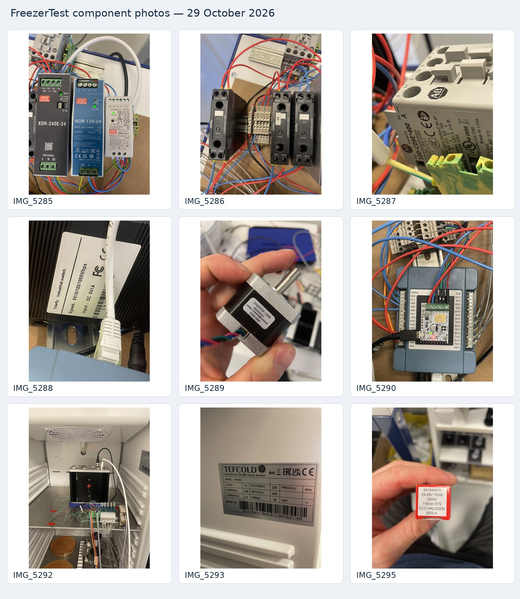

# Component photo reference — 29 October 2026

These owner-supplied photographs support the installed-component descriptions in [hardware and connections](../../02-hardware-and-connections.md). Label text is evidence of a pictured part or rating, not a measurement of current consumption or proof of a complete wiring path. The usual placement and operating sequence come from the [owner review R2](../../10-sources-and-maintenance.md#r2-owner-review-and-component-photos-29-october-2026).

| Photo | Readable identification / observation | Boundary |
|---|---|---|
| [IMG_5285](IMG_5285.jpg) | Mean Well **XDR-240E-24**, label 24 V / 10 A / 240 W; **NDR-120-24**, 24 V / 5 A; **MDR-40-5**, 5 V / 6 A | Owner confirms XDR supplies lamp and freezer-contactor coil, NDR supplies camera, and MDR supplies MCC, Tic, switch and Hall sensor. Load allocation comes from the owner follow-up, not the photo alone. |
| [IMG_5286](IMG_5286.jpg) | Three Schneider Electric **SSD1D520BDC1** solid-state relays | Owner identifies relay functions as camera, lamp and freezer contactor; photo does not uniquely map left/middle/right to those loads. |
| [IMG_5287](IMG_5287.jpg) | Allen-Bradley **100-C09E*400**, Series A contactor | The asterisk is printed in the pictured family designation; do not infer the exact fitted coil suffix/voltage from it. |
| [IMG_5288](IMG_5288.jpg) | **Telenty Industrial switch**, label **5 × 10/100/1000 Mbps**, **DC 5 V / 1 A** | This is a label transcription; the exact model is hidden/not shown. |
| [IMG_5289](IMG_5289.jpg) | Stepper motor **SY42STH38-1684B** | Owner already identified NEMA 17 frame size; winding ratings/drive ratio are not established by the visible label alone. |
| [IMG_5290](IMG_5290.jpg) | **Tic T834** marking visible on the controller beside/over the MCC terminal panel | Supports controller identity; placement does not establish an electrical pin-to-pin wiring diagram. |
| [IMG_5292](IMG_5292.jpg) | Camera on the upper aluminium tray; chamber fan, thermocouple terminal arrangement, cabling, and dishes of granular material visible | Owner supplies probe meanings. Granules' identity and conditioning effectiveness are not established by appearance alone. This is a setup view, not a permanent camera reference revision. |
| [IMG_5293](IMG_5293.jpg) | **TEFCOLD UF400V** nameplate: **230 V, 50 Hz, 300 W, 2.5 A, net volume 249 L**, **R290 80 g** | These are appliance nameplate entries, not measured heating/cooling power or a qualified test-temperature range. |
| [IMG_5295](IMG_5295.jpg) | Lamp packaging reference **641840875**; **24–28 V, 100 W, 118 mm, R7S, ECO HALOGEN, 900 lm, 2000 h** | Brand is not visible. Packaging ratings do not establish a calibrated spectrum, illuminance, actual operating voltage, or stability after the configured 2 s warm-up. |

The original `Images/*.HEIC` files remain on the owner's computer. Repository copies are JPEG references, with orientation retained, the longest side limited to 2400 pixels, and camera metadata removed. Labels/content were not retouched. [Inventory and digests](inventory.json) link each source filename/digest to its published reference. Do not infer connector pin mapping from wire colors or a partially obscured label.
