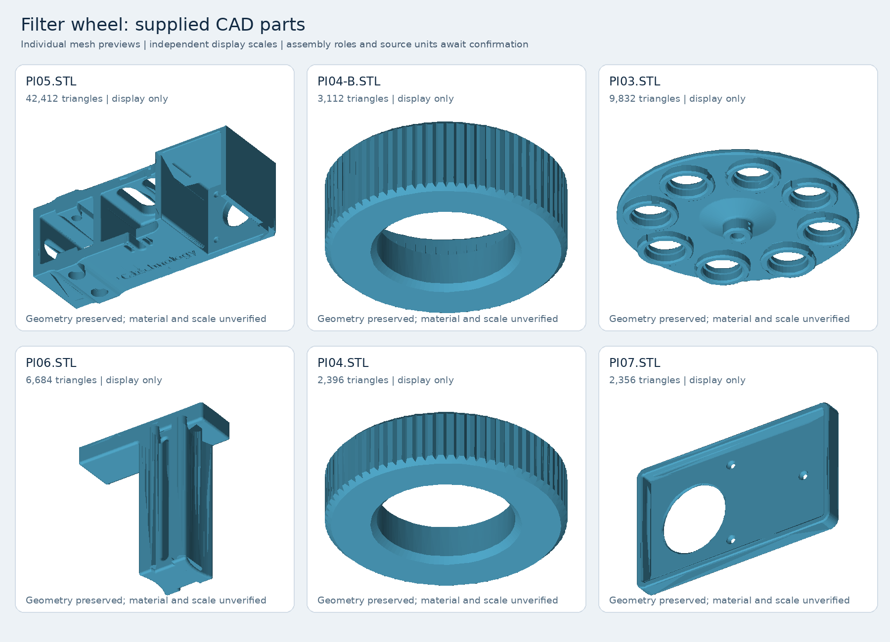

# Filter-wheel CAD reference

The owner supplied these six components on **27 October 2026** and identified them as the filter-wheel parts. Originals are copied unchanged here so they remain available with the knowledge base. The spelling/case of each supplied filename is preserved, including `Pl` (lowercase L) versus `PI` (uppercase I).

| Supplied mesh | Triangle count |
|---|---:|
| [Pl05.STL](Pl05.STL) | 42,412 |
| [PI04-B.STL](PI04-B.STL) | 3,112 |
| [PI03.STL](PI03.STL) | 9,832 |
| [Pl06.STL](Pl06.STL) | 6,684 |
| [PI04.STL](PI04.STL) | 2,396 |
| [PI07.STL](PI07.STL) | 2,356 |

Each part is displayed independently at its own scale, not assembled. The owner confirms a NEMA 17 motor, Hall sensor on the fixed base, and magnet on the rotating part. A part-to-role/assembly map has not yet been supplied. Do not infer material, print process, dimensional tolerance, or build revision from an STL mesh. STL does not encode a physical unit, so mesh coordinates are not asserted to be millimetres.

All six binary meshes were checked for consistent triangle-record length and finite vertex coordinates. [The inventory](inventory.json) records SHA-256 digests, file sizes, triangle counts, and bounds in unconfirmed mesh units. This is a file-integrity check, not a manufacturing or assembly validation.

For the operating hardware, see [hardware and connections](../../02-hardware-and-connections.md). Needed next: mark which file is the base, rotating wheel, sensor/motor mounts, and other pieces; identify whether `PI04` and `PI04-B` are alternatives or both fitted; confirm units/materials and the current assembly revision.
